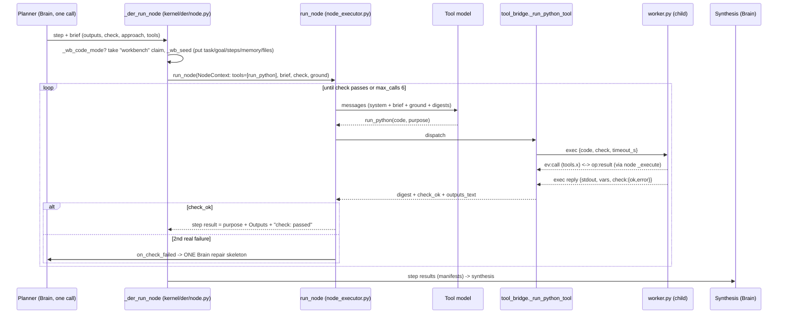

# The Workbench (CLM-11): architecture and blueprint

The **Workbench** gives a DER node a persistent Python process as its work surface, so a
step that reads ten files and parses them costs one model call and one digest, not a
growing tool-result history. It builds on the context machinery described in
[`CLM.md`](./CLM.md) (the view, the record, `wb:` refs that expand through it).

This document describes the code as it is on branch `kernel-split-2026-11-11`. The specs
are the source for intent and measurement; the code is the source for names.

- Requirements: [`specs/clm-memory/requirements.md`](../../specs/clm-memory/requirements.md) (CLM-0 .. CLM-11)
- Design (decisions, rounds, ripple map): [`specs/clm-memory/design.md`](../../specs/clm-memory/design.md)
- Tasks and measured results: [`specs/clm-memory/tasks.md`](../../specs/clm-memory/tasks.md)
- Kernel layout (where node code lives): [`KERNEL_DECOMPOSITION.md`](./KERNEL_DECOMPOSITION.md)
- Execution model these plug into: [`DER_DAG.md`](./DER_DAG.md)

This is the **app's** context machinery. It is not the MCM dev-memory SDK
(`backend/agent/mcm.py` is a separate, lite port; see `CLAUDE.md`).

---

## 1. The Workbench

### 1.1 Purpose

A DER node on the menu path calls fine-grained tools (read_file, grep_files, ...) one at
a time; every result grows the node's prompt. In code mode the node instead writes
Python that runs in a **persistent worker process per conversation**. Values live in the
process namespace; the model sees a bounded digest and `wb:` references, not the data.
The planner states the step's contract up front; a harness check closes the step.

Package: `backend/agent/workbench/` (sibling of `kernel/`). It never plans, routes,
recalls, writes a store, calls a model or approves. It is reached through the registered
tool `run_python` (`tool_registry.py`, spec `run_python`: `code`, `purpose`, `timeout_s`,
`fresh`, `close`) via the normal dispatch (`tool_bridge.py:_run_python_tool`), so ledger
rows, deadlines, `calls[]` and `as_step_result` apply without new code.

Import rule (contract test `test_workbench_registration_contract.py`): only
`tool_bridge.py` and `kernel/der/node.py` import the package; `node_executor.py` never does.

### 1.2 Components

| Component | File : symbol | Job |
|---|---|---|
| Protocol | `workbench/protocol.py` : `PROTOCOL_VERSION` (2), `SUPPORTED_VERSIONS` (1, 2), `OPS`, `REQUEST_KEYS`, `EVENT_KEYS`, `REPLY_KEYS`, `encode`, `decode`, `ProtocolError` | Frame shapes (JSON lines, UTF-8) |
| Worker (child, stdlib only) | `workbench/worker.py` : `main`, `op_exec`, `op_inspect`, `op_put`, `sh`, `_Tools`, `_call_tool`, `ToolError`, `_install_audit_hook`, `_watchdog`, `_lower_integrity`, `_changed_vars`, `_preview` | Run code in a namespace, capture output, evaluate `check`, call tools, run shell commands |
| Client | `workbench/client.py` : `WorkbenchClient` (`start`, `exec`, `inspect`, `put`, `close`, `rss_bytes`), `resolve_interpreter`, `confine_env`, `label_low`, `base_launch`, `RSS_LIMIT_BYTES` (512 MB) | Spawn, request/reply, timeouts, kill, answer callback frames, memory cap |
| Manager | `workbench/manager.py` : `WorkbenchManager` (`workbench_for`, `touch`, `_make_room`, `_spill`, `end_spilled`, `close`, `reap_once`, `stats`), `get_manager`, `expand`, `spill_id`, `StoreSink`; constants `IDLE_END_S` (600), `MAX_LIVE` (2), `BUDGET_BYTES` (768 MB) | Per-conversation ownership, idle end, eviction, spill, scope refusal |
| Digest | `workbench/digest.py` : `digest`, `refs`, `make_ref`, `parse_ref`, `remember_origin`, `remember_named`, `named`; `STDOUT_HEAD`/`STDOUT_TAIL` (600 each), `VALUE_MAX` (400), `MAX_VAR_LINES` (12), `OTHER_VAR_LINES` (4) | Reply to model text and `wb:` refs |
| Ground | `workbench/ground.py` : `ground`, `ground_files`, `failures` | Bounded folder facts |
| Policy | `workbench/policy.py` : `admit_put`, `refusals`, `PUT_MAX_CHARS` (64,000) | What may enter the namespace |
| Code-mode entry and loop | `kernel/der/node.py` : `_wb_on`, `_wb_code_mode`, `_wb_seed`, `_wb_ground_text`, `_wb_brief`, `_wb_output_names`, `_wb_repair_tracker`, `_wb_escalate`, `_wb_slim_run_python`, `_wb_needed_tools`, `_wb_tool_lines`, `_wb_callback_handler`, `_wb_needs_fallback`, `wb_stats`; prompts `_WB_SYSTEM`, `_WB_TOOLS_NOTE`, `_WB_REPAIR_PROMPT` | Choose code mode, seed the namespace, build the code-mode `NodeContext`, escalate once |
| Node loop support | `node_executor.py` : `run_node` (check handling, `_manifest_only` close), `_observe_check`, `_is_exploration`, `NodeContext.brief/check/on_check_failed/on_check/wb_outputs/wb_node/ground/stats` | Close on a passed check; count failed checks; trigger escalation |
| Tool entry | `tool_bridge.py` : `_run_python_tool`, `_expand_workbench`, `_wb_outputs_text`, `_wb_key`, `_wb_spill_note`, code-row writer (one `tool_results` row per execution) | Dispatch, outputs text, expand `wb:` refs |
| Planner brief | `kernel/planning.py` : `_planner_brief_on`, brief rules and example; `PlanStep` (`core_models.py`), `QueueItem` (`der_loop.py`) | Per-step `outputs`, `check`, `approach`, `tools` |
| Evidence | `goal_contract.py` : `_harness_check_passed`, `_checked_after_change` | A passed harness check counts as outside evidence |

### 1.3 The loop (roles)

- **Brain** (`reasoning`): plans, writes each step's brief inside the existing planner
  call (no extra call), reads reports at synthesis, and is called **once** per code node on
  the second real failed check.
- **Tool model** (`tool_execution`): writes and runs all Workbench Python and repairs its
  own script. Code-mode context: `role="tool_execution"`, `helper_role=None`,
  `max_tokens=1024`, `max_calls=6`.
- **Harness**: runs the `check` (inside the worker, same request as the body). No model
  call judges the check.

**Brief fields** (per planner step): goal, `outputs` (names with types), `check` (one Python
expression over the outputs), `approach`, `tools`. Single quotes only and no backslashes
inside `check` / `outputs`; relative forward-slash paths. A step without a brief still
runs and closes by `STATUS`.

**Code-mode entry rule** (`_wb_code_mode`, decided once at node entry in
`_der_run_node`): all of these hold.
1. `IRIS_WORKBENCH=1`.
2. `run_python` is on the mode's menu.
3. The step is not WRITE class (`required_classes(goal)` contains no `WRITE`). File-changing
   steps stay on the menu path (owner decision 2026-11-16).
4. The step has a brief with `outputs` and a `check`, **or** its class is READ or RUN.
5. No browser, screen or web reference (`_vision_relevant`, `external_reference`).
6. An interpreter resolves (`resolve_interpreter`); else `wb_stats["unavailable"]` counts.

The node also takes the `workbench` claim **before** `run_node` starts its clock
(`_der_claim`; time waited is `wb_wait_s`), seeds the namespace (`_wb_seed`), and releases
the claim in the node's `finally`.

**Repair loop.** Attempts 1-2: tool model, from the digest and the check error. After the
second real failed check, `on_check_failed` (= `_wb_escalate`) makes ONE Brain call
(`call_kind="wb_repair"`, `reasoning_effort="low"`, `_WB_REPAIR_MAX_TOKENS` 4096) that
returns a repair skeleton (at most `_WB_SKELETON_MAX_LINES` = 40 lines). The skeleton is
`put` into the namespace as `skeleton` and shown as text; the **tool model** runs it (the
harness never runs Brain code itself). Attempt 3: tool model. Still failing: DER recovery.
An output not yet defined is "exploration", not a failed attempt (`_is_exploration`).

**Fallback** (`_wb_needs_fallback`): re-run the same item once on the menu path when the
workbench is unavailable, the sandbox refused, or two consecutive `run_python` calls fail
with the same exception type, or no execution happened and the node failed. Counted in
`wb_stats` and the log only.

### 1.4 Data flow: one turn



```
CLM path (menu or code node, IRIS_CLM_OFFLOAD=1):
 tool result -> record_result -> tool_results row (queued) -> view block (ref = row id)
   gauge.count(view) > (window-reserve)*0.8 at a boundary
     -> offload_decision (ref readable, open items carried, saving >= 256)
     -> placeholder + digest stay; OFFLOADED on memory_events lane
   expand=<ref> / trigger -> original bytes back; RESTRETCHED (+ PREMATURE_EVICTION)
   wb:<incarnation>/<name> refs use the same gate; "readable" = worker alive and name present
```

### 1.5 Contracts

**Protocol v2** (`protocol.py`; the child repeats the constants, the contract test pins both):

```
hello     {"v":2,"op":"hello"}
exec      {"v":2,"op":"exec","id","code","timeout_s"[,"check"]}
inspect   {"v":2,"op":"inspect","id","expr","offset","limit"}
put       {"v":2,"op":"put","id","name","value"}
shutdown  {"v":2,"op":"shutdown"}
call      {"v":2,"ev":"call","id","seq","tool","args"}        worker -> parent, mid-exec
result    {"v":2,"op":"result","id","seq","ok","value","error"} parent -> worker
exec reply {"re":"exec","id","ok","stdout","stderr","value","error":{type,message,trace_tail}|null,
            "vars":[{name,type,size,preview}],"wall_ms","truncated","out_n","incarnation"[,"check":{ok,error}]}
```

- `check` is evaluated after the body in the same request; if the body raised, the check
  reply is `{"ok":false,"error":"body raised"}`.
- Callbacks: `tools.<name>(**args)` in the script writes an `ev:call` frame and blocks.
  The client answers only `call` frames of the current exec, through the node's own
  dispatch closure (turn-live check, domain guard, claims, `_der_before_call`,
  `box.dispatch`, `_der_after_call`, hooks). Each callback is one `calls[]` entry
  (`via: run_python`). Budget 24 per exec (`CALLBACK_BUDGET`), 48 per node. A failed or
  denied tool raises `ToolError` in the script. While a callback is pending, the exec
  deadline and watchdog pause. One result frame is capped at `RESULT_FRAME_MAX` (2,000,000 bytes).
- `sh(command, input=None, timeout=120)` runs a command of any language in the project
  folder (`sh('node app.js')`, `sh('npm test')`, `sh('node -', input=js)`). Returns
  `{"code","stdout","stderr","timed_out"}`; never raises for a non-zero exit; kills the
  process tree on timeout; bounded by the run's own deadline.

**Namespace and enter/leave policy.** In: `task`, `goal`, `steps` (finished-step results),
`memory`, `files` (relative paths, bounded), via `put` and `admit_put`. Out: only through
the step result (manifest) and the existing `write_pin` hook.

**Digest** (`digest.py:digest`): stdout head + tail <= 1,200 chars, final value <= 400,
error tail, declared outputs first, then at most 4 other changed variables (12 lines
without declared outputs), each as `wb:<incarnation>/<name>`. Above 256 MB held it adds a
"holds N MB" note. `recall_memory(expand="wb:...")` routes to `_expand_workbench` ->
`manager.expand` -> worker `inspect`; a spilled value reads back from its `tool_results` row.

**Step result = outputs manifest** (`run_node`, `_manifest_only`): the purpose line,
`Outputs:` with each output in full when <= 600 chars, else 600 chars plus type, size and
`wb:` ref, then the line `check: passed`. No stdout and no changed-variable lines. The
goal contract reads the closing line with `_HARNESS_PASSED_RE`
(`goal_contract.py:_harness_check_passed`): a passed harness check is outside evidence for
the step's fact.

**Ground** (`ground.py:ground`): one pure, bounded function (50 ms, 2,000 entries, depth 3,
<= 1,200 chars): numbered runs collapsed, sizes, two head lines of up to six named text
files. `profile=True` (code nodes) adds up to 6 profiled files (150 ms budget, shapes of
up to 6 lines). Header text: `PROJECT FILES (the current folder; already listed - do not
list it again):`. Used in the code node's first message, the flag-on planner prompt
(`_wb_ground_text`), and the repair prompt. In code mode the MEMORY text leaves the step
message; it stays in the `memory` variable.

**Tools from Python.** `_wb_needed_tools` chooses at most `_WB_TOOLS_MAX` (5) tools the
brief names that Python cannot replace (`_WB_PY_REPLACES` lists those it can); only then
does `_WB_TOOLS_NOTE` add one-line signatures. The `run_python` schema in code mode is
slimmed to `code` + `purpose` (`_wb_slim_run_python`).

### 1.6 Lifecycle, limits, spill

- **Owner.** One worker per conversation, started lazily at the first `run_python`
  (`WorkbenchManager.workbench_for`). Ends on 10 min idle (`reap_once`), conversation
  delete, workdir or mode change, backend exit (stdin EOF).
- **Launch.** `python -I -X utf8 -u worker.py`, binary pipes, `CREATE_NO_WINDOW`; the
  worker keeps a private copy of fd 1 for frames and points fd 1/2 at capture buffers.
  Interpreter: project venv, then PATH python, then `sys.executable` when not frozen
  (`resolve_interpreter`); none = unavailable.
- **Caps.** 512 MB per worker tree (`RSS_LIMIT_BYTES`, polled every 0.25 s), 768 MB for
  all live workbenches (`BUDGET_BYTES`), at most 2 live (`MAX_LIVE`); a new interpreter
  counts 30 MB (`NEW_WORKBENCH_BYTES`). On Windows the measure is **private bytes**
  (`WorkbenchClient._held`), not working set: Windows trims an idle process's working
  set (measured: a worker holding 300 MB read rss 1 MB). `_make_room` evicts the oldest idle
  entry; errors are `WorkbenchCapReached` / `WorkbenchBudgetReached`.
- **Spill.** On `fresh`, `close`, idle end and eviction the values the step result or a
  live placeholder names are written as `tool_results` rows `wbspill-<incarnation>-<name>`
  (32,000 chars each, newest 24 named values; declared outputs only, plus `out<n>` refs).
  Spill and close run outside the manager lock. A `wb:` ref expands from its row after the
  process is gone.
- **`fresh` / `close`.** `run_python(fresh=True)` spills, starts a new incarnation, runs.
  `run_python(close=True)` runs, spills, ends. A hard kill changes the incarnation and
  yields `workbench_gone` with no spill.
- **Code rows.** One `tool_results` row per execution (purpose, outcome, wall_ms, code),
  min length 0, written on the `tool_results` lane.

### 1.7 Safety

- **Scope.** One profile in both modes; `run_python` is offered in both. Developer mode =
  the IRIS repo via the self-edit view. Personal mode refuses a workdir at or under the IRIS
  repo (`manager._under_repo`, `WorkbenchScopeRefused`); with no bound folder the existing
  ask-user folder flow applies.
- **Sandbox.** Same trust boundary as `run_command`: cwd = session workdir; env as
  `run_isolated`; one audit hook (`_install_audit_hook`) refuses write-opens outside cwd
  and temp.
- **Windows Low integrity.** A personal-mode worker is launched with `IRIS_WB_CONFINE=1`
  (`client.confine_env`); `worker._lower_integrity` sets its token to Low (`S-1-16-4096`)
  and reads it back, exiting 87 with the mark `workbench_confine_failed` on failure
  (`ConfineFailed` / `WorkbenchConfineFailed`). Every child the worker starts inherits
  Low. The session folder is labelled Low with `label_low` (icacls; one pass ~3 s for
  20,000 files, `ICACLS_TIMEOUT_S` 120). Off Windows the confinement is a no-op, logged once.
- **Permissions.** `run_python` has permission `side_effect`; callbacks pass the node's own
  dispatch, so tool approval and the browser claim apply per callback.
- **Oracle.** `tool_choice` asks nothing inside code. One shadow consumer `repair_route`
  (REPAIR / ESCALATE) is asked at each failed check via `on_check` and the repair tracker;
  it stays shadow until the Oracle bar (rows >= 100, precision >= 0.90, ECE <= 0.05).

### 1.8 Flags and state

| Flag | Read at | State |
|---|---|---|
| `IRIS_WORKBENCH=1` | `kernel/der/node.py:_wb_on`, `kernel/planning.py:_planner_brief_on` | **Off.** Flag off: node and planner prompt are byte for byte today's (parity suites). After TG-7 v2 stage 1 the verdict was "stays OFF until the owner decides on the failing rows" (section 3) |
| `IRIS_WB_CONFINE=1` | set by the client for a personal-mode worker | Internal; not a user flag |
| `IRIS_CLM_OFFLOAD`, `IRIS_CLM_BASELINE`, `IRIS_CLM_DUMP_DIR` | [`CLM.md`](./CLM.md) section 1.5 | |

Per the project rule, a flag that is off is unfinished: its live gate result (and the
reason it stays off, with the number and date) belongs in `tasks.md`.

### 1.9 Failure paths

| Failure | Result |
|---|---|
| No interpreter | `_wb_code_mode` False, `wb_stats["unavailable"]`; menu path |
| Seed failed | `wb_stats["seed_failed"]`; claim released; menu node |
| Sandbox refusal / same exception twice / no execution | `_wb_needs_fallback` -> one re-run on the menu path |
| Check fails twice | one Brain repair skeleton; then DER recovery |
| Worker over cap | `WorkbenchCapReached`; spill where possible; error text to the model |
| Worker killed | new incarnation; `workbench_gone` for old `wb:` refs not spilled |
| Confinement cannot start | `WorkbenchConfineFailed`; no unconfined personal worker |
| Callback budget spent | `ToolError`; state kept |

### 1.10 Guards

`backend/tests/contract/` (`_wb_common.py` shares fixtures):
`test_workbench_core_contract.py` (protocol, soft stop, hard kill),
`test_workbench_manager_contract.py`, `test_workbench_lifetime_contract.py` (fresh, close,
spill, eviction), `test_workbench_digest_contract.py`, `test_workbench_round4_digest_contract.py`,
`test_workbench_ground_contract.py`, `test_workbench_policy_contract.py`,
`test_workbench_callbacks_contract.py`, `test_workbench_check_contract.py`,
`test_workbench_repair_contract.py`, `test_workbench_code_mode_contract.py`,
`test_workbench_round4_node_contract.py`, `test_workbench_round4_w3_contract.py`,
`test_workbench_round5_worker_contract.py`, `test_workbench_sh_contract.py`,
`test_workbench_scope_contract.py`, `test_workbench_confine_contract.py`,
`test_workbench_registration_contract.py` (import rule), `test_workbench_live_fixes_contract.py`,
`test_call_kind_contract.py`, `test_goal_contract_harness_check_contract.py`.
Run targeted files only; never the full suite.

---

## 2. How to measure

1. Start the backend detached with the flag for the arm; `IRIS_CLM_BASELINE=1` on every arm
   (one row per model call: role, `call_kind`, `sends`, seconds, usage).
2. Run `evals/run_evals.py` on the cohort, arms interleaved, at least 5 rounds. The driver
   writes a blocks file: a list of `{"arm","rep","results":[eval result files]}`.
3. Analyse: `python evals/wb_ab_analysis.py <blocks.json> --pairs off:on[,A0:A1,B0:B1]
   [--baseline logs/clm_baseline.jsonl] [--log logs/iris.log] [--json out.json]`. It joins
   eval results (`pass`, `reply_s`; never `seconds`), baseline rows and `iris.log` lines
   (code node, fallback, escalated, `scripts=N exploring=M wait_s=X`) on `conversation_id`.
4. `call_kind` values: label, plan, node, code_node, wb_repair, synth, other
   (`InferenceRouter.generate(..., call_kind=...)`; `clm_baseline.py` row field).
5. CLM-only report: `scripts/clm_baseline_report.py` over `logs/clm_baseline.jsonl`.

Cohorts (`wb_ab_analysis.py:COHORTS`): context x01-x04 (x05 noise control), data c46-c52,
config c38-c45, run-and-report c14 c17 c18 c19 c25 c26 c27, explain c13, write control
c01 c02 c11.

**TG-7 v2 pass bar** (on vs off, per cohort, medians; design.md "Round 4"): pass >= off and
no task lower by >= 2 of 5; Brain calls per task <= 3.1 and <= off; tool-model calls <= 0.4 x
off (context, data) and <= off elsewhere; prompt tokens <= 0.5 x off (context, data);
completion tokens <= 0.7 x off; steps <= off; reply_s <= 0.8 x off (context, data) and <= off
elsewhere; escalations <= 10 % of code nodes with median <= 10 s; scripts per code node
<= 1.5; planner retries <= off; small arm pass above B0, blind drops 0, largest prompt <=
4,000. The flag goes on only when every row holds on the cloud arm.

---

## 3. Measured results

Source: `specs/clm-memory/tasks.md`, "TG-7 v2 cloud, STAGE 1" (2026-11-16 14:02-17:58,
commit `d4d494de`): context x01-x04 + noise x05 + data c46-c52, `IRIS_WORKBENCH` 0/1
interleaved x5 (60 task-runs per arm), deepseek-v4.1-flash in both roles, developer mode.
Result files `evals/results/20261116-{142816,144824,151350,153432,160021,162425,164920,171014,173826,175749}.json`.

| all 12 tasks | off | on | change |
|---|---|---|---|
| pass | 58/60 | 60/60 | better |
| reply_s median | 43.0 | 30.8 | x0.72 |
| prompt tokens total | 3.21 M | 2.23 M | x0.70 (tool model x0.38) |
| completion tokens total | 212 k | 142 k | x0.67 |
| max prompt of one call | 48.9 k | 28.8 k | x0.59 |
| planner retries | 14 | 4 | x0.29 |
| HTTP sends | 672 | 609 | x0.91 |

Per cohort against the bar:
- **Context (x01-x04, 20 runs/arm):** pass 20/20 vs 18/20 PASS; Brain calls median 3 vs 4 PASS;
  reply_s x0.67 PASS; prompt tokens median x0.46 PASS; completion x0.62 PASS; planner retries
  0 vs 12 PASS; tool-model calls median 7 vs 9 = x0.78 FAIL (bar 0.4); escalations 14.3 % of
  code nodes, median 52.7 s FAIL (bar 10 %, 10 s); scripts per code node 4.43 FAIL (bar 1.5).
- **Data (c46-c52, 35 runs/arm):** pass 35/35 both PASS; reply_s x0.68 PASS; scripts per node
  1.21 PASS; escalations 0 PASS; tool-model calls median 2 vs 2 FAIL (bar 0.4; the off arm
  already needs 2); prompt tokens median x0.78 FAIL (bar 0.5); completion x1.03 FAIL (bar 0.7);
  planner retries 4 vs 2 FAIL.
- **Noise (x05, no code node):** equal within noise.

Causes by call kind (from `tasks.md`): (1) the repair call at max_tokens=1200 was cut by the
provider's hidden reasoning and resent (17 sends for 5 calls, 52.7 s median) - fixed (4096;
guard `test_d1_the_repair_call_has_the_planners_token_budget`); (2) remaining scripts per code
node are look-at-the-data scripts; two head lines cannot show a prose rule, so about 2 scripts
is the floor and the 1.5 bar conflicts with the data (owner decision); (3) the brief's fixed
planner cost (about 530 tokens) dominates the data cohort's token rows; (4) the x01/x02
planner prompt is 24-28 k tokens in both arms (a 17-19 k recall block), not a Workbench cost.
Final-answer prompt 4,672 -> 1,007 tokens per call (D5); code-node call 2,486 vs menu-node
7,125 tokens. Verdict at that date: the flag stays OFF until the owner decides on the failing rows.

Earlier run (tasks.md, before Round 4): re-run after F1-F4 stopped after 2 of 5 rounds: off
10/10, on 7/10; escalations 2 in 18 code nodes (was 19 in 26).

<!-- TG-7 v2 re-run results: filled by the main session -->

### TG-7 v2 full re-run (2026-11-17, commit b851a420, 31 tasks, 5 rounds per arm)

| all 31 tasks (155 runs per arm) | off | on | change |
|---|---|---|---|
| pass | 140/155 | 150/155 | +10 |
| reply_s median | 38.6 | 25.5 | x0.66 |
| model calls median | 6 | 4 | x0.67 |
| tool-model calls median | 2 | 1 | x0.50 |
| Brain calls median | 3 | 3 | equal (the floor) |
| HTTP sends | 1,399 | 989 | x0.71 |
| prompt tokens total | 4.14 M | 2.11 M | x0.51 |
| completion tokens total | 358 k | 209 k | x0.58 |
| largest prompt | 48.9 k | 22.5 k | x0.46 |
| planner retries | 44 | 5 | x0.11 |
| escalations | - | 3 of 154 code nodes (1.9 %) | |

Per cohort (on vs off, medians): context x01-x04 - pass 18/20 = 18/20, reply x0.36, prompt
tokens x0.15, completion x0.24, tool-model calls x0.27, Brain 4 -> 3; data c46-c52 - pass
33/35 vs 35/35, reply x0.64, prompt x0.48, completion x0.76, tool calls x0.5; config c38-c45 -
40/40 both, reply x0.61, prompt x0.45; run-and-report c14 c17-c19 c25-c27 - pass 35/35 vs
23/35, reply x0.67, prompt x0.74; explain c13 - 5/5 both, reply x0.82, prompt x0.47; write
control c01 c02 c11 - 15/15 both, reply x1.20, prompt x0.77, planner retries 5 vs 2; noise x05
(no code node) - equal within noise.

Causes of the remaining failing rows, each fixed (commit after this run):
(1) data c51 2/5 + context x02 1/5 replies said "the output was truncated": the call dump
(IRIS_CLM_DUMP_DIR, conv-8235) showed the synthesis read a code step through
_der_node_record_evidence's COMPRESSED path - content_summary[:300] - because run_python is
neither a gather nor a read tool; the manifest was cut mid-value with the total and "check:
passed" gone. run_python now takes the wide path (guard test_code_step_evidence_contract).
(2) write cohort planner retries 5 vs 2: all 3 logged parse failures had one model typo, a
stray quote after a number ('"step_number":2","description"'); the parser repairs exactly
that, only when no plan parsed (guard test_planner_json_repair_contract). (3) the 3
escalations (all x03, all passed after the repair) took 166-177 s: at max_tokens 4096 the
hidden reasoning (4,846-5,988 tokens) was cut and resent up to 4 times, each resend
generating from the start; the repair budget is now 16,384 (one send). Not a Workbench
fault: x04 1/5 a dollars-vs-cents model error; x05 1/5 a WebSocket handshake timeout.


---

## 4. Where to change what

| Change | Part that owns it |
|---|---|
| View, placeholder, gate, order | `context_view.py` |
| Token counting | `context_gauge.py` only (one count function) |
| In-node shrink and events | `node_executor.py:run_node` |
| Bind CLM to a node | `kernel/der/node.py:_clm_node_hooks` |
| Worker protocol | `workbench/protocol.py` and `worker.py` together; bump `PROTOCOL_VERSION` in both |
| Code-mode entry rule, prompts, escalation | `kernel/der/node.py` (`_wb_*`) |
| Brief fields | `kernel/planning.py`, `core_models.PlanStep`, `der_loop.QueueItem` |

New kernel code goes in the part that owns it, never in the `agent_kernel.py` facade
(rules R1-R10 in `KERNEL_DECOMPOSITION.md`). After a kernel edit run
`python scripts/kernel_split_check.py globals --check`.
