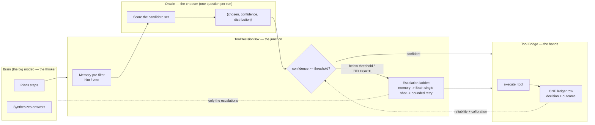
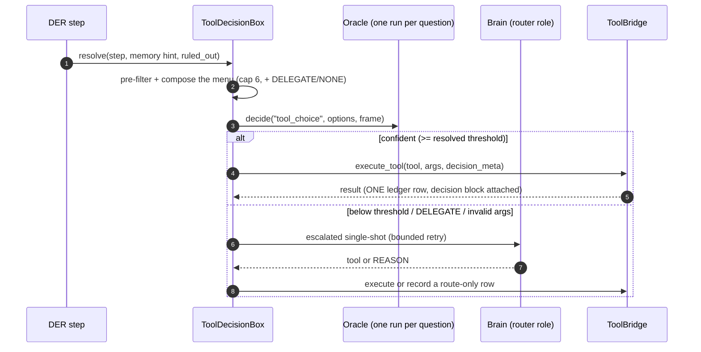
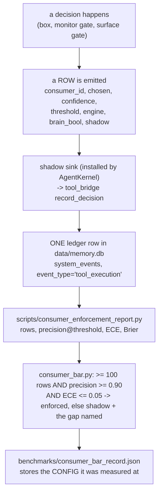
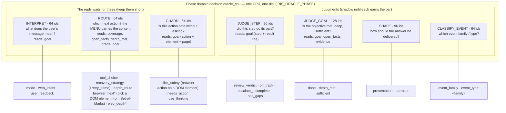
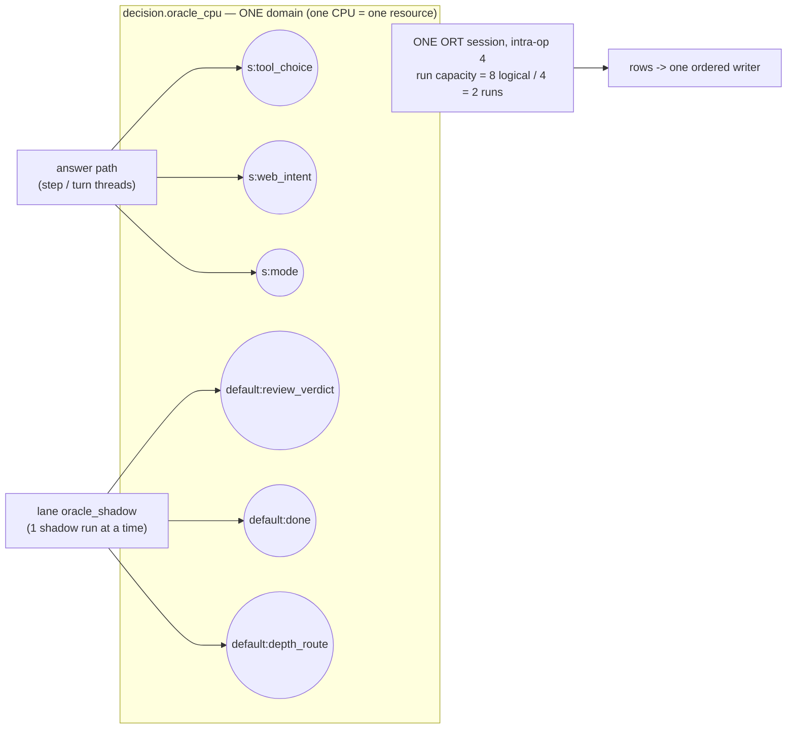

> History and chronology moved out of oracle.md. The current architecture blueprint is in oracle.md.

# Oracle — Decision Engine Architecture & Operations

> **2026-10-11 (session 398): THE ORACLE NOW DECIDES TOOLS - the structure, the
> labels and the first live A/B. Read this first; the 2026-10-10 notes below are
> the measurement history that led here.** Pins: `pin_a6684b997993` (diagnosis),
> `pin_c66d84ce99f6` (frame fix), `pin_e82adeb3b11e` (structure), `pin_c980238fedeb` (A/B).
>
> **WHY d1 COULD NOT EARN THE BAR (measured, not the model):** (1) the node path
> gave EVERY call of a step the same frame - the previous STEP's result, computed
> once per node - while the tool model's answer moved read -> edit -> run;
> (2) the label was PARITY with the tool model's habit: three valid tools
> (read_file / list_directory / glob_files) scored two of them "wrong", so no
> question design could pass 90% (replay: 53% -> 57.8% with decision lines);
> (3) no production path let the Oracle decide (resolve()/propose() had no caller).
> Also fixed: recovery_strategy's question never reached d1 (AUTO_INSTRUCTION);
> click_safety's action was cut by the 64-id guard budget (now action-first, 128).
> Checked against the HF reference (LiquidAI/d1-3B prompt.py/runner.py): one
> deviation, 2 vs 3 newlines before QUESTION:, measured immaterial (0/50 answer
> changes, mean TV 0.012 < the Q4 quant drift 0.018) and NOT changed. The
> reference's `calibration.apply` hook was replayed: it only learns the class prior.
>
> **THE STRUCTURE (the pattern for every future decision job):**
> - DECIDE: `NodeContext.choose_tool` -> kernel `_choose_tool` ->
>   `ToolDecisionBox.choose_node_tool`: one d1 question before each tool-model
>   call, on the step's pre-call `route` frame (goal, done_when, calls_this_step,
>   last_result). It acts ONLY through the chokepoint: ENFORCED (allow list + bar +
>   calibrated threshold) else SAMPLED (`tool_choice` is now TIER_SAMPLABLE;
>   per-consumer share `IRIS_ORACLE_SAMPLE_FRACTION_TOOL_CHOICE`). A pick narrows
>   the model's menu to ONE tool - the model writes the arguments or finishes.
> - GATE 1 PER PICK: a sampled pick acts only on a read_only tool unless
>   `IRIS_ORACLE_SAMPLE_SIDE_EFFECTS=1` (eval workdirs are throw-away). Production
>   default: read-only picks sampled at 5%.
> - OUTCOME LABELS: `label_decided_row` - ok / failed / overridden (the model
>   called another tool) / finished (not scored). `decision_label` reads
>   `outside_label` on EVERY row and leaves an unadjudicated outcome row unscored.
> - STAYS ACCURATE AS TOOLS CHANGE: `tool_registry.ORACLE_HINTS` = one short
>   "when to choose" line per tool with its precondition (contract test: every
>   NODE_TOOLS entry declares one); `menu_fp` (names + option text hash) on
>   every row, so an added or re-described tool never inherits old evidence.
> - REPLAY: rows carry `state` / `brain_params` / `brain_ok`;
>   `scripts/replay_tool_choice.py` re-asks d1 on recorded states under a variant
>   in minutes. These rows are also the fine-tuning set.
> - BROWSER: `browser_next` (route job; the page's numbered elements are the
>   options) on every browser_act; 10 eval tasks in group `browser`.
>
> **A/B, d1 deciding every node tool call (2026-10-11):** coding 13/15 (c12 PASS
> solo; c14 = known phrasing flake), browser 10/10; d1 decisions 84-148 ms.
> Outcome-graded rows: raw AUROC **0.72** (parity cohorts 0.57-0.67); right 10/11
> at conf >= 0.9, ~50% below 0.6. FINDING: narrowing `tools` does not bind the
> model (it called other tools) - a binding decision must force `tool_choice` at
> the API. TO DECIDE ALL TOOLS: force the pick at the API above the calibrated
> threshold, grow outcome rows to the bar per tool, then LoRA-fine-tune d1 on the
> replay rows (new identity, fresh calibration).

> **2026-10-10 (session 396/397): THE READOUT WAS OUR ERROR, NOT THE MODEL. The flat
> confidence that blocked every consumer came from reading d1's answers off the wrong
> tokens. The reference readout was ported exactly; web_intent / narration / mode AUROC are
> now ABOVE the 0.65 bar. Read this before the 2026-10-09 note below — that note's
> conclusion ("d1 is not ready to enforce anything") was measured under the broken readout
> and is SUPERSEDED.**
>
> **THE ERROR.** Our Wave-2 backend (commit `e02fec98`) retired the A/B/C letter readout and
> scored d1 from option-NAME first-tokens over `/v1/chat/completions` with the server's chat
> template. The reference implementation (`LiquidAI/d1-3B` repo: `prompt.py` + `runner.py`,
> the model's own shipped code) does the OPPOSITE: options render as `A {description}` with
> single-token LETTER codes, the model replies with the code ("Reply with the option code
> only."), the prompt is built MANUALLY (BOS + `<|im_start|>user ... <|im_end|>` +
> `<|im_start|>assistant`, no chat template, no system turn, exactly TWO newlines between
> state and `QUESTION:`), and the readout max-pools each code token with its space-prefixed
> form at the ONE answer slot (full-vocab log-softmax, no temperature, no calibration hook).
> d1's calibrated distribution lives in its LETTER-token logits; the name-token readout read
> a distribution the model was never trained to calibrate. Measured: name readout confidence
> flat 0.90-0.96 on right and wrong alike (one isotonic knot, OOF AUROC 0.476 on 116
> web_intent rows); letter readout spreads 0.47-0.99 with the question (0.47 on a genuine
> ambiguity — honest uncertainty), 5/5 tool questions and 4/4 noul questions correct.
>
> **WHY THE WAVE-2 RETIREMENT WAS WRONG.** Its claim ("the letter shape collapses to a
> constant answer") came from the probe era of the `bytes[0]`-as-id logprob defect
> (`_extract_logprobs`; "that defect voided two probe runs on 2026-10-08") and does NOT
> reproduce under the correct reference format. Nobody re-ran the letter probe after the
> parser fix. RULE: a conclusion from a broken instrument must be re-validated when the
> instrument is fixed.
>
> **THE FIX (commits `1561a908` + `9173745f`).** `decision_backend_d1.py` restored the
> reference format end to end (renderers, manual prompt, `/completion` transport, letter
> readout with the reference's fallback pool, noul criteria lines, `image_data` for images);
> the dead name-readout family was deleted; `model_id` now carries `+letters`
> (`d1-3b-ad-q4_k_m+letters`) so the report scopes rows by readout — old name-readout rows
> fail closed into `other_backend` and never blend (AC25.8). `CURRENT_READOUT_MODE` is
> `letters`. `9173745f` then flowed the offered tools' DESCRIPTIONS into the option lines
> (the reference puts the description beside the code: `A Read a file's contents`).
>
> **THE MEASURED SIGNAL (letters cohort, engine `d1-3b-ad-q4_k_m+letters`, after ~2.5 groups
> of traffic).** The AUROC clause (>= 0.65) was the universal blocker under the name readout;
> it is now cleared by three consumers:
>
> | consumer | rows | AUROC | parity / precision | note |
> |---|---|---|---|---|
> | web_intent | 40 | **0.674** | 87.5% precision | closest to enforcement; blockers are rows (40/100) then the threshold clauses |
> | narration | 41 | **0.733** | 70.7% parity | was 24% blind / 44% shape-v2; now the best parity consumer |
> | mode | 41 | **0.677** | 41.5% parity | parity capped by the keyword reference (the incumbent by design), not the model |
> | tool_choice | 127 | 0.642 | 53.5% parity | at the bar's edge; v3 (bare names) 52.4% / v4 (descriptions) 54.7% |
> | review_verdict | 102 | 0.558 | 33.3% parity | from 0.32 ANTI-CORRELATED under the name readout |
> | user_feedback | 17 | 1.0 | 88.2% | small n |
> | escalate_incomplete | 14 | 0.60 | 71.4% | |
> | presentation | 5 | 1.0 | | frame fix landed (0% blind -> 50% shape-v2) |
> | call_closing | 63 | 0.265 | | REFUSED_CONSUMERS — measurement-only forever |
> | depth_met | 41 | 0.40 | 39% | reference is the loop's own grade (a heuristic) |
>
> **AUROC AT LARGER n (2026-10-10, later the same day): THE EARLY NUMBERS REGRESSED.**
> After two more coding groups the same consumers read: web_intent **0.44** (61 rows; only
> 5 minority references — the keyword reference almost never says "web"), mode **0.56**
> (68 rows), narration **0.63** (75 rows), tool_choice **0.65** (273 rows),
> tool_approval **0.57** (89 rows, classes balanced 46/43). The "above the bar" readings in
> the table above were SMALL-n OPTIMISM (error bars ~ +/-0.10 at n=64, worse with a 5-row
> minority); the AUROC clause is NOT stably cleared by any consumer. Do not quote the early
> table without this correction.
>
> **DIVERSE TRAFFIC, MEASURED (10 new research tasks, 5 web + 5 no-web, same day): it helps
> the skewed consumers.** web_intent 0.44 -> **0.62** (70 rows, minority 5 -> 10), narration
> 0.63 -> **0.70** (89 rows), mode 0.56 -> 0.59 (77 rows). But **tool_approval at n=104
> (volume clause MET, classes 60/44) reads AUROC 0.4953, ECE 0.069** — at that size this is
> a real reading, not noise: d1's confidence on the approval question does not yet rank
> outcomes above chance. The build is done and live; the SIGNAL is the gap. Candidate levers
> (each a new criteria_version, never a blend): a richer frame (the full goal, the call
> args, the offered tool list), or a different question shape. Re-read the bar only at
> n >= 100 with both classes present, and treat a homogeneous coding cohort as one slice,
> not the distribution.
>
> **WHAT STILL CAPS tool_choice, in size order.** (1) THE PARITY LABEL'S NOISE: a confident
> valid-but-different pick scores wrong; AUROC is punished for the LABEL's unfairness, not
> the model's. The fix is the binary outcome-referenced approval question — `tool_approval`
> (build spec: `pin_1fb3ce63bb3b`): "is <tool> right for this goal, given this result?"
> yes/no, labelled by the call's OUTCOME. (2) VOLUME: 64 rows per cohort is nothing; AUROC
> error bars ~ +/-0.10. (3) THE MODEL'S CEILING: d1's Decision Index Tools score is 74.5 —
> its BEST category — so the ceiling is high when the question is fair.
>
> **THE BAR AND THE TRAFFIC REALITY.** The hardened bar (`consumer_bar._derive_hardened`):
> distinct rows >= 100 (`MIN_ROWS`); both classes present; minority >= 5% (`MIN_MINORITY`);
> OOF AUROC >= 0.65 (`MIN_AUROC`); a calibrated threshold with precision >= 0.90 and Wilson
> LB >= 0.85 on >= 50 distinct rows above it (`MIN_ROWS_ABOVE`); OOF calibrated ECE <= 0.05
> (`MAX_ECE`). Read the constants from `backend/agent/consumer_bar.py` — do not trust a
> snapshot. **The dedup ceiling (measured):** the report dedupes repeated inputs
> (key = consumer, engine, round(conf,4), chosen, reference, correct), so running the SAME
> eval group twice does NOT grow distinct rows — the second research group added ZERO
> web_intent rows. Coding tasks stay distinct (per-run workdir timestamps in the goals); the
> 9 research tasks are EXHAUSTED for web_intent/mode/presentation. Distinct rows need
> DIVERSE traffic: new eval tasks in `evals/tasks.json` (legitimate — it is the eval set, not
> a test), or real personal-mode conversations. `tool_approval`, once built, is the
> fastest-growing consumer: every tool call in every coding task produces a row.
>
> **HOW THE ORACLE WORKS IN THE APP WITH d1 (current).** d1-3B (`d1-3b-ad-q4_k_m`, a
> JEV-style System One decision model) is served BORROW-ONLY by the shared llama-server
> `:8082` — the same server vision uses. `backend/agent/decision_backend_d1.py` implements
> `decide()` on the Decision Index prompt shapes: a **choice** renders letter-coded options
> and pools over the code tokens; a **noul** (yes/no) renders the native yes/no template
> ("Reply with yes or no only.") and pools over the yes/no forms. The prompt is built
> manually (im_start markup, no chat template, no system turn). The engine answers ONE
> question per run; it never writes prose and never acts. Every non-deciding consult runs on
> `lane("oracle_shadow")` (off the reply path); the row goes through the kernel's single
> writer to `system_events.interaction_payload.decision`. Identity is
> `model_id|readout_mode|criteria_hash` (`decision_engine.decision_identity`); the row's
> `engine` field is the readout-tagged `model_id`, and a frame change bumps the consumer's
> `criteria_version` stamp (e.g. `tc-frame-v4`, `narration/shape-v2`) so cohorts never blend.
> Enforcement is the INTERSECTION of the owner's `IRIS_DECISION_ENFORCE` allow list and the
> earned bar record, through `decision_engine.decides()` / `oracle_acts()` (fail-closed on
> identity change). The flip path: `scripts/consumer_enforcement_report.py --write` persists
> the bar record, then validate enforcement LIVE (a real turn where the Oracle's verdict
> acts) and crystallize a landmark with the numbers. NEVER fabricate a bar.
>
> **FRAME-EVIDENCE FIXES (commit `7f154a9f`).** `job_input()` renders ONLY declared job
> fields — every other frame key is silently dropped. Measured consequences: `presentation`'s
> frame carried 5 summary keys but the `shape` job declared only `goal` (which the frame never
> had), so d1 answered an EMPTY state (0/5 parity, 143 rows at 0.0%); `narration`'s beat
> counts (the numbers that determine its reference) were invisible; `mode` rows were lost
> since the lane move; the async boundary dropped `last_result` silently. The `route` and
> `shape` jobs now declare the UNION of what their consumers' frames carry (absent keys
> render as nothing); `route`'s budget went 64 -> 256 to fit `goal[:200]` + a ~600-char
> `last_result` snippet. RULE: when adding evidence to a frame, (a) declare the field on the
> job, (b) bump the `criteria_version` stamp, (c) write a `job_input` test that the field
> renders.
>
> **OWNER DECISION (2026-10-10): narration STAYS, mode is REMOVED.** The earlier
> removal directive was rescinded for narration after the readout fix changed its
> numbers (it is the best parity consumer). `mode` was then REMOVED (owner, later
> the same day): its incumbent is a FREE deterministic keyword rule, so enforcing
> it could never pay (a 0 ms rule swapped for a ~100-300 ms model call), its
> reference IS the keyword list (the bar could only prove agreement with a list
> the system already trusts), and its AUROC fell below the bar at volume (0.591
> at 77 rows; the 0.677 that once justified keeping it was small-n). The keyword
> classifier itself is UNTOUCHED (mode_detector._infer_mode decides the mode);
> only the Oracle shadow measurement is gone. Historical mode rows stay in the
> ledger, retired.
>
> **tool_approval/v2 (owner-directed iteration, 2026-10-10): THE FRAME WAS THE
> CAP — THE SIGNAL MOVED.** v1 read AUROC 0.4953 at n=104 with a frame missing
> the call's ARGUMENTS and the offered tool list. v2 declares both on the
> `approve` job (budget 256 -> 384; the physical reason is in the job table)
> and stamps its rows `tool_approval/v2`. Measured after one coding + one
> research group: **AUROC 0.5996, ECE 0.054, classes 55/41, at 96 distinct
> rows** (read with logs/_ta_v2_report.py — the main report has no stamp
> filter, so the cohorts MUST be split or they blend). The direction is
> validated: the args evidence moved the ranking from chance (0.50) toward the
> bar (0.65). Not yet at the bar; the retire/keep decision point the owner set
> ("still ~0.5 at n >= 100") reads: NOT ~0.5 — the consumer earned its next
> measurement, not retirement.
>
> **NEXT MOVES.** (1) Build `tool_approval` per `pin_1fb3ce63bb3b` (binary outcome-referenced
> approval consumer; new `approve` job; consult post-hoc at tool-result time with the
> pre-call frame bound as values; `brain_bool` from the outcome; `criteria_version`
> `tool_approval/v1`). (2) Drive DIVERSE traffic (new eval tasks / personal-mode). (3) Grow
> rows toward 100 distinct per consumer, then read the thresholds. (4) If a consumer crosses
> the FULL bar, flip through the sanctioned path and validate enforcement live.
>
> Evidence: pins `pin_861acb2d93d1` (handoff), `pin_58c62492493d` (root cause),
> `pin_2824ab91c286` (measured signal), `pin_1fb3ce63bb3b` (tool_approval spec),
> `pin_43a539123efa` (bar state + traffic), `pin_d2ff1f0dadfa` (lesson catalog),
> `pin_b1c59f5fe88a` (ops runbook). Landmarks: `lm_ec93df5d1939ff58`
> (d1-reference-readout-live), `lm_e3b4087166a4bffe` (oracle-frame-evidence-live).

> **2026-10-09 (SUPERSEDED 2026-10-10 — see the note above; its conclusion was measured under the broken name-token readout): measured against the LIVE store, `data/memory.db`, 225 d1 `tool_choice` rows: the enforcement bar is blocked by two HARNESS defects and by real 45% accuracy — NOT by row volume. Read this before asking "why is the Oracle still shadow".**
>
> The rows exist and are already labelled. Every `tool_choice` shadow row carries
> `brain_choice` (the Brain's ACTUAL pick), and `scripts/consumer_enforcement_report.py`
> scores on that pair; its own `honest` block reports
> `label_source = "agreement with the incumbent (brain_choice/brain_bool)"`. The report's
> `label_sources` SUMMARY field is derived from `outside_label` (line ~202), which parity
> rows never set — so it prints `incumbent:205` while the scorer reads `brain_choice`
> (line ~178). **Two fields, two keys. The summary is cosmetically misleading; there is
> NO missing labelling path.** `tool_choice` has 225 rows against a 100-row bar, so
> volume is not the constraint.
>
> **DEFECT 1 — 24% of rows are structurally unscoreable.** In 53 of 225 rows the Brain's
> actual tool was never ON THE MENU the engine scored (`list_directory` x31, `write_file`
> x21, `search` x1). Cause, and it is documented in its own docstring
> (`tool_decision.py` `_order_engine_names`): "278 tool_choice rows where the Brain's tool
> was never on the menu". The 2026-10-01 fix corrected the ORDER but the CAP still
> truncates — `candidate_cap=6` and `_compose_engine_menu` reserves 2 slots for
> DELEGATE/NONE, so only FOUR real tools ever reach the menu. 224 of 225 rows scored the
> SAME six names. **`write_file` — a primary tool in a coding agent — is unreachable.**
>
> **DEFECT 2 — 10% of rows are forced wrong.** 23 of 225: d1 answered `DELEGATE` (19) or
> `NONE` (4); the reference is a sentinel in ZERO rows, so every one scores wrong by
> construction. This is the mirror of the error the report docstring already warns about
> ("collapsing a name to a bool would manufacture agreement and inflate precision") —
> here the label manufactures DISAGREEMENT and depresses precision.
>
> **THE HONEST NUMBER.** Reported 90/225 = 40.0%. Excluding both defects: **90/202 =
> 44.6% agreement on genuinely comparable rows.** That is far below the bar
> (`min_precision` 0.90), so `threshold: None` and `rows_above: 0` are CORRECT — the report
> is right to refuse. Fixing the harness is necessary but **will not produce a passing
> consumer**; say so before spending time on it. `review_verdict` is separate and worse:
> AUROC **0.42**, below random — and its parity reference (the Brain's verdict) is itself
> not the truth about whether a step verified.
>
> **REFUTED, recorded so it is not re-investigated:** d1 does NOT emit a constant answer.
> A burst of 3 identical-looking rows suggested a frozen model; measured over all 225
> there are 124 distinct probability vectors and 100+ distinct confidences, and `chosen`
> varies (read_file 83, edit_file 66, run_command 52, DELEGATE 19, NONE 4, grep_files 1).
> Three samples is not a distribution.
>
> **BOTH DEFECTS ARE NOW FIXED (2026-10-09, measured after).** (1) `decision_label`
> returns `None` for a row whose reference was truncated off the scored menu or whose
> answer is a control label, and the report counts them separately
> (`unscoreable_offmenu`, `unscoreable_control`) instead of scoring them wrong;
> `backend/tests/contract/test_decision_label_unscoreable_contract.py` guards it and is
> proven to fail on the old rule (72 live rows disagree; the old code scored every one
> wrong). (2) `candidate_cap` is **6 → 11** in BOTH `decision_engine.CANDIDATE_CAP_DEFAULT`
> and the LIVE `agent_config.yaml` `constraints` block — the yaml overrides the code
> default, so changing only the constant does nothing (measured: `candidates=6` in the
> log until the yaml was changed too). 11 covers `_DEV_MENU_ORDER`'s nine tools plus the
> two control labels.
>
> **PROOF THE MENU FIX WORKS (live d1 rows, split by menu width).** Off-menu references
> **25% → 5%**; control-label rows **10% → 0%**; and the engine now *picks*
> `write_file` 11 times in 20 rows — a tool it could not previously see at all. Note the
> accuracy on comparable rows **did not improve** (45.1% old, 40.0% new, n=20): fixing
> the menu made the measurement honest, it did not make d1 right.
>
> **CONSEQUENCE, BY DESIGN (AC13.3/AC25.5).** The cap lives inside `criteria_hash`, so
> widening it re-identifies every choice consumer and `calibrated_cap` stays at 6 —
> thresholds are correctly STALE and enforcement is refused. The log line
> `deployed configuration differs from the calibrated one (candidate_cap=11,
> calibrated_cap=6) - thresholds are STALE` is the system working, not failing. Any
> curve fitted at width 6 says nothing about width 11 and must be re-derived.
>
> **LIVE GATE (app-testing Mode A), coding trio, run ONE AT A TIME.** c02 51s/reply 19s
> PASS, c10 10s/reply 8s PASS, c15 75s/reply 43s PASS — **STANDARDS: no regression** on
> all three. `tool_choice` decision latency at width 11: 85–432 ms (was 6-name menus).
> A first c02 run showed FAIL/454 s, which was SELF-INFLICTED: I launched c02 and c10
> concurrently. The skill warns of exactly this (contention roughly doubles `reply_s`);
> run sequentially. An earlier c15 at 128 s was the same mistake.
>
> **CONCLUSION ON ENFORCEMENT (item 4).** d1 is NOT ready to enforce anything, and the
> reason is now measured rather than assumed. On genuinely comparable rows it agrees
> with the incumbent ~40–45%; `review_verdict` sits at **AUROC 0.375–0.42, worse than
> random**, so its confidence is anti-correlated with correctness. The parity reference
> is also the wrong ground truth for a reviewer — the Brain's verdict is not whether the
> step verified. So the honest position: the pipeline is now sound, the rows are valid,
> the menu is complete, and **the engine's judgment does not currently beat the thing it
> is measuring against**. No flip is warranted; `threshold: None` everywhere is correct.
> Row volume is no longer the blocker and never was.
>
> Evidence: `evidence/rowgap/before.json`; pins `pin_43e198d5b697` (measurements),
> `pin_4f8ebc74fd3e` (methodology), `pin_80eba17ac837` (the unscoreable fix),
> `pin_17fdedfda7fa` (the cap fix + live gate + conclusion).
>
> **Role bindings (unrelated defect, now explained):** `iris_gateway.py:~10862` writes the
> newest BINDING stamp into the flat `provider_selected_at`, collapsing two clocks into one
> value, so the strict `>` authority tie-break at `backend/main.py:~713` has nothing to
> break — any later flat-only writer wins by default. That is how `reasoning` reached the
> stale `cerebras` key and every planning call 401'd. Same bug class the 2026-08-16 comment
> at `main.py:687` describes; the stamp fix reintroduced a weaker form of it.

> **2026-10-09 (specs/oracle-native-decision-surface, Waves 0-6 ALL COMMITTED): the
> d1 surface is rebuilt. In one line: d1 now answers in its OWN named readout,
> the identity keys on readout+criteria, the state is structured (images
> declared), the sampled rung exists, an outcome-join labels rows, per-job
> batch machinery exists and was MEASURED OFF.** Where this note disagrees with
> §0/§19 (the 2026-10-05/01 state) or REQ-20's retired one-question letter, this
> note wins. Commits: W0 `c1ce03b9`, W1 `c4b49fee`, W2 `e02fec98`, W3 `c375e15f`,
> W4 `89956385`, W5 `ab3f0735`, W6 `4df192c6`; the measured record is
> `specs/oracle-native-decision-surface/VERIFY.md`; pins: `pin_208c91542f5b`
> (W0), `pin_e3cf92296718` (W1), `pin_ad5318b0e63e` (W2),
> `pin_b480f896b79f` (W3), `pin_8345e29e25b2` (W4), `pin_5df98dd6fb33` (W5),
> `pin_88041e0e1fe6` (W6).
>
> **Readout (W2) — SUPERSEDED 2026-10-10 (see the top note).** This paragraph
> described the name-token readout as the permanent shape and retired the letter
> readout. That was WRONG: the letter readout is RESTORED per the reference
> implementation (`LiquidAI/d1-3B` prompt.py/runner.py), and the name-token
> readout was our error. Kept as history: a `choice` renders LiquidAI's named
> criteria block; a `noul` renders the yes/no instruction; `score` (ordered
> levels) is schema-only. Measured then: probe 3/3; the verdict-equality
> contract 297/297; warm p50 34 ms per consult.
>
> **Identity (W3, AC2.1): `model_id|readout_mode|criteria_hash(consumer, cap)`.**
> `decision_engine.criteria_hash` digests the declared criteria plus the
> candidate cap (AC13.3); the retired letter mode is named `legacy_letters`.
> An identity with no entry resolves `None` (fail closed); a criteria edit or
> cap change re-identifies the consumer and kills its threshold; a flip measured
> under a moved readout/criteria is reported superseded (never deleted).
> `EngineConfig.backend_id` stays the BARE model id (the ledger's `engine`
> field); the bar record's per-consumer config carries the full decision
> identity (`benchmarks/consumer_bar_record.json`).
>
> **State and images (W4, REQ-3/5).** `job_input()` returns a structured
> `OracleState` (job, declared fields, text, budget_ids, images); the backend
> reads it whole and applies the budget cap (logged). `guard` declares
> `image_fields=("screenshot",)`; click_safety's consult carries the SESSION
> screenshot (never the desktop), pinned at gate time. `capture_base64` keeps
> its 2-tuple; `capture_frame()` returns the MEASURED scale + origin (no DPR
> assumption).
>
> **The sampled rung + outcome labels (W5, REQ-6/10/14).** Rows carry the full
> scope `(turn_id, step_id, node_exec_id, call_ordinal)`; write-time shadow
> dedup keys on scope so distinct turns stay joinable (the AC6.3a-1 ridge,
> option (a): a larger store, honest joins). Tiers (AC6.6): SAMPLABLE =
> needs_action/recovery_strategy/escalate_incomplete; REFUSE-DIRECTION =
> click_safety/review_verdict; JOIN-only = done/sufficient/depth_met/
> tool_choice; `call_closing` is tier C (REFUSED - measurement-only, forever).
> The sampling decision channel: `SAMPLE_FRACTION=0.05` named constant,
> `IRIS_ORACLE_SAMPLE=0` kills it, a deterministic scope hash decides; the
> incumbent answers every non-sampled consult; sampled rows are registered
> PENDING and labelled by the turn outcome at run-grade. `call_closing` claims
> are measured per executed call and labelled by the loop's own exits:
> correct / premature / untested / abandoned (the six-exit map is
> fixture-proven; the closing rule stays the sole judge - the fence test bans
> even the name from node_executor).
>
> **Batching (W6, REQ-7): mechanism shipped, MEASURED OFF.** The dial's load
> counts QUESTIONS in flight (AC7.3-relevant only once runs batch); one run
> stays one state; criteria/failure isolation and batch-is-never-one-row are
> contract-pinned. The LOCAL transport cannot answer a multi-question call
> (no `/v1/systemone` on the hosted llama-server build; a 3-question prompt
> folds to one answer), so production keeps one-question runs. REQ-20's
> intent (independence of answers) stands; its letter ("one question per run")
> is restated: one run = one state, answering that state's questions, when the
> transport can.
>
> **2026-10-08 (specs/phonon2-d1-model-swap, Waves 3-5): the resident backend is
> d1-3B** (`d1-3b-ad-q4_k_m`, a JEV-style System One decision model) served
> BORROW-ONLY by the shared llama-server :8082 — the same server vision uses.
> `backend/agent/decision_backend_d1.py` implements decide() on the Decision
> Index prompt shapes (native NOUL for yes/no consumers, choice menus
> otherwise), reads the answer from the logits at the single answer slot, and
> fail-closes when the server hosts anything else (§9: no fallback model).
> Measured live 2026-10-08: p50 139 ms per decision (pooled keep-alive client;
> a fresh connection per decision costs ~400 ms of Windows TCP setup), min
> 62 ms, p90 320 ms. d1 boot-loads on the GPU at startup (14.6-21 s from the
> D: SSD twin). The consumer spec registry lives in decision_engine.py. The
> calibration is FRESH: no consumer has a threshold for the d1 identity yet
> (fail-closed by design, REQ-6 AC6.2); rows accumulate in shadow as the app
> runs and `fit_oracle_calibration.py` writes the first d1 thresholds when
> the bar is met. §0 below is the 2026-10-05 state, kept as history; the
> two-key enforcement architecture it describes is UNCHANGED.
>
> **2026-10-05: read §0 (current state, calibration + two-key enforcement) first, then §19
> (Jobs).** §0-prev is the 2026-10-01 state. Sections between §1 and §17 describe the engine
> as of 2026-09-26/27; where §0 or §19 disagree, those win.
>
> **Last verified: 2026-09-26 (session 360)** against the running app, not against  
> memory. Every number below says where it came from. Anything not re-measured is  
> marked as such. The previous revision described the retired LFM build  
> (`LFM2-350M-Extract Q4_K_M` via llama-cpp-python, `softmax_tau=0.5`, an 0.85  
> threshold, 3 consumers) and was wrong in every one of those respects.

---

## 0. Current state (2026-10-05, session ae9c2fb9) — read first

**In one line:** the Oracle measures honestly now, each consumer has its own calibrated
threshold, and a consumer decides only when TWO keys turn - the owner switched it on AND it
earned the bar. With the default configuration it decides nothing (by design, measured).

### 0.1 What was wrong (measured on the live ledger, `data/memory.db`)
| Fault | Effect | Fix |
|---|---|---|
| yes/no (Noul) rows stored P(true) as `confidence` | a sure "no" read as low confidence; AUROC inverted (web_intent 0.218, escalate_incomplete 0.003, on_track once 0.0) | rows carry `confidence` = max(p, 1-p) and the raw `probability` (explorer, monitor_shadow, surface_shadow; the ledger allow-list dropped `probability`); old rows normalised on load |
| the same input rescored again and again | 10,308 of 18,467 active-engine rows were repeats (presentation: 2 distinct of 918); the 100-row bar was met by repeats | the report and the fit count DISTINCT rows |
| one hand-set threshold (0.40) for every consumer, no calibration | a yes/no question at 0.40 is "always sure"; ECE judged on raw scores, so no consumer could pass | per-consumer isotonic calibration + fitted threshold (§0.2) |
| bar too loose | precision counted on all rows (one confident row could pass it); no ranking check | hardened bar (§0.3) |
| enforcement broken both ways | earned consumers could not decide (no site passed `enforced=`); unearned ones decided (web_intent at 0.8 with precision 0.41, recovery_strategy, depth_met's private tau 0.80, tool_choice "enforced at birth" with no deciding path) | one chokepoint, two keys (§0.4) |
| shadow scores on the reply path | median 3.8 s/turn (narration ~1 s/turn on the asyncio loop, 3.6x per turn; web_intent twice per goal; mode, depth_met, escalate_incomplete inline) | every non-deciding call runs on the `oracle_shadow` lane (§0.5) |

### 0.2 Calibration (Stage A, commit db0b0b64)
- `scripts/fit_oracle_calibration.py` (`--dry-run` prints only) fits, per (backend id,
  consumer), an **isotonic** map from the row's confidence in the chosen answer to
  P(agrees with the incumbent), blocks of >= 20 rows; **5-fold out-of-fold** ECE / Brier /
  AUROC; the **threshold** is the smallest calibrated t with precision >= 0.90, Wilson 95%
  lower bound >= 0.85 and >= 50 distinct rows at or above it. Output:
  `benchmarks/oracle_calibration.json`. Refit after a model change or a criteria change.
- `backend/agent/oracle_calibration.py`: `calibrated(backend, consumer, raw_conf)` and
  `threshold(backend, consumer)`; never raises (no file / no entry = None = fail-closed).
- The label is still **agreement with the incumbent** (Brain answer, or the rule the system
  actually used) - not ground truth. "Earned" means "agrees with the incumbent >= 90% where
  confident".

### 0.3 The bar (`consumer_bar.derive_status`)
Enforced only if ALL: distinct rows >= 100; the reference has two classes with the minority
>= 5%; out-of-fold AUROC >= 0.65; a calibrated threshold exists (so >= 50 rows above it at
precision >= 0.90, Wilson LB >= 0.85); out-of-fold calibrated ECE <= 0.05. The report names
every failing clause. `python scripts/consumer_enforcement_report.py --write` writes
`benchmarks/consumer_bar_record.json`.

### 0.4 Enforcement - one chokepoint, two keys (Stage B)
`decision_engine.decides(consumer)` returns the calibrated threshold only when all four hold
(cheapest first): (1) the consumer is in the owner's `IRIS_DECISION_ENFORCE` list
(**default EMPTY**), (2) its bar record says `enforced` on the active engine, (3) a threshold
was fitted for it, (4) the configuration is not stale. `oracle_acts(consumer, raw_conf)` =
decides and calibrated(raw_conf) >= threshold. `enforced_consumers()` is the INTERSECTION.
One INFO line per process says who decides and why each switched-on consumer does not.
Every deciding site goes through it: web_intent (explorer), tool_choice (`_engine_try`,
propose), recovery_strategy, depth_met (private tau removed), sufficient, done,
escalate_incomplete, use_thinking, needs_action, mode. Below the threshold the incumbent
(rule or Brain) decides. The narration gate never decides: it asked "speak/silent" on a
constant frame, not the question the narration rows measure, and a calibration only
transfers to the same question (the inline consults were removed).
**Why two keys:** narration passes the bar (AUROC 0.78, precision 0.905) but its incumbent
is a free deterministic rule; enforcing it would swap a 0 ms rule for a ~300 ms model that
disagrees 10% of the time. The bar says whether the Oracle MAY decide; the owner says where
it PAYS (a consumer whose incumbent is a Brain call).

### 0.5 Off the reply path
narration is scored once per turn on the lane; web_intent once per (turn, goal) (64-entry
cache) on the lane unless it decides; mode keeps the keyword confidence unless it decides;
depth_met, escalate_incomplete, use_thinking, sufficient, done run deferred unless they
decide; needs_action is not scored when the lexical rule already says yes.
Removed (dead): `on_track` (no caller since 2026-10-02), `has_gaps` (no live site).

### 0.6 Measured result (2026-10-05, active engine gliner25-decide-onnx-int8, distinct rows, out-of-fold)
| consumer | distinct rows | AUROC | ECE (cal.) | threshold | status / gap |
|---|---|---|---|---|---|
| narration | 533 | 0.78 | 0.041 | 0.69 (189 rows above, precision 0.905) | **earned**; not switched on (no payoff) |
| on_track (removed) | 418 | 0.78 | 0.072 | 0.74 | ECE > 0.05 |
| tool_choice | 2122 | 0.68 | 0.028 | none | no t reaches precision 0.90 |
| done | 534 | 0.67 | 0.021 | none | no t reaches precision 0.90 |
| mode | 545 | 0.49 | 0.236 | none | no ranking once repeats are removed (was 0.73) |
| web_intent | 654 | 0.53 | 0.023 | none | no ranking as agreement-with-keyword (as a yes/no classifier its AUROC is 0.88; the reference is only 12% yes) |
| review_verdict | 1537 | 0.55 | 0.016 | none | biased to "refine" (incumbent says pass 96%) |
| depth_met / depth_route / escalate_incomplete | 654 / 454 / 346 | 0.56 / 0.53 / 0.42 | - | none | no ranking |
| user_feedback | 250 | 0.31 | - | none | reference one class (2.4% minority) |
| event_family, event_type:*, presentation, recovery_strategy, sufficient, retry_same, use_thinking, needs_action | 0-72 | - | - | none | too few distinct rows / one class |

### 0.7 What would make the Oracle pay (open)
1. A consumer whose incumbent is a **Brain call** and that earns the bar is the one worth
   switching on (it saves seconds). Today none does: tool_choice and done are closest
   (AUROC 0.67-0.68, no threshold at precision 0.90).
2. Labels: agreement with the incumbent caps the Oracle at the incumbent's quality. Ground
   truth (test result, user correction, outcome) where it exists would let it beat it.
3. Prompt / option work for review_verdict (biased) and user_feedback (near-uniform), then
   refit; a refit is cheap (`fit_oracle_calibration.py`).
4. Test-harness hazard: `behavioral/test_wave5_replay_behavior.py` hits a pytest
   INTERNALERROR ("Bad file descriptor") in ~15-25% of runs since its scoring moved to the
   lane (the real model loads on a lane thread); stub the engine in that test.

---

## 0-prev. State on 2026-10-01 (session f2fd8db3) - history

**The Oracle work was PAUSED here (owner): back to the audit tasks.** What was live, what was
learned, and what was open when the Oracle work resumed.

### 0.1 What runs now

| Part | State | Where |
|---|---|---|
| Model | GLiNER2.5-Decide ONNX int8, CPU, intra-op 4 — unchanged | §1, §8 |
| Input | every consumer belongs to a JOB (interpret / route / guard / judge_step / judge_goal / shape / classify_event); the engine renders the job's fields and cuts the text at the job budget (64-128 ids) | §19.2-19.4 |
| Shadow scores | off the reply path: `done`, `on_track` (`monitor_bool(defer=)`), `review_verdict` (`Reviewer.set_shadow_sink`), `depth_route` (`async_=`), new consumers via `DecisionEngine.shadow()` (lane `oracle_shadow`) | §19.3 |
| Concurrency | phase domain `decision.oracle_cpu`, EXIT-DRIVEN admission: a decision starts when a run slot frees (2 slots = CPU capacity), due-time order from the dial, reply decisions first. `.env`: `IRIS_ORACLE_PHASE=1`, `IRIS_ORACLE_PHASE_EXIT=1` (local, untracked; code defaults off) | §19.5-19.7 |
| Enforcement | NO consumer enforced; all shadow until each meets the bar (rows >= 100, precision >= 0.90, ECE <= 0.05) | §17 |
| Calibration instruments | ONE label rule (`calibrate_decision_threshold.decision_label`) for the calibrate script and the enforcement report | §7.1 |

### 0.2 Measured (all numbers from this session)

| What | Before -> after | Evidence |
|---|---|---|
| Coding eval, total reply time (15 tasks, all pass) | 1385 s -> 535 -> 461 -> **340 s** | `evals/results/20261001-104424`, `-111006`, `-120004`, `-163433` |
| Worst single Oracle decision | 2.3 s -> 0.42 s (job budgets) | `benchmarks/oracle_jobs_bench.py` |
| Shadow scores on the reply path, per coding run | `done` 167 s, `on_track` 61 s, `review_verdict` 59 s, `depth_route` 33 s -> 0 | backend logs, §19.1 |
| Reply-path decision under a burst (p50) | lock 1091 ms, timed phase 398-506 ms -> exit-driven **203 ms** (tie with a bench-only semaphore N=2, 219 ms) | `benchmarks/oracle_ctl_*.json`, §19.6-19.7 |
| Distributions under concurrency | 297/297 bitwise identical in every config | same files |

### 0.3 Learned (do not relearn these)

1. **Latency is input length.** 30 words 150 ms, 400 words 2.3 s; floor ~117 ms. ORT tuning
   (ENABLE_ALL, threads, affinity, spinning) is exhausted — §8.1-8.2.
2. **Only `frame["goal"]` reached the model** before jobs; every other frame field was dead.
3. **A shadow score must not sit on the reply path** — it changes nothing the reply uses.
4. **Batching changes answers on this export**: different rows of one batch leak into each other
   (up to 0.62), identical rows do not; gain <= ~12%. Batching is DROPPED (owner) — §19.6.
5. **The timed phase gate oversubscribes the CPU** (up to 8 runs on 4 cores); the fix is to admit
   on EXITS, not to tune periods (per-job periods measured worse: -35% throughput) — §19.5-19.7.
6. **One position per consumer starves the busiest consumer** under exit admission (8.9 s); one
   position per decision with a due time fixed at arrival fixes it — §19.7.
7. **The tool_choice SHADOW menu was the registry head** (4 vision tools) — rows before commit
   `6bf92d5a` are not calibration evidence.
8. **Two instruments, two label rules** gave web_intent 1.0 vs 0.377 — one rule now (§7.1).

### 0.4 Open when the Oracle work resumes

- **Coupling gate (in progress 2026-10-01)** — see the line below; owner note: if coupling works,
  it may give the "decide together" outcome without batching.
- `depth_met`, `mode`, `narration`, `presentation` still scored inline (read the
  `Oracle inline decisions` log line; move each unenforced one to `engine.shadow()`).
- One `tool_choice` decision took 4.7-5.9 s twice (live) — not explained.
- `tool_choice` calibration: recollect rows after `6bf92d5a`, then fit (ECE 0.059 vs bar 0.05).
- `web_intent` confidence is anti-calibrated (conf < 0.5 agrees 97%, 0.5-0.6 agrees 4%).
- Per-turn breakdown of Brain calls by caller, to find decisions worth moving to the Oracle.
- `browser_next` / `web_depth` (Wave C) shadow consumers — the ROUTE job over Set-of-Marks.
- Possibly: a smaller model or a re-export with independent batch rows — only with a benchmark
  and a new calibrated identity.

**Coupling result (2026-10-01, `evals/run_pairs.py`, two coding sessions at once, 7 pairs,
3 runs per config, alternating, restart between):** T4 PASS - 236 `[CoupledRegistry]` lines,
always one nucleus + one barrier, rational (both sessions `der`, c_eff 1.0). T8 INCONCLUSIVE -
completed 14/14 in all 6 runs; collisions 0 (`429s=0` every turn); Explorer steps added 3/5/4
(off) vs 6/5/4 (on); reply sum 512/563/360 s (off, mean 478) vs 416/378/644 s (on, mean 479).
No measurable effect; per CLAUDE.md step 8 coupling STAYS OFF with this reason. It does not
group or co-decide anything: it nudges each session's Sigma parameter `a` (the nudge sat at its
0.05 bound). Untested: the irrational branch (voice + research sessions; the mode is global, so
the pair runner can only pair coding sessions). Files: `evals/results/pairs-[BC][123]-*.json`.

Commits of this work, in order: `569e1698` `6bf92d5a` `d16f833c` `fbfea380` `689911e3`
`e58c34a2` `d3b7405e` `c3484f51` `6ef18575` `eee33b94` `cea17800` `fb53cb6d`. Landmarks:
`lm_d19b422b8d778746` (phase domain live), `lm_f34858a6bdab8028` (exit-driven admission live),
`lm_34630e8be75c70ce` (Sigma redo live). Pins: `pin_4da84ad5416c`, `pin_392275852934`,
`pin_097ddaf3521f`, `pin_dffd95f2fd71`; handoff `pin_e62617d22e5a` (HANDOFF 7).

## 1. What Oracle is

A resident, in-process, **CPU-only** scorer inside the IRIS backend. It answers  
one question at a time against a caller-supplied feature frame and returns a  
probability distribution. It is the local reproduction of the JEV "System One"  
shape: a closed output space, calibrated probabilities, no prose.

| Fact              | Value                                                                           | Where it comes from                        |
| ----------------- | ------------------------------------------------------------------------------- | ------------------------------------------ |
| Model             | GLiNER2.5-Decide, torch-free **ONNX** export                                    | `backend/agent/decision_backend_onnx.py`   |
| Model directory   | `C:\temp\gliner-onnx` on this box                                               | `resolve_model_dir(None)`                  |
| Backend identity  | `gliner25-decide-onnx-int8`                                                     | `GlinerOnnx.backend_id`                    |
| Provider          | `CPUExecutionProvider` only — **zero VRAM**                                     | `decision_backend_onnx.py` session options |
| Fallback model    | **None, by design.** A missing model degrades to the legacy path                | AC21.4                                     |
| Writes            | Nothing. Read set = the args; write set = the return value, counters, log lines | `test_readonly_engine.py`                  |
| Questions per run | **One.** Batched scoring was removed — see §9                                   | commit `330d973e`                          |

## 2. Name vs key — read this before renaming anything

Three strings are easy to confuse and only one of them is renameable.

| String                      | What it is                                                                                                                  | Renameable?                                                   |
| --------------------------- | --------------------------------------------------------------------------------------------------------------------------- | ------------------------------------------------------------- |
| `Oracle`                    | the engine's **display** name (`ENGINE_NAME`, `DecisionEngine.name`, `effective_config()["name"]`, the log lines, this doc) | yes — it is a label                                           |
| `oracle`                    | the **config block id** in `backend/agent/agent_config.yaml` that `load_engine_config` looks up                             | yes, but it is a settings migration (the block moves with it) |
| `gliner25-decide-onnx-int8` | the **backend identity**                                                                                                    | **no** — it `KEYS` the calibrated threshold                   |

Why the third one is different. A probability threshold is only meaningful for  
the distribution it was measured on. `backend_thresholds` in the config maps  
*backend identity → threshold*, and the engine looks up the identity of the  
backend that is actually loaded. Rename the key and every measured curve becomes  
unaddressable, so enforcement fail-closes and the engine stops deciding alone.  
That is a recalibration, not a rename.

## 3. The separation — who thinks, who decides, who acts



The three rules that keep the layers honest:

1. **Oracle never writes the world.** Its only output is a score table. The  
   single ledger writer is `AgentToolBridge._record_tool_event` (or  
   `record_decision` for a route-only row); engine metadata rides the SAME row  
   as the tool outcome, never a second event.
2. **The Brain never picks cheap.** Routine selection costs no reasoning call.  
   The Brain sees below-threshold picks, `DELEGATE`, and broken args.
3. **Neither guesses the pass mark.** It is resolved per active backend from  
   measured data, and a backend with no measurement is refused (§5).

## 4. The decision path, as it actually runs



Measured live on this box (`Oracle decide ...` log lines, 2026-09-26):  
`tool_choice` 137-171 ms, `mode` 111 ms, `review_verdict` 143 ms,  
`escalate_incomplete` 331 ms. The cost is per question, not per menu item —  
see §8 for the stage split.

## 5. Thresholds — keyed by backend, fail-closed

> **Superseded 2026-10-05 for enforcement (§0.2, §0.4):** a deciding site uses the
> per-consumer CALIBRATED threshold from `benchmarks/oracle_calibration.json`
> (`decision_engine.decides`). The single `backend_thresholds` value (0.40) below remains
> only as the row's recorded operating point.

Resolution order, in `ToolDecisionBox._resolve_decision_threshold`:

1. an **explicit caller value** (tests, and callers that know their curve);
2. the **active backend's** entry via `EngineConfig.threshold_for(consumer)`;
3. **no enforcement** — `_NEVER_ENFORCE_THRESHOLD` (above any probability), with  
   a WARNING naming the backend.

A deployed menu width that differs from the calibrated width also resolves to  
"no enforcement" (`threshold_stale`, AC25.5). With **no engine at all** the  
legacy 0.85 stands, so engine-free unit suites keep their behaviour.

Shipped values (`agent_config.yaml`):

| Backend identity            | Threshold | Meaning                                                                         |
| --------------------------- | --------- | ------------------------------------------------------------------------------- |
| `gliner25-decide-onnx-int8` | **0.40**  | the deployed operating point, derived from the coverage/accuracy curve at cap 6 |
| `lfm2-350m-extract`         | 0.85      | historical only — the retired model's sharpened softmax                         |

**Measured defect, fixed 2026-09-26.** The box used to hardcode 0.85 and the  
kernel never passed a value, so EVERY decision was judged against the retired  
LFM curve whatever backend was live, and the wrong number is what the ledger  
recorded. A real row read: `engine=gliner25-decide-onnx-int8`, `threshold=0.85`,  
`confidence=0.237`. For any confidence in [0.40, 0.85) that silently changes the  
outcome. Pinned by `backend/tests/unit/test_tool_decision_threshold_resolution.py`.

## 6. Consumers (15) and their status

`CONSUMERS` in `decision_engine.py` is the enumeration; the enforcement default  
is `tool_choice` only (`IRIS_DECISION_ENFORCE`).

| Group            | Consumers                                                         | Status 2026-09-27                                                                                                                                               |
| ---------------- | ----------------------------------------------------------------- | --------------------------------------------------------------------------------------------------------------------------------------------------------------- |
| Core             | `tool_choice`, `presentation`, `narration`                        | `tool_choice` 65 rows on the ACTIVE engine, precision 1.0 (§16); `presentation` 123 rows, all written before the reference fix; `narration` newly wired (§14.3) |
| Recovery         | `recovery_strategy`, `retry_same`                                 | `recovery_strategy` scoring since its criteria were registered; `retry_same` has NO row of its own — it rides `recovery_strategy` as `retry_same_offered`       |
| Reviewer         | `review_verdict`                                                  | scoring; fires per step, so it needs completed work                                                                                                             |
| Monitor (Noul)   | `sufficient`, `done`, `on_track`                                  | NO ROWS YET — they fire on completion, and the traffic's web steps were failing (§15)                                                                           |
| Routing          | `mode`, `web_intent`                                              | `mode` past 100 rows with precision 1.0; `web_intent` scoring since its row path was wired                                                                      |
| Surface (REQ-29) | `has_gaps`, `use_thinking`, `escalate_incomplete`, `needs_action` | `escalate_incomplete` scoring; the other three have no rows yet (they need a completed step or a reasoning-style prompt)                                        |

**`CONSUMERS` is DOCUMENTATION, not a gate** (2026-09-27). Reading it as "the  
only consumers that can exist" is what made this list look like a wall. A new  
decision point now measures itself without being added here — see §17.2.

Two shapes are used: a **Choice** (an option menu) and a **Noul** (a single  
calibrated probability of truth, for the bool monitors). A 2-way softmax is a  
different object from a Noul, and the monitor gates depend on that difference.

`tier0_classify` is a recorded **non-fit** — replacing a sub-millisecond  
deterministic classifier with a ~150 ms model would be a regression.

## 7. The calibration loop — rows to an enforcement bar

This is the part that decides whether any consumer may act alone, and it is the  
part that was broken for most of this project's life. The chain:



### 7.1 What "correct" means (the label rule)

A precision number without a stated label is meaningless, so the instrument  
prints its rule:

- A **dispatched** row (a real tool ran) is correct when the event outcome is  
  `success`/`reason` — the same rule `calibrate_decision_threshold.py` already  
  applies, kept identical on purpose.
- Since 2026-10-01 both instruments call ONE function,
  `scripts/calibrate_decision_threshold.py::decision_label` (the calibrate script had scored
  shadow rows by OUTCOME - the Brain's pick - and read web_intent as 1.0 in every band). Guard:
  `unit/test_calibrate_decision_threshold.py::TestOneLabelRule`.
- A **shadow** row (Oracle scored, the legacy path decided) is correct when the  
  engine's `chosen` AGREES with the Brain's actual `brain_bool`. That agreement  
  IS the parity the bar measures. A shadow row with no reference answer is  
  counted as **skipped**, never credited as correct.


### 7.2 The row shape (a real row, rowid 1040)

```json
{"consumer_id": "escalate_incomplete", "engine": "gliner25-decide-onnx-int8",
 "chosen": true, "confidence": 0.5106, "brain_bool": false,
 "shadow": true, "route": "shadow", "engine_latency_ms": 331}
```

`brain_bool` is the field the whole bar depends on: the ledger's decision-block  
filter used to drop it, which made every shadow row unscoreable. Fixed and  
guarded by `backend/tests/contract/test_shadow_row_sink.py`.

### 7.3 What was actually broken (three separate causes, all fixed)

| Symptom                                      | Cause                                                                                                                                                                               | Fix                                                                                                                                                     |
| -------------------------------------------- | ----------------------------------------------------------------------------------------------------------------------------------------------------------------------------------- | ------------------------------------------------------------------------------------------------------------------------------------------------------- |
| No rows at all                               | nothing installed the consumer modules' row sink, so rows fell through to a log line                                                                                                | `AgentKernel._shadow_row_sink` + its install in `__init__`                                                                                              |
| Shadow rows unscoreable                      | the ledger filter dropped `brain_bool`                                                                                                                                              | `_DECISION_META_KEYS` extended                                                                                                                          |
| Rows never landed even when a step completed | the native C++ writer BLOCKED in-app (the new watchdog caught it: "ledger write for list_directory has not returned after 10s") while the same call worked from an isolated process | `IrisCoreEngine.ingest_event` now prefers the **Python** writer — the one documented to land rows in `system_events` — with the native path as fallback |

Live proof after the fixes: the tool row (1039) and the shadow row (1040) both  
landed, and the log shows the write completing in **0.187 s / 0.157 s** with no  
watchdog warning.

## 8. Measured performance

Recorded baseline `benchmarks/decision_engine_baseline.json` (backend  
`gliner25-decide-onnx-int8`, 8-core host):

| Stage                                     | Cost                |
| ----------------------------------------- | ------------------- |
| tokenize                                  | 0.002 ms            |
| encode (structure)                        | 0.028 ms            |
| **session run (the model's own compute)** | **165.382 ms**      |
| post-process                              | 0.011 ms            |
| p50 / p95 per decision                    | **166 ms / 198 ms** |
| warm-up (one-off, backgrounded)           | 7950 ms             |

Session options in the baseline: `ORT_SEQUENTIAL`, `ORT_ENABLE_ALL`,  
`intra_op_num_threads=4`, `inter_op_num_threads=1`, `CPUExecutionProvider`.

**Read that table carefully before promising speed.** 99.9 % of the time is the  
model computing. One question is therefore at its floor.

Honest levers that do NOT touch the pass mark:

1. score fewer consumers per turn (each one is a full run);
2. reuse the same-question cache (already built: a repeat is free);
3. tune the ORT thread options (same maths, less waiting) — **already tuned and  
   RE-MEASURED 2026-09-26 on this box**; see below;
4. keep the engine warm (already done, background daemon thread).

Levers that DO invalidate the mark (a new identity + a fresh calibration): a  
smaller or differently quantised model, a different prompt/instruction shape,  
a different menu width.

### 8.1 The intra-op thread count is already at its optimum

`_OnnxRunner` sets `intra_op_num_threads = cpu_count // 2` (4 on an 8-logical-core  
host), `inter_op_num_threads = 1`, `ORT_ENABLE_ALL`, `ORT_SEQUENTIAL`,  
`CPUExecutionProvider`. Re-measured 2026-09-26 with  
`scripts/bench_oracle_threads.py` (20 runs per setting, shipped 6-tool menu,  
same box):

| intra-op        | p50          | p95          | vs the optimum                    |
| --------------- | ------------ | ------------ | --------------------------------- |
| 1               | 316.9 ms     | 338.8 ms     | 2.06x slower                      |
| 2               | 194.9 ms     | 213.8 ms     | 1.27x slower                      |
| **4 (shipped)** | **153.9 ms** | **189.7 ms** | —                                 |
| 8 (all cores)   | 186.6 ms     | 273.2 ms     | 1.21x slower at p50, 1.44x at p95 |

Two facts worth keeping: `os.cpu_count()` reports LOGICAL processors while ORT's  
intra-op pool wants PHYSICAL cores (hence `// 2`), and "use every core" is a  
REGRESSION here, worst at p95. The shipped value stands; no code change was  
needed, and the earlier session's numbers were reproduced independently  
(181 ms then, 153.9 ms now — a faster box under the same settings).

Threads do not change the maths, so this lever can never invalidate the  
threshold. `scripts/bench_oracle_threads.py` re-derives the optimum on any host.

### 8.2 Thread affinity and spinning — measured, not shipped (2026-10-01)

Asked: can the ORT session go faster on this CPU (i7-7700, 4 cores / 8 logical)?  
A one-off bench (removed after the result, owner request; it is in commit `d3b7405e`) (intra-op 4 kept; 40 alone + 2x20 overlapping  
decisions per variant; every distribution compared bitwise — all identical):

| Variant                                               | alone p50  | overlap p50 / p95    | decisions/s |
| ----------------------------------------------------- | ---------- | -------------------- | ----------- |
| shipped (spinning on, no affinity)                    | 125-144 ms | 201-203 / 219-286 ms | 9.1-9.9     |
| `session.intra_op.allow_spinning=0`                   | 117-142 ms | 193-203 / 202-239 ms | 9.7-10.3    |
| affinity, one pool thread per physical core (`3;5;7`) | 139 ms     | 207 / 229 ms         | 9.5         |
| affinity + spinning off                               | 134 ms     | 215 / 268 ms         | 9.0         |

Affinity is slower. Spinning off moved within the run-to-run noise (three runs: better,  
worse, better). `ORT_ENABLE_ALL` and the thread counts were already set (§8.1). Nothing  
shipped: the CPU path is at its floor for this model; the levers that remain are a shorter  
input (§19) or a different model (a new calibrated identity).

## 9. What is deliberately NOT here

**Batched multi-question scoring — REMOVED 2026-09-26 (owner decision).**  
`decide_many` was deleted from both the backend and the engine, not disabled,  
so the mistake cannot be repeated by calling it. The grounds:

- MEASURED with the real model: three DISTINCT questions in one session run  
  changed a verdict — batch `no` where the same question scored alone answered  
  `yes`. The pre-existing tests only compared a batch of ONE, which is why this  
  stayed invisible.
- JEV's fan-out property is **independence**: "one answer is never hidden  
  context for another, so adding or removing a question does not move the  
  others." Sharing one encoder pass across questions is exactly what breaks  
  that, and this export cannot share the read while isolating the questions —  
  one run carries one question's context.
- The owner's rule: no parallelism without a no-regression benefit.

A guard test (`backend/tests/behavioral/test_batch_single_encode.py`, 4 tests)  
fails loudly if the entry point returns. Re-adding a batch requires a NEW  
calibration for the batch shape — not a call site.

**No fallback model.** A missing/incomplete ONNX directory means the engine is  
unavailable and callers take the legacy path. Silently substituting another  
model would judge every consumer on a curve nobody measured.

**No prose.** Oracle scores; it never writes text. The Brain writes the text,  
including on a negative branch.

## 10. Operations

```powershell
# is the engine healthy, and at which operating point?
python scripts/consumer_enforcement_report.py            # rows/precision/ECE per consumer
python scripts/consumer_enforcement_report.py --json     # machine output
python scripts/consumer_enforcement_report.py --write    # + benchmarks/consumer_bar_record.json

# calibration against the ledger (READ-ONLY; refuses below N=50 rows)
python scripts/calibrate_decision_threshold.py --since 2026-09-20

# offline accuracy battery / microbenchmark
python scripts/bench_decision_models.py
python scripts/bench_decision_engine.py

# drive live turns to accumulate rows (internet access is a CAPABILITY gate:
# without --web the kernel has no web tools and a web ask runs no tool at all)
python scripts/accumulate_rows.py --count 5 --delay 30 --web
```

Enforcement flags: `IRIS_DECISION_ENFORCE` (comma list; default `tool_choice`).  
An empty value means full shadow — record but never act.

## 11. Open items (honest, 2026-09-27) — SUPERSEDED by §0.4 (2026-10-01); kept as history

1. **ORT thread tuning** — CLOSED 2026-09-26. It was already tuned in an earlier  
   session, and this session RE-MEASURED it on this box: intra=4 → p50 153.9 ms  
   is the optimum, intra=8 regresses to 186.6/273.2 ms. The shipped default  
   stands; `scripts/bench_oracle_threads.py` re-derives it per host (§8.1).
2. **Row volume.** 8 of the 15 consumers have rows as of 2026-09-27. The seven  
   without are NOT broken: they fire on COMPLETED work, and the traffic's web  
   steps fail on this box, so no step ever reached a completion check. The  
   traffic list now leads with prompts that use tools which succeed locally.  
   See §15 before investigating any zero-row consumer.
3. **`test_unparseable_json`** was reported as a pre-existing stale red by an  
   earlier session. NOT re-verified in this session — do not treat it as  
   confirmed either way.
4. **Batched rows** could still be collected as shadow-only evidence someday, but  
   nothing should enforce on them.
5. **`retry_same`** is still listed as a consumer but has no row of its own: its  
   data rides `recovery_strategy` as `retry_same_offered`. The owner agreed it  
   should be treated as a FIELD of that consumer. Removing it from `CONSUMERS`  
   means updating the pinned enumerations and their tests in ONE change — not  
   done yet, deliberately, so the declared set is never left half-changed.
6. **`mode`'s ECE is converging, not fixed.** The reported number is dominated by  
   rows written before the confidence-pairing fix (`175a0774`), so it falls as  
   fresh rows arrive: 0.268 → 0.263 → 0.258 so far. Do not read the current value  
   as the fix having failed.
7. **`narration`** is wired with a three-answer menu and needs volume (§14.3).

## 12. Evidence index (verified this session)

| Claim                                   | Evidence                                                                                                     |
| --------------------------------------- | ------------------------------------------------------------------------------------------------------------ |
| Oracle name, logs, config id            | `decision_engine.py` (`ENGINE_NAME`), `agent_config.yaml` (`id: oracle`), live `Oracle decide ...` log lines |
| Threshold keyed by backend, fail-closed | `tool_decision.py::_resolve_decision_threshold`; 7 tests in `test_tool_decision_threshold_resolution.py`     |
| The 0.85-against-GLiNER defect          | ledger row (engine `gliner25-decide-onnx-int8`, threshold 0.85, confidence 0.237)                            |
| Rows land, with the parity pair         | ledger rowid 1040; `[tool-event] ingest ... finished in 0.187s`                                              |
| Tool schemas are valid JSON Schema      | `test_tool_schema_normalization.py` (7 tests, incl. the real 14-tool list)                                   |
| Batched scoring gone                    | `test_batch_single_encode.py` guard; commit `330d973e`                                                       |
| Performance split                       | `benchmarks/decision_engine_baseline.json`                                                                   |

---

## 13. Oracle vs the Brain — and the two Brain roles

This section exists because the two are easy to confuse, and the confusion costs  
real time.

| Part          | What it does                                                 | Where it runs                                   |
| ------------- | ------------------------------------------------------------ | ----------------------------------------------- |
| **Oracle**    | scores a candidate menu and returns a calibrated probability | in-process, CPU, ONNX, one question per run     |
| **The Brain** | writes the plan, the prose, and the tool CALL arguments      | a provider: hosted API, Ollama, or a local GGUF |


Oracle never writes text and never calls a provider. The Brain never scores a  
menu. They meet at one point: `ToolDecisionBox` either accepts Oracle's pick or  
escalates the same choice to the Brain.

### 13.1 Two roles, set independently

The router resolves TWO roles through their own bindings, so the two can be  
different models, on different providers:

| Role             | Used for                                |
| ---------------- | --------------------------------------- |
| `reasoning`      | planning, synthesis, escalation answers |
| `tool_execution` | producing tool-call arguments           |

Both messages below are the ones the UI sends. No CLI and no raw server.

```text
1. load a local GGUF (the Models card Load button):
   {"type":"load_local_model","payload":{"model_path":"<abs .gguf>","with_projector":false}}

2. bind one or both roles (the Models card selection):
   {"type":"set_model_selection","payload":{
      "reasoning_model":"gemma4:31b-cloud",
      "tool_execution_model":"granite3.3:8b",
      "model_provider":"ollama"}}
```

A working mixed setup, measured live 2026-09-26: reasoning on a hosted model  
(`gemma4:31b-cloud` through Ollama) and tool execution on a LOCAL model  
(`granite3.3:8b`), so the rate-limited provider only sees the planning calls.

### 13.2 Where the models live, and the check that broke the split

The app scans `C:\Users\<user>\.lmstudio\models` by default (env `IRIS_MODELS_DIR`  
wins, then the LM Studio default, then the repo's `models/gguf`, which is EMPTY).  
`.iris_model_settings.json` in that folder lists every model this app has loaded.

**Fixed 2026-09-26.** `AgentKernel.set_model_selection` checked the requested  
model against a hard-coded catalog for BOTH `API` and `OLLAMA` providers. The  
catalog is authoritative for a hosted API preset, but NOT for a local server —  
`provider_catalog.model_belongs_to_provider` says so itself: "... never for local  
servers where the catalog is a suggestion list". The result was a model the user  
really has being silently dropped, and the role falling back to the PREVIOUS  
instance model, which made any Brain/Tool split impossible to set. The check is  
now `ProviderKind.API` only, pinned by  
`tests/behavioral/test_provider_switch_keeps_own_model.py::TestKernelCatalogSanitizer`.

### 13.3 Local GGUF caveat: the quant must be in the build

`llama.cpp-prismml\bin\llama-server.exe` is what the app finds first. A ternary  
(1-bit) GGUF needs `GGML_TYPE_PTQ1_0` (type 143) in that build. The bundled  
build is from the fork's July commit and does NOT have it, so a PTQ1_0 model  
fails immediately with:

```text
tensor 'output.weight' has invalid ggml type 143. should be in [0, 43)
```

A standard quant (Q4_K_M, Q3_K_M, and so on) loads fine. See  
`.install_prismml.bat` and the rebuild note in the graph for the ternary path.

## 14. The parity reference — why a row that looks complete is not scoreable

Found and fixed 2026-09-27. Read this before adding a consumer.

Every shadow row must carry TWO halves: the engine's answer (`chosen`) and the  
Brain's ACTUAL answer. Without the second half the row has no label, and the  
enforcement report counts it as **skipped** rather than scoring it. A row that  
looks complete but carries no reference is worse than a missing row: it looks  
like evidence.

Measured on the live ledger before the fix:

| consumer            | rows | chosen | brain_bool | brain_choice | scorable                       |
| ------------------- | ---- | ------ | ---------- | ------------ | ------------------------------ |
| tool_choice         | 459  | 459    | 0          | 0            | dispatched (judged on outcome) |
| presentation        | 123  | 123    | 0          | 0            | **no**                         |
| escalate_incomplete | 4    | 4      | 4          | 0            | yes                            |
| mode                | 2    | 0      | 0          | 0            | **no**                         |
| probe               | 1    | 1      | 0          | 0            | n/a                            |

Five consumer ids had ever written a row. Only one was scoreable.

### 14.1 Two shapes, and why the name matters

| Reference      | Compared as       | Consumers                                                                                           |
| -------------- | ----------------- | --------------------------------------------------------------------------------------------------- |
| `brain_bool`   | bool against bool | `sufficient`, `done`, `on_track`, `has_gaps`, `use_thinking`, `escalate_incomplete`, `needs_action` |
| `brain_choice` | name against name | `mode`, `review_verdict`, `presentation`, `web_intent`, `recovery_strategy`                         |

A LABEL consumer answers with a name. Collapsing that name to a bool to reuse  
`brain_bool` would manufacture agreement and inflate precision, so the name is  
recorded and compared as a name.

### 14.2 The whitelist is the trap

`tool_bridge._DECISION_META_KEYS` is a whitelist: `record_decision` builds the  
ledger's decision block from it, so **a key that is not on the list is dropped in  
transit**. Four consumers were writing their reference under a key that was not  
on it, and each row arrived with no reference:

| consumer            | was writing                    | now writes                                        |
| ------------------- | ------------------------------ | ------------------------------------------------- |
| `mode`              | `engine_mode` / `keyword_mode` | `chosen` / `brain_choice`                         |
| `review_verdict`    | `brain_verdict`                | `brain_choice` (kept `brain_verdict` for callers) |
| `recovery_strategy` | `counter_choice`               | `brain_choice` (kept `counter_choice`)            |
| `presentation`      | nothing                        | `brain_choice` from the live surface              |

**Rule for the next consumer:** write `chosen` plus `brain_bool` or  
`brain_choice`, and confirm the reference key is on `_DECISION_META_KEYS`. If the  
engine and the live path speak different vocabularies, TRANSLATE before recording  
(`presentation` maps `plain` to `plain_text`), or the comparison never matches and  
the report shows precision 0 as though it were a measurement.

### 14.3 What is still missing

- **`narration`** is declared as a consumer and has no scoring site: nothing in  
  the backend calls the engine for it, so it can never produce a row. Wiring it  
  needs a decision about what it gates.
- **`retry_same`** rows land under `recovery_strategy` (with `retry_same_offered`  
  as a field). It has no separate row path of its own.
- **The bar itself** needs live traffic. The wiring is not the limit: `tool_choice`  
  has 459 rows and precision 0.405 against a 0.90 bar, which is a decision-quality  
  problem, not a plumbing one.

## 15. The planner is the gate everything depends on

Read this BEFORE concluding that a consumer is broken.

Measured 2026-09-27: eight of the fifteen consumers had rows; seven had none.  
Every one of the seven looked broken and none of them was. The cause was one  
layer upstream: **`_plan_task` could not reach a model**, so no plan was ever  
produced, so the DER branch was never taken, so the step consumers never ran.  
`[DER]` stayed 0 across more than forty turns while the consumers sat there  
correct and idle.

The log told the story in four lines:

```
[AgentKernel._plan_task] router planning failed: No local model loaded for in-process inference
[AgentKernel._plan_task] router planning failed: 'LocalModelManager' object has no attribute 'generate'
[AgentKernel.infer] inference failed: 'LocalModelManager' object has no attribute 'generate'
openai._base_client: Raising connection error
[AgentKernel._plan_task] planner returned no valid plan for: <every prompt>
```

Five separate defects, each fixed (commits `074da0b9`, `a113ac3c`):

| Defect                                                                                               | Consequence                                                                     | Fix                                                             |
| ---------------------------------------------------------------------------------------------------- | ------------------------------------------------------------------------------- | --------------------------------------------------------------- |
| The OpenAI client for a local provider was built for `http://localhost:1234` (the LM Studio default) | the app's own server for the loaded GGUF, on `127.0.0.1:8082`, was never called | a local provider now points at `LocalModelManager.PORT` (§15.1) |
| `LocalModelManager` had no `generate()`                                                              | three call sites raised `AttributeError` and degraded                           | `generate()` wraps the manager's own adapter                    |
| `InProcessTransport` called `mgr.generate()`                                                         | same error down the transport path                                              | it prefers the manager's `get_inprocess_client()`               |
| The kernel's own router never received the local manager                                             | a kernel created AFTER a load had `_inprocess_mgr = None`                       | the kernel attaches it at construction                          |
| `recovery_strategy` never registered criteria                                                        | the engine logged `no criteria ... refusing to score`                           | criteria registered on first use (now automatic, §17.2)         |

**The rule to carry forward:** a consumer with zero rows has four candidate  
causes, and they are in this order — the decision point never ran, the engine  
refused it (no criteria), the row had no reference (§14), or the traffic never  
produced the trigger. Check the log for the consumer's own name before reading  
its code.

### 15.1 Where a local model actually lives

| Nothing                                | Value                                                            |
| -------------------------------------- | ---------------------------------------------------------------- |
| The app's own OpenAI-compatible server | `http://127.0.0.1:{LocalModelManager.PORT}/v1` — 8082 by default |
| The configured LM Studio endpoint      | `http://localhost:1234` — served by LM Studio, NOT by this app   |

Pointing a local provider at the second one produces `Connection error` and a  
planner with no plan. `AgentKernel._is_local_provider()` accepts both the legacy  
literal `iris_local` and the modern `local:<model>` naming; a hard-coded literal  
there is what silently routed every locally-loaded model to the wrong port.

## 16. Score one engine at a time

A threshold belongs to the backend it was measured on (AC25.8), so a row  
measured on a different engine cannot speak for the model actually deployed.  
The report now scopes its sample to the ACTIVE backend and COUNTS the rest as  
`other_backend` — never dropped in silence.

Measured effect of that one change:

|                         | before | after   |
| ----------------------- | ------ | ------- |
| `tool_choice` rows      | 522    | 65      |
| `tool_choice` precision | 0.442  | **1.0** |

457 of those 522 rows came from the retired `LFM2-350M-Extract` engine. The  
0.442 was the retired model's report card, presented as the current model's, and  
it hid a deployed engine that was right every time. This is the same class of  
error as scoring an old row FORMAT (§14): mixing two populations in one number  
produces a figure that describes neither.

**Before quoting any precision, check `engines=[...]` in the report line.**

## 17. How a consumer gets enforced

> **Superseded 2026-10-05 (§0.3, §0.4):** the bar is hardened (distinct rows, two classes,
> AUROC >= 0.65, calibrated threshold, calibrated ECE) and enforcement is the INTERSECTION
> of the owner's `IRIS_DECISION_ENFORCE` (default empty) and the bar record, through
> `decision_engine.decides()`. The env list alone or the record alone enforces nothing.

Three gates, all required. Gates 1 and 2 are the protection; gate 3 is the switch.

| Gate                                 | What it checks                                                                                                                                                                               | Enforced by                                                                     |
| ------------------------------------ | -------------------------------------------------------------------------------------------------------------------------------------------------------------------------------------------- | ------------------------------------------------------------------------------- |
| 1. The measured bar                  | rows >= 100 **AND** precision >= 0.90 **AND** ECE <= 0.05 — never a partial flip                                                                                                             | `consumer_bar.derive_status`, recorded in `benchmarks/consumer_bar_record.json` |
| 2. A threshold for the ACTIVE engine | keyed per backend (AC25.8). Missing → `no threshold for the active backend (fail-closed)`. A configuration that differs from the calibrated one turns enforcement OFF for **every** consumer | `EngineConfig.threshold_for`, plus `enforced_consumers()`                       |
| 3. The switch                        | the consumer is in the bar record as `enforced`, **measured on the current engine**, or named in `IRIS_DECISION_ENFORCE`                                                                     | `enforced_consumers()`                                                          |


Gate 3 became **record-driven** on 2026-09-27 (owner decision, option B): passing  
the bar turns the consumer on with no config edit. The record must name the engine  
it was measured on, so a flip earned on a retired model is refused —  
and logged, naming both engines. The env list remains as a manual override for the  
declared set.

Enforcement is per consumer and reversible, and every failure path is closed: no  
record, an unreadable record, an empty record, and an unresolvable engine identity  
all enforce **nothing**.

### 17.1 Reading a status line

```
[mode] rows=104 above_threshold=24 shadow_rows=104
  threshold=0.4 precision=1.0 ece=0.263 brier=0.138
  status=shadow  gap: ECE 0.263 > 0.05
```

`rows` is every labelled row; `above_threshold` is the subset above the calibrated  
threshold, and precision is computed on THAT subset. The `gap` names the single  
clause that failed — the flip needs the gap to read `(flip allowed)`.

Before quoting a precision, check `engines=[...]`: a line that averages several  
engines describes none of them (§16).

### 17.2 Adding a consumer

A new decision point **measures itself** — no entry in `CONSUMERS`, no separate  
registration block:

```python
ds = eng.decide("my_consumer", options, frame, instruction="...the question...")
```

`ensure_consumer_spec` registers the criteria on first sight, taking the labels  
from the `options` you already pass. The `instruction` is the question the model  
scores against; omitted, a generic one is used so the consumer is still measured  
(and the bar will say honestly whether the question was good enough).

Add one only when **all four** hold:

1. a repeated decision is currently made by a keyword list, a timer, or a Brain call;
2. it is a choice among a few named options (or a yes/no);
3. what actually happened is observable, so the row has a reference (§14);
4. it happens often enough to collect 100 rows, and being wrong is cheap or gated.

**Two costs to weigh before adding.** A shadow consumer spends one scoring call on  
every occurrence, and one that never reaches the bar spends it forever.  
`tier0_classify` is the recorded **non-fit** for exactly this reason (§9).

## 17.3 The Oracle's jobs and their routing (added session 365)

Read this before changing any routing. It is the map of **every place the Oracle is  
asked a question**, what shape the question takes, and where the row goes. Tuning a  
route means changing one of these lines — not the engine.

```
                              THE ORACLE (GLiNER2.5-Decide, ONNX int8)
                     one job: score a caller-supplied option set / statement.
                     It NEVER writes prose and NEVER acts. ~137-560 ms per score.
                                          |
   ======================== ROUTING: WHO ASKS, AND WHAT THEY GET ========================
                                          |
  CHOICE shape (a menu)                   |  BOOL shape (a Noul: P(statement))
  `eng.decide(cid, options, frame)`       |  `surface_bool(cid, stmt, ...)` / `eng.noul(...)`
  reference = `brain_choice` (NAME vs NAME)|  reference = `brain_bool` (BOOL vs BOOL)
  -> tool_bridge._DECISION_META_KEYS       |  -> same whitelist (or the row is dropped)
                                          |
  ----------------------------------------|--------------------------------------------
  tool_choice        | ToolDecisionBox    |  sufficient    | _der_findings_sufficient
   (the gate)        |  .resolve()        |   (loop)       |  called at the GRAFT decision
                     |  menu = registry   |                |  (agent_kernel, _DER_GATHER_TOOLS)
  mode               |  ModeDetector      |  done          | monitor consult in
  web_intent         |  explorer          |                |  _der_plan_next_step
  presentation       |  reply surface     |  on_track      | same consult
  narration          |  NO LIVE SITE      |  has_gaps      | NO LIVE SITE (producer deleted
                     |                    |                |  2026-08-06; kept for parity)
  review_verdict     |  Reviewer          |  use_thinking  | _needs_thinking (needs a
  recovery_strategy  |  ToolDecisionBox   |                |  THINKING_TRIGGERS phrase)
   (retry_same rides |  .recovery_strategy|  escalate_     | incomplete-result keywords
    it as a FIELD)   |                    |  incomplete    |
                     |                    |  needs_action  | _goal_needs_action (a NONE
  depth_route        |  ToolDecisionBox   |                |  decision, tool_decision:1140)
   (session 365)     |  .depth_route      |  depth_met     | run-grade chokepoint
   menu = the loop's |  called from the   |   (session 364)|  (agent_kernel, right after
   real continuations|  CONTINUATION      |                |  "[DER] run grade:")
                     |  decision          |                |
  ----------------------------------------|--------------------------------------------
                                          |
   ============================ WHERE THE ROWS LAND (one path) ============================
   emit_row / _record_shadow_row
        -> AgentKernel._shadow_row_sink
        -> bridge.record_decision(meta, 'shadow', session_id=...)
        -> tool_bridge._ingest  ->  ffi_ingest_event  ->  IrisCoreEngine.ingest_event
        -> PREFERS the PYTHON writer; the NATIVE writer BLOCKS (measured 889 s/row)
        -> system_events.interaction_payload.decision  ->  scripts/consumer_enforcement_report.py
        -> consumer_bar.derive_status  (rows>=100 AND precision>=0.90 AND ECE<=0.05)
        -> enforced_consumers()  (bar record, or IRIS_DECISION_ENFORCE=<csv>)
                                          |
   ============================== THE JEV CASCADE (the shape of every gate) ==============
   Noul.confident(tau) is TWO-SIDED (p >= tau or p <= 1-tau):
        confident  -> the engine's verdict is ACCEPTED
        unsure     -> ESCALATED to the stronger judge (the Brain)
   So an uncalibrated consumer is SAFE: it only ever acts on cases it is sure about.
   NEVER hand-roll `noul.true(0.5)` - that discards the escalation band.
   CHECK AUROC BEFORE ENFORCING: `tool_choice` showed precision 1.0 with AUROC 0.5385
   (chance) - a perfect precision at the threshold while the confidence ranks errors
   at chance, which leaves the cascade with NO band to route on.
```

### 17.3.1 Measured consumer status (session 365, after the ledger was repaired)

| consumer                                                         | rows | shape  | note                                                             |
| ---------------------------------------------------------------- | ---- | ------ | ---------------------------------------------------------------- |
| `tool_choice`                                                    | 568  | CHOICE | MET; the only consumer enforced by default                       |
| `mode`                                                           | 280  | CHOICE | MET; AUROC 0.7873 (the only usable ranking)                      |
| `web_intent`                                                     | 233  | CHOICE | MET                                                              |
| `presentation`                                                   | 232  | CHOICE | MET                                                              |
| `review_verdict`                                                 | 228  | CHOICE | MET                                                              |
| `narration`                                                      | 108  | CHOICE | MET; fires per step                                              |
| `escalate_incomplete`                                            | 73   | BOOL   | 27 to go                                                         |
| `recovery_strategy`                                              | 46   | CHOICE | 54 to go; `retry_same` is a FIELD of it, not a row               |
| `on_track`                                                       | 16   | BOOL   | AUROC 0.0 (INVERTED) - investigate before trusting               |
| `depth_met`                                                      | 3    | BOOL   | session 364; AUROC None (n=2) - do NOT enforce yet               |
| `depth_route`                                                    | 0    | CHOICE | session 365; **site never fires** - see §17.3.2                  |
| `sufficient`                                                     | 1    | BOOL   | **first row ever** this session, after the gate became reachable |
| `done`, `retry_same`, `has_gaps`, `use_thinking`, `needs_action` | 0    | -      | see the gate table above for each one's trigger                  |

### 17.3.2 The two things to fix before tuning any route

1. **`depth_route`'s site is too narrow.** It is wired at the four returns of  
   `_der_plan_next_step`'s `done` branch, but that branch requires the monitor consult to  
   return `done is True` — and the `done` consumer has **0 rows**, so it essentially never  
   fires. Fix: score at the **monitor consult itself** (before the `if data.get("done") is
   True:` check) and add `next_step` to the menu for the not-done path. Then the reference  
   still varies with state AND the site fires on every consult.
2. **A local goal can still reach the web.** The session-365 veto  
   (`_is_local_workspace_goal` → `_WEB_GATHER_TOOLS` added to `_vetoed`) lives in  
   `ToolDecisionBox.resolve()`, but a measured turn chose the tool via a different route  
   (`[TOOL_DECISION] kind=TOOL source=memory`). Apply the veto where the **candidate menu**  
   is built so every route inherits it.

**Cost warning before adding anything:** a shadow consumer spends one scoring call on every  
occurrence, and one that never reaches the bar spends it forever (§17.2). `tier0_classify`  
is the recorded non-fit for exactly this reason.

## 19. Jobs — the engine owns the input, the budget and the shadow path (2026-10-01)

**Read this before adding or changing a consumer.** A *job* is the KIND of question  
the Oracle is asked. The job — not the call site — decides what the model reads and how  
much of it. Code: `decision_engine.ORACLE_JOBS`, `CONSUMER_JOBS`, `oracle_job()`,  
`job_input()`, `DecisionEngine.shadow()`. Guard: `contract/test_oracle_jobs_contract.py`.

### 19.1 Why (measured, coding eval 2026-10-01)

| Finding                                              | Number                                                                                                                                       |
| ---------------------------------------------------- | -------------------------------------------------------------------------------------------------------------------------------------------- |
| Latency follows input length (real model, quiet box) | 30 words 150 ms · 120 words 430 ms · 400 words (the 512-id cap) 2.3 s                                                                        |
| Inputs varied by call site                           | 30 words (`tool_choice`) to 400 words (`done` got the Brain's whole prompt)                                                                  |
| Shadow scores the reply waited for, one eval run     | `done` 166.7 s · `on_track` 60.5 s · `review_verdict` 59.0 s · `depth_route` 32.7 s                                                          |
| Fields built and never read                          | the backend reads ONLY `frame["goal"]`: `depth_route`'s coverage / open facts / depth_met and `depth_met`'s evidence never reached the model |

Each new consumer repeated the same choices (its own text, inline or not), so each needed  
its own speed fix. The job table makes those choices once.

### 19.2 The jobs




`*` = planned (spec research-memory-chain-browser Wave C), not built. A consumer with no  
entry runs as `general` (goal only, 128 ids) and the guard test names it.

**The browser has TWO jobs, on purpose.** Choosing WHICH element to act on is a ROUTE  
question: the DOM state enters as the menu — the Set-of-Marks labels of the candidate  
elements — plus a short goal; the model never reads raw DOM. Deciding whether that action  
is SAFE is a GUARD question about one already-chosen action. Today the Brain picks the  
element (`browser_act` arguments) and the click-safety gate (rules → Brain → ask the user)  
decides safety; the Oracle only SHADOWS `click_safety`. `browser_next` is the Wave C  
shadow consumer that will measure the element choice.

### 19.3 The rules the engine enforces

1. **Input.** `decide()` renders the job's fields, in order, into the text (lists as  
   `a; b; c`, floats to 2 places). A frame that holds only `goal` renders the same text as  
   before, so those consumers keep their calibrated input (unless the budget now cuts it).
2. **Budget.** The ONNX backend stops adding text at the job's `budget_ids`; the label  
   structure is never cut; 512 stays the absolute ceiling. Owner maximum: 128.
3. **No reference in the input.** Reference fields (`brain_choice`, `brain_bool`,  
   `incumbent_route`) are never listed in a job — a row whose input carries the answer  
   measures nothing.
4. **Shadow is off the path.** A shadow consumer calls  
   `engine.shadow(consumer, options, frame, sink=..., reference={...})`: the score runs on  
   `lane("oracle_shadow")` and the row (standard shape + `job` + reference) goes to the sink.  
   `decide()` is for answers the caller USES.
5. **Counted, not trusted.** `INLINE_DECISION_COUNTS` counts decisions scored on a non-lane  
   thread, per consumer (no I/O on the decision path). An unenforced consumer with inline  
   counts is a measurement the reply waited for.
6. **A changed input is a new calibrated identity.** Bump the consumer's  
   `criteria_version` (`depth_met/v2`, `depth_route/v2`, `done/v2`, `on_track/v2`).

### 19.4 Measured per job (`benchmarks/oracle_jobs_bench.py`, real model, long inputs)

| Job                           | Budget | p50    | max    |
| ----------------------------- | ------ | ------ | ------ |
| interpret (mode)              | 64     | 268 ms | 353 ms |
| route (tool_choice, 6 labels) | 64     | 265 ms | 276 ms |
| guard (click_safety)          | 64     | 267 ms | 272 ms |
| classify_event                | 64     | 282 ms | 315 ms |
| judge_step (review_verdict)   | 96     | 364 ms | 379 ms |
| shape (presentation)          | 96     | 365 ms | 370 ms |
| judge_goal (done)             | 128    | 417 ms | 435 ms |

Worst case 2.3 s → 0.42 s. **The floor, honestly:** one decision on this model and CPU  
costs ~117 ms with 2 labels and 5 words, ~160 ms with 6 labels. Under 150 ms is reachable  
only for very short text (~20 ids) and small menus. Below that needs a smaller model (a new  
calibrated identity — benchmark first), not a smaller budget.

### 19.5 Jobs and the phase domain — one dial, one position per consumer (owner-agreed 2026-10-01)



**The rules, and why:**

1. **ONE domain for every job.** All jobs run on the same CPU, and PHASE_DOMAINS gives one  
   domain per layer + resource. Separate domains per job would each see only their own load  
   and could not repel each other — the collisions the model exists to prevent.
2. **Every consumer holds its OWN position** (participant `"{session}:{consumer_id}"`). The  
   job sets what the model reads (§19.2-19.3), not where the consumer sits on the dial.
3. **One period for the dial.** Per-job periods (~2x each job's decision time: 0.55 s for  
   64-id jobs, 0.75 s for 96, 0.85 s for 128) were MEASURED and REJECTED  
   (`benchmarks/oracle_phase_bench.py`, 3 reps each, bitwise 91/91 in both):
   |                            | decisions/s | answer-path decision in the burst |
   | -------------------------- | ----------- | --------------------------------- |
   | one period 0.3 s (shipped) | 9.8-10.1    | 487-587 ms                        |
   | per-job periods            | 6.2-6.6     | 427-586 ms                        |
   A third less throughput for no answer-path gain (`oracle_phase_jobs_*.json`).
4. **Shadow scores are already on the dial.** `lane("oracle_shadow")` calls `decide()`,  
   which passes the phase gate on any thread (participant per consumer). The lane is a  
   FIFO, so at most ONE shadow run is in flight; with a run capacity of 2 this leaves one  
   slot for the answer path. That is deliberate: in the 8-thread burst bench an answer-path  
   decision took ~4x its alone time from CPU contention even with the priority bypass, so  
   more concurrent shadow runs would cost the reply. The ROW WRITES stay on their one  
   ordered writer (a correctness rule, PHASE_DOMAINS "Memory (side lanes)").
5. **Priority.** USER_TURN / SPEAK decisions bypass the gate (wait 0). Live coding run:  
   phase_wait p50 0 ms, max 252 ms over 342 decisions.

### 19.6 Classical vs phase vs semaphore — the control (CONCURRENCY_MODEL §7, open thread 3)

`benchmarks/oracle_phase_bench.py` (`--config semaphore --permits N` is BENCH-ONLY: the engine
runs without its lock, the phase gate is stubbed inside the bench process, and a two-level
priority semaphore wraps every decision — USER_TURN/SPEAK first). One engine, one workload for
every config (99 decisions per burst covering all 7 jobs, one long input, 8 worker threads, 5
reply-path `tool_choice` decisions per burst under USER_TURN), intra-op 4, 3 reps each, quiet
machine, 2026-10-01. Files: `benchmarks/oracle_ctl_*.json`.

| Config | completed | wasted | decisions/s | reply-path p50 / p95 (n=15) | per-decision under load (p50) vs alone | bitwise identical |
|---|---|---|---|---|---|---|
| classical lock | 297 | 0 | 6.64 | 1091 / 1188 ms | 1110 ms vs 125 ms (8.8x) | 297/297 |
| **phase** (shipped) | 297 | 0 | **10.06** | 506 / 609 ms | 746 ms vs 128 ms (5.4x) | 297/297 |
| semaphore N=2 | 297 | 0 | 8.53 | **258 / 304 ms** | 912 ms vs 125 ms (6.5x) | 297/297 |
| semaphore N=3 | 297 | 0 | 9.94 | 272 / 368 ms | 739 ms vs 136 ms (5.3x) | 297/297 |

Fairness — extra wait under load vs alone, per job (p95 mean / max, ms):

| Job | classical | phase | sem N=2 | sem N=3 |
|---|---|---|---|---|
| interpret | 1101 / 1235 | 567 / 649 | 862 / 899 | 782 / 805 |
| route | 1089 / 1269 | 822 / 1042 | 938 / 1158 | 669 / 884 |
| guard | 1131 / 1270 | 513 / 749 | 848 / 866 | 697 / 795 |
| judge_step | 1412 / 1706 | 929 / 1102 | 1041 / 1129 | 1017 / 1242 |
| judge_goal | 1456 / 1736 | 986 / 1480 | 1062 / 1156 | 936 / 1119 |
| shape | 1174 / 1249 | 809 / 1081 | 886 / 945 | 820 / 916 |
| classify_event | 1107 / 1236 | 405 / 622 | 845 / 891 | 718 / 781 |

No consumer starves in any config (worst single wait: classical `done` 1.74 s, phase `done`
1.48 s, sem N=2 `tool_choice` 1.16 s, sem N=3 `on_track` 1.24 s).

**Verdict: the SEMAPHORE WINS on reply-path latency (p50 258-272 ms vs 506 ms); throughput is
a TIE between phase and semaphore N=3 (10.06 vs 9.94/s, within run-to-run noise); both beat the
classical lock by ~1.5x.** Per the owner's rule, nothing was switched: reported, not shipped.

Why (reading, not yet proven): the priority bypass lets a reply decision skip the phase GATE but
not the CPU — the phase domain admits every participant within `max_wait_s` (0.3 s), so up to 8
runs share 4 cores and the reply decision lands in a crowded CPU. A semaphore holds runs in flight
at N, so the reply waits for one slot and then runs on a quieter CPU. This is the "semaphore wins
only on reply latency" case: a smaller fix may exist inside the phase model — e.g. reply-class
decisions get right of way (non-priority participants defer while a priority decision is in
flight or waiting). That is a design change for the owner, measured with this bench before it
ships; phase parameters were NOT tuned to beat the semaphore.

### 19.7 The phase-native fix: exit-driven admission (owner choice A, 2026-10-01)

Owner: keep the phase model, but let WHEN follow the "natural exit" of decisions and WHO follow
the physics. Built in `PhaseDomain.enter()/exit()` behind `IRIS_ORACLE_PHASE_EXIT` (the timed
gate `wait_for/acquire` is unchanged):

- **When:** a decision starts only when a run slot is free — a slot frees when a decision is
  DONE. Slots = the CPU's own run capacity (`_oracle_run_capacity`: 8 logical / 4 intra-op = 2),
  the same number the load parameter already used. No timer admits work.
- **Who:** each waiting decision gets its own position, placed at the widest gap on the dial; its
  DUE TIME is fixed at arrival (arrival + time to its firing point) and waiters go in due-time
  order. Priority classes (USER_TURN, SPEAK) have right of way.
- Fail-open: a capacity fault falls back to the timed gate; a wait past 30 s admits and logs.

Two shapes were measured and rejected on the way (same bench, 3 reps):

| Shape | reply p50 / p95 | worst wait | why rejected |
|---|---|---|---|
| one shared position per consumer, +pi after a run | 269 / 345 ms | **route 8.9 s** | the busiest consumer (tool_choice, ~45% of the burst) got 1 turn in 7 |
| one position per decision, LIVE position order | 262 / 348 ms | **route 5.4 s** | a waiter whose firing point passed while no slot was free jumped a full turn back |
| **one position per decision, due time fixed at arrival** | **203 / 336 ms** | 1.7 s | shipped behind the flag |

Final comparison (same session, quiet machine, `benchmarks/oracle_ctl_*.json`):

| Config | decisions/s | reply p50 / p95 | per-decision under load p50 | worst wait | bitwise |
|---|---|---|---|---|---|
| phase, timed gate | 9.94 | 398 / 598 ms | 764 ms | 1.3 s | 297/297 |
| **phase, exit-driven** | 8.64 | **203 / 336 ms** | 878 ms | 1.7 s | 297/297 |
| semaphore N=2 (bench only) | 8.84 | 219 / 299 ms | 877 ms | 1.1 s | 297/297 |
| semaphore N=3 (bench only) | 9.94 | 272 / 368 ms | 739 ms | 1.2 s | 297/297 |

**Verdict: TIE with the semaphore N=2 within noise (best reply p50, p95 between N=2 and N=3).**
Against the timed gate: reply wait halved, throughput -13% — the right trade for IRIS, where shadow
scores run off the reply path. Honest description: with ~90 waiters the due times spread inside
one period, so the order is close to arrival order with phase spacing; the physics part is that
each decision's place comes from its position on the dial and its start from another's exit.
Guard: `contract/test_phase_domain_exit_admission.py` (fails 4/4 on the previous code).

**Batched "decide together" — tested, rejected (2026-10-01).** The export accepts a batch
dimension (`input_ids ['batch','seq']`). K same-job `tool_choice` decisions in one pass (own
attention mask each, padded): only 5-10% faster per decision (K=8: 927 -> 834 ms), and the
answers MOVE — max |logit diff| 0.18 (K=2), 0.31 (K=4), 0.33 (K=8), and at K=8 one pick changed.
Re-tested WITHOUT padding (owner asked whether the test was wrong): K IDENTICAL inputs batched are
bitwise identical, but K DIFFERENT texts of the SAME length still move up to 0.62 — the exported
graph lets rows of a batch leak into each other (identical rows hide it). Padding was not the
cause; the export is. Gain is at most ~10% because one decision already uses all 4 intra-op
threads. Batching breaks the identity rule (REQ-3, §9) and stays out.

Status: LIVE via `IRIS_ORACLE_PHASE=1` in the local `.env` (live gate passed 2026-10-01,  
coding 15/15 + research 8/8, no standard regression); the code default stays off so the  
tests that unset the flag keep pinning the lock path.

## 20. Superseded material (was §18)

**Superseded material.** The previous revision of this document described the  
LFM2-350M-Extract build (`llama-cpp-python`, `softmax_tau=0.5` sharpening, an  
0.85 global threshold, three consumers, a head-KV cache). All of it is retired:  
the model is GLiNER2.5-Decide via ONNX, the sharpening is deleted, the pass mark  
is 0.40 keyed by backend identity, there are fifteen consumers, and the head  
cache has no meaning for an encoder. The history lives in  
`specs/tool-decision-engine-improvements/` and in the commits, not here.

---

# ARCHIVED BLUEPRINT (oracle.md as of 2026-11-09)

> The full text of oracle.md before its 2026-11-09 rewrite, kept unchanged so that
> code comments citing "oracle.md <section>" with a date on or before 2026-11-09
> (6.1, 7.2, 7.5, 7.6, 12.x and others) still resolve. Section numbers below are the
> OLD numbers. It describes earlier models and runs; the current blueprint is oracle.md.

## Oracle - Architecture Blueprint

The Oracle is IRIS's local decision engine. This file describes what it is, every
layer it touches, how a decision is made, how it earns the right to act, and how well
it performs. History and chronology live in `oracle-history.md`.

Source of truth is the code. Names in `code font` are real identifiers.

---

### CURRENT STATE — 2026-11-08 (read before §2–§7)

`tool_choice` no longer uses the bar-thresholded forced pick described in §2–§7.
The production role is **candidate compression + class decision**:

- **Class decision (default).** The d1-2b ranks the FULL offered menu; its top-1
  tool's class (READ / WRITE / RUN) is the class when the class-mass margin is at
  least 0.30. The model receives the tools of that class and picks one.
- **Shortlist fallback.** When the class margin is below 0.30, the top-5 tools
  of the FULL menu's distribution (low-value tools demoted by 0.20) go to the
  model and it picks. (The safe pool applies only when the class mode is off.)
- **Unmapped tools are never removed** (2026-11-09). The class map covers the
  coding tools only, and the 93.7% was measured on coding menus (1 of 1581
  stored decided rows offered a web/browser tool). Every offered tool outside
  the map (`search`, `crawler_query`, the browser and desktop tools,
  `get_system_info`) rides along with the class list and the shortlist, and
  the margin counts their mass as a competitor. Guard:
  `test_tool_choice_class_unmapped_contract.py`.
- **Forced top-1 is OFF** (`IRIS_ORACLE_TOOL_CHOICE_ALWAYS=0`). It caused the
  301 s c14 regression: the top-1 `list_directory` was worse than the model's
  own pick.
- **The d1-2b decides the class, not the specific tool.** The model keeps the
  final tool and writes the arguments. This is deliberate and measured; see §10.

Measured: class accuracy **93.7%** on 398 stored rows. Margin buckets:
< 0.1 → 64.7%, 0.1–0.3 → 88.5%, 0.3–0.7 → 92.4%, ≥ 0.7 → 97.7%.

E2E, c14, same backend: no Oracle 126 s, shortlist 103.5 s, **class decision
73 s**, forced 301 s. The eval standards (23.6 s) are stale for this machine;
compare same-session baselines.

Flags (`.env`): `IRIS_ORACLE_TOOL_CHOICE_CLASS_DECISION=1`,
`IRIS_ORACLE_TOOL_CHOICE_SHORTLIST_K=5`,
`IRIS_ORACLE_TOOL_CHOICE_ALWAYS=0`,
`IRIS_ORACLE_SAMPLE_FRACTION_TOOL_CHOICE=1`.

**Who decides on d1-2B (2026-11-09, after 12.9 and 12.10).** `route_v2` alone
(`deciding=['route_v2@0.6148']`, raw confidence, no map; live gate memory 3/3).
narration and presentation lose to a trivial rule; the rest miss their bars. Before the fix: `deciding=['narration',
'presentation', 'route_v2']`. Every other allow-listed consumer
(`needs_action`, `tool_approval`, `review_verdict`, `depth_met`,
`tool_choice` on the bar path) logs "not earned (no
enforced bar record for the active engine)": their bars were earned on d1-3B
and fail on the d1-2B identity (`needs_action`: minority 4.9% < 5%; the rest
AUROC 0.44-0.58). The "ENFORCED" marks in §2.3 and §3.1 are the d1-3B state;
the code fails closed correctly. `needs_action`'s pre-step consult now sends
`{goal, expected}`, the frame its v7 rows carry (it sent the goal alone; guard
`test_needs_action_decide_frame_contract.py`).

The `tool_choice` bar record and calibration are the stale v4/v7 era and do
**not** describe this role. Do not write a bar record under the
class/shortlist labels; the bar measures the thresholded outcome label. See
§10 (the role and evidence) and §11 (handoff and next steps).

**2026-11-09: `escalate_incomplete` is RETIRED** (owner) with its only job
`judge_step`: no step-level truth exists to certify it (§12.5). The keyword
list in `der_loop.check_escalation` decides alone. Which jobs the Oracle must
own and which are a boon: §12.7.

---


### 1. What the Oracle is

One small local model answers ONE question per run and returns a probability
distribution over the answers the caller offered.

- **Model**: d1-2B (`d1-2B-Q4_K_M.gguf`), a typed "System One" decision model
  (architecture `lfm3`). It is served by the shared `llama-server` on `:8082`, the same
  server and the same loaded model that vision uses (with its `mmproj` projector). The
  Oracle only borrows it: it never spawns, restarts or loads anything.
  The retired d1-3B (`lfm2`) cannot answer the native Decision Index API
  (`/v1/systemone` answers 501 for it), so the swap changed the readout, not only
  the weights.
- **Question shapes** (`DECISION_TYPES`): `choice` (pick one named option),
  `noul` (P(statement is true), yes/no), `score` (ordered levels, schema only; no
  consumer uses it).
- **One question per run.** A run reads a state, renders one question, and reads the
  answer from the logits at the single answer slot. Zero text is generated.
- **It is not an LLM chat and not a batch classifier.** It never writes prose, never
  writes arguments, never writes memory, never emits events, never calls a hosted
  provider. A model that is not d1 on the shared server means "Oracle unavailable";
  there is no fallback model.
- **Its guesses are never evidence.** Evidence is outside only: a tool outcome, a
  test, a completion, a user correction. The Oracle's own answer never labels itself.
- **Shadow until it earns a job.** Every consumer starts in shadow: the incumbent
  (a rule, a keyword list or the Brain) decides, the Oracle is scored beside it, and
  the pair is recorded. A consumer acts only when the owner has switched it on AND it
  has passed the measured bar AND a threshold was fitted for the running model
  (section 5). With nothing switched on, the Oracle decides nothing.
- **Failure is silent to the user.** Every Oracle call returns a score or `None`.
  `None` always means "the incumbent decides", byte-for-byte as if the Oracle did
  not exist.

Display name `Oracle`; config block id `oracle` in `backend/agent/agent_config.yaml`;
module `backend/agent/decision_engine.py` (the identity key `d1-3b-ad-q4_k_m...`
keys every calibrated threshold, so these keys are never renamed as a label change).

---

### 2. Layer diagram

#### 2.1 Runtime stack (one tool decision)

```
 USER TURN  (voice / text)
     |
     v
 AGENT KERNEL ........................ backend/agent/agent_kernel.py
   plan -> DER steps -> verify -> synthesise -> speak/display
     |
     |  each DER step runs a NODE
     v
 NODE LOOP ........................... backend/agent/node_executor.py  run_node()
   NodeContext { generate, execute, on_result, choose_tool,
                 history, last_result_text, tools }
     |
     | (1) before EVERY model call, unless the last call was a model slip:
     |     forced = ctx.choose_tool()
     v
 KERNEL HOOK  _choose_tool ........... agent_kernel.py (node path)
   reads the step's live state: history_text, last result, step_facts,
   done_when, ORACLE_HINTS option lines (tool_registry.oracle_hint)
     |
     v
 ToolDecisionBox.choose_node_tool .... backend/agent/tool_decision.py
   decides("tool_choice")  -> enforced?   else sampled_consult_ok() -> sampled?
   menu = _order_engine_names + _compose_engine_menu (cap 32, DELEGATE/NONE)
   frame = goal, done_when, calls_this_step, step_facts, last_result
     |
     v
 DecisionEngine.decide ............... backend/agent/decision_engine.py
   job_input()  -> OracleState (job fields + budget + images + option_criteria)
   phase gate   -> domain "decision.oracle_cpu"  (IRIS_ORACLE_PHASE)
   inference thread (never the caller's step thread)
     |
     v
  D1Backend.decide .................... backend/agent/decision_backend_d1.py
    build the typed question (state + named criteria)
    POST /v1/systemone  {state, questions:{q0:{type, instructions, criteria}}}
    the model answers with the option NAME and its distribution
      |
      v
  llama-server :8082 .................. d1-2B-Q4_K_M.gguf + mmproj (shared with vision)
     ^
     |  DecisionScore { chosen, confidence, distribution, engine_latency_ms }
     |
 back in choose_node_tool:
   DELEGATE / NONE            -> None (the model keeps the full menu)
   enforced: oracle_acts()    -> calibrated(conf) >= threshold, else None
   sampled:  read-only gate   -> side-effect tool refused unless eval switch
   -> returns (tool, row{route, criteria_version tc-decide-v3, menu_fp, state})
     |
 back in _choose_tool:
   binding iff route == "enforced"  OR  confidence >= IRIS_ORACLE_FORCE_MIN (0.9)
     |
     v
 run_node: gen_tools = [that one tool]; gen_extra["tool_choice"] = tool
     |
     v
 InferenceRouter.generate ............ backend/agent/inference/router.py
   sanitises the tool name, forwards `tool_choice` only to a transport whose
   generate() names the keyword; on a 400/422/"tool_choice" refusal retries
   ONCE with "auto" (logged); remaps sanitised names back
     |
     v
 Transport ........................... backend/agent/inference/transport.py
   body["tool_choice"] = {"type":"function","function":{"name": tool}}  (else "auto")
     |
     v
 TOOL MODEL writes the ARGUMENTS (or ends the step without a call)
     |
     v
 ctx.execute -> AgentToolBridge dispatch -> tool runs -> result
     |
     v
 ctx.on_result(name, params, ok)  (fires with the PRE-CALL state still readable)
   |-- label_decided_row(...)         ok / failed / overridden / finished
   |-- record_shadow_tool_choice      parity row, lane("oracle_shadow")
   |-- browser_next_shadow            on browser_act with an element_id
   `-- tool_approval_shadow           post-hoc yes/no, outcome-labelled
     |
     v
 shadow-row sink (installed by AgentKernel) -> AgentToolBridge.record_decision
   -> write-time dedupe (bounded LRU) -> system_events
      event_type='tool_execution', interaction_payload.decision
   -> data/memory.db  (resolved by resolve_memory_store_path)
```

#### 2.2 Learning loop (offline, manual)

```
 data/memory.db  system_events.decision rows
     |
     |  scripts/consumer_enforcement_report.py      (read-only; --write persists)
     |    load_rows: label (decision_label), collapse repeats, scope by engine,
     |               optional --scope CONSUMER=criteria_version
     |    fit_consumer (via fit_oracle_calibration): isotonic map + threshold,
     |               5-fold out-of-fold AUROC / ECE / Brier / precision / Wilson LB
     |    consumer_bar.derive_status: shadow | sampled | enforced + the gap
     v
 benchmarks/consumer_bar_record.json   (status per consumer + the identity it was
                                        measured on)
     |
 scripts/fit_oracle_calibration.py     (offline; --dry-run prints only)
     v
 benchmarks/oracle_calibration.json    (knots + threshold per identity/consumer)
     |
     v
 decision_engine.decides() / oracle_acts()   <- the ONE enforcement chokepoint
     ^                                          reads the bar record, the
     |                                          calibration file, the owner's
     |                                          IRIS_DECISION_ENFORCE list
 scripts/replay_tool_choice.py         re-ask d1 on recorded states (no writes)
 scripts/export_tool_choice_training.py  outcome-checked decisions -> JSONL
 scripts/finetune_d1_lora.py           LoRA fine-tune (optional; new identity)
```

#### 2.3 Shadow and sampled consumers around the engine

```
                      +-----------------------------------------+
                      |  DecisionEngine  (one resident backend)  |
                      +-----------------------------------------+
    route job  ---- tool_choice (enforced) | recovery_strategy | depth_route
                    browser_next (shadow, element ids as options)
    approve job --- tool_approval (ENFORCED: the pre-call guard; post-hoc rows keep flowing)
    guard job ----- click_safety (shadow + refuse-only sample) | needs_action (v7, ENFORCED: the DIRECT/REACT mode rule)
    judge_review -- review_verdict (ENFORCED, refuse-only)
    judge_goal ---- done | sufficient
    judge_depth --- depth_met (ENFORCED, tighten-only)
    judge_call ---- call_closing (REFUSED: measurement only)
    shape job ----- presentation | narration
    interpret job - web_intent (v2, turn-outcome label) | user_feedback
    classify_event  event_family | event_type:<family>
    boot: main.py _boot_load_d1 loads d1 (+mmproj) on :8082 at startup
    lanes: oracle_shadow (most consults), click_safety_shadow,
           event_oracle, memory_events   (backend/utils/durability_queue.lane)
```


#### 2.4 Boot and serving

- `backend/main.py` `_boot_load_d1` starts as an async task right after the TTS
  prewarm. It reads the pinned vision model; it loads only a file whose name contains
  `d1-2b` or `d1-3b` (any other pin is refused with a log). It prefers a same-named file on the
  `D:/lmstudio/models` SSD twin to the `C:` copy, skips the load if d1 is already
  resident on the shared server, and calls `LocalModelManager.load_model(...,
  with_projector=True, custom_params={"n_ctx": ...})`. `n_ctx` is the `last_ctx`
  of the model's entry in `models/gguf/.iris_model_settings.json` (default 8192).
- The shared server port is `LocalModelManager.PORT` (env `IRIS_LOCAL_MODEL_PORT`,
  default 8082).
- `D1Backend` checks `GET /v1/models` for a served id whose file name contains
  `d1-2b` or `d1-3b`. When the server reports `output_modalities`, a d1 build must
  declare `decisions` (the d1-3B GGUF has no Decision Index metadata and answers
  `/v1/systemone` with 501). The result is cached for `IRIS_D1_CHECK_TTL_S` (default 300 s). If the
  server hosts anything else, every decision returns `None`.
- The load is borrow-only and `retry_load = True`: a miss at boot is transient, and
  the engine probes again on the next decision.
- HTTP uses one pooled keep-alive client (`httpx.Client`, timeout
  `IRIS_D1_TIMEOUT_S`, default 20 s).
- The d1 server runs with `--batch-size` and `--ubatch-size` EQUAL to the context
  window (`local_model_manager._build_server_cmd`, d1 builds only). The native
  Decision Index API builds ONE graph for the whole prompt, so the PHYSICAL batch
  must cover it: with llama.cpp's 512 default, a 27-tool menu (1629 tokens) was
  rejected with "input (1631 tokens) is too large to process" and every decision
  failed closed. Measured on the 8 GB card: ctx 8192 / batch 4096 = +2096 MiB VRAM
  and 3.5 s to ready; ctx 8192 / batch 8192 = +2776 MiB and 2.5 s to ready.
- After d1 is resident, `_boot_load_d1` proves the shared server multimodal once (`[D1BOOT] vision verdict proved in N s`); a proven verdict does not expire (a failed vision call drops it). Before 2026-10-13 a 300 s re-probe sent a 1x1 PNG inside turns and held the one-slot server 13.6 s while the node's `tool_choice` decision waited 9.8 s.
- d1 starts with `--cache-ram 0` (`local_model_manager._build_server_cmd`, d1-3b models only): Oracle prompts share about 4 tokens, so the host prompt cache never paid, yet it kept every prompt. After one eval run it held 592 prompts / 1.6 GB, each decision spent 240-380 ms on the cache update (3-6 ms after boot), and its per-request listing wrote about 10 MB/min to the backend log. After: no cache updates; a whole backend run logged 6.5 MB.

---

### 3. Concepts

#### 3.1 Consumers

A consumer is one decision point (one question asked at one place in the app).
Each has an id, a declared decision type and criteria, and one job.

`CONSUMER_DECLARATIONS` (`decision_engine.py`) declares the type of every consumer below. `CONSUMERS` is the smaller set of 14 ids the owner can switch on; `click_safety`, `browser_next`, `user_feedback` and the event consumers are declared but are not members of it (`tool_approval` joined 2026-10-18 when its pre-call guard became its live decision).

| Consumer | Job | Type | Incumbent that decides today | Where |
|---|---|---|---|---|
| `tool_choice` | route | choice | the tool model | node loop (`choose_node_tool`): class decision + shortlist (§10); the forced path is OFF |
| `tool_approval` | approve | noul | none (labelled by the call-level outcome) | `tool_approval_shadow` post-hoc; ENFORCED: the pre-call guard in `node_executor.run_node` |
| `browser_next` | route | choice | the tool model's element pick | `browser_next_shadow`, each `browser_act` |
| `click_safety` | guard | choice (safe/unsafe/unsure) | rules, then Brain judge, then ask the user | `tools/browser_tools.py`, `click_safety_shadow` |
| `recovery_strategy` | route | choice | the recovery ladder | `ToolDecisionBox.recovery_strategy` |
| `depth_route` | route | choice | the loop's own continuation | `ToolDecisionBox.depth_route` |
| `review_verdict` | judge_review | choice (pass/refine/veto) | the Brain reviewer | `der_loop.Reviewer`; ENFORCED, refuse-only, outcome-labelled |
| `done`, `sufficient` | judge_goal | noul | Brain done-bit / sufficiency gate | `monitor_shadow` |
| `depth_met` | judge_depth | noul | the loop's run grade below threshold | `surface_shadow`, run-grade point; ENFORCED, tighten-only, labelled by the EXTERNAL turn verdict |
| `needs_action` | interpret_step | noul | the node mode rule (`external_reference.mode_for_goal`: DIRECT only for a question-word goal) | `agent_kernel._der_run_node`: outcome row at each REACT node end; v7, shadow (see 7.2/7.4) |
| `presentation` | shape | choice | reply-surface rules | `agent_kernel` reply surface |
| `narration` | shape | choice | deterministic beat rule | `agent_kernel` |
| `web_intent` | interpret | noul | duplicated web-trigger keyword lists | `explorer`; v2 turn-outcome label |
| `user_feedback` | interpret | choice | none (a Brain sample is the reference) | `event_oracle` |
| `event_family`, `event_type:<family>` | classify_event | choice | rule label, Brain sample | `event_oracle` |
| `call_closing` | judge_call | noul | the node closing rule | measurement only |

Rules of the registry:

- A consumer with NO declared decision type is registered undeclared and is never
  scored: the engine logs it and the d1 backend refuses it (`decision_backend_d1.py`).
  It never borrows another consumer's shape.
- `event_type:<family>` consumers inherit the `event_family` declaration.
- `REFUSED_CONSUMERS = {"call_closing"}`: never enforced, never sampled, never
  resolved to a threshold, whatever any flag says. It is asked only about calls that
  claimed to close a step and never about a call that changed a file.
- The owner's allow-list (`IRIS_DECISION_ENFORCE`) only accepts ids that are members
  of `CONSUMERS`. `tool_approval`, `click_safety`, `browser_next`, `user_feedback` and
  the event consumers cannot be switched on by that flag.
- Retired and absent: `mode`, `on_track`, `has_gaps`, `retry_same`,
  `escalate_incomplete` (2026-11-09, with its job `judge_step`: §12.5, §12.7;
  guard `contract/test_escalate_incomplete_retired_contract.py`). `tier0_classify`
  is a recorded non-fit (a sub-millisecond rule would become a ~150 ms model call). `use_thinking` (removed 2026-10-13, owner: models think natively, Mercury ignores the thinking flag, and its only callers were dead dispatch paths; `_needs_thinking` keeps its phrase rule).

#### 3.2 Jobs (`ORACLE_JOBS`)

A job is the KIND of question. It fixes what the model reads (which frame fields, in
which order) and how much (a text budget in token ids). The engine builds the input;
a call site cannot make it longer, shorter or blind. Fields not declared by the job are
dropped by `job_input()`. Reference fields (`incumbent_route`, `brain_*`) are never
declared, because an input that carries the answer measures nothing.

| Job | Question | Declared fields (render order) | Budget (ids) |
|---|---|---|---|
| `route` | which of these next actions? | coverage, open_facts, depth_met, grade, goal, done_when, calls_this_step, step_facts, last_result, task_class, previous_chosen, previous_outcome, step_index, needs_vision, vision_candidates, ruled_out, error_snippet, pushes_used | 384 |
| `approve` | will this call succeed? | goal, calls_this_step, last_result, proposed_tool, tool_description, args, offered_tools | 384 |
| `guard` | is this action safe without asking? | goal; image field `screenshot` | 128 |
| `interpret_step` | does this STEP need a tool, or does it only answer from what is known? | goal, expected | 160 |
| `interpret` | what does the user's message mean? | goal | 64 |
| `judge_review` | did this step do its part? | goal | 288 |
| `judge_goal` | is the objective met, deep and sufficient? | goal, open_facts, evidence | 128 |
| `judge_depth` | is the objective met, deep and sufficient? | evidence, coverage, open_facts, goal | 384 |
| `shape` | how should this answer be delivered? | goal, content_chars, has_structure, card_already_rendered, zone, mode, steps, beats_authored, beats_admitted, multi_segment | 128 |
| `classify_event` | which event family/type? | goal | 64 |
| `judge_call` | was this call the closing call? | goal, call, result | 96 |
| `general` | a consumer with no job | goal | 128 |

Mapping: `CONSUMER_JOBS`. The budget is a cap, not a floor. The backend cuts the state
at `max(64, budget) * 4` characters from the END (so the field order protects what
matters) and logs every trim. Only `guard` declares an image; a text consumer never
receives one even if its frame carries one.

#### 3.3 Job input and frame (tool_choice as the example)

`job_input(consumer, frame)` renders `goal` as plain text and every other declared
field as `field: value` (lists joined by `; `, floats to 2 places), skipping absent
fields. The `tool_choice` frame on the node path carries, with the call-site caps:

- `goal` (200 chars) - the step goal
- `done_when` (200) - the step's own criterion
- `calls_this_step` (400) - `history_text`: the last 6 calls of this step, e.g.
  `read_file m.py ok; edit_file m.py FAILED`
- `step_facts` (400) - `node_executor.step_facts`: for each file the step names,
  whether it exists and whether this step already read or changed it ("read in this
  step", "read N times in this step", "does not exist yet"); files seen in the last
  result and not yet read; the last command and whether it worked
- `last_result` (600) - what THIS step's last call returned (read at call time, not
  the previous step's result)
- `option_criteria` - the per-option text (below); it never renders into the state

Order puts `calls_this_step` and `step_facts` before `last_result`, so when the budget
cuts the state it cuts the long result snippet and never the history.

**Menu and option lines.** The options are the tools the node offers, ordered by
`_order_engine_names` (vision tools first for a vision-relevant goal; in developer
mode the coding tools in `_DEV_MENU_ORDER` first; else registry order), then
`_compose_engine_menu` reserves two slots inside the cap for the control labels
`DELEGATE` ("Not sure - let the model choose the tool") and `NONE` ("No tool - the step
is already done"). Each option renders as `{code} {text}`; the text is the tool's
decision line from `tool_registry.ORACLE_HINTS` - one short "when to choose it, with its
precondition" line per tool (25 node tools plus the two controls), for example `read_file`:
"Read a file that exists but is not read in this step". A tool with no hint falls back to
the first sentence of its description (`oracle_hint`).

**Option codes.** `A`..`Z` when there are at most 26 options, else `00`, `01`, ...
A code that is not a distinct single token falls back to a bounded pool (`A`..`Z`, then
`00`..`99`). If no distinct code exists the consumer fails closed. The general bound
on any consumer's option count is `OPTION_CEILING = 120`; `candidate_cap` (32) is the
width of the tool menu only.

**Menu fingerprint.** Every tool-choice row carries `menu_fp`, a short hash of the
offered names in order plus their option text (`_menu_fingerprint`). A tool added or
re-described changes it.

#### 3.4 Prompt and readout (`decision_backend_d1`)

The native Decision Index API builds the prompt SERVER-SIDE from a typed question.
The backend sends no hand-written prompt and reads no logprobs:

```json
POST /v1/systemone
{"state": "{state}",
 "questions": {"q0": {"type": "choice",
                      "instructions": "{instruction}",
                      "criteria": {"option name": "option text"}}},
 "images": ["data:image/png;base64,..."]}
```

- `choice` names every option and its text in `criteria`; the answer carries the
  option NAME, its `probabilities` and a `confidence`.
- `noul` uses `criteria` with the `true` / `false` descriptions; the answer carries
  `noul` = P(true).
- `score` lists the ordered level labels lowest first; the answer carries the
  `score` (the median level index), a `legend` and the per-level `probabilities`.
- `confidence` is P(chosen). A noul row stores confidence in the CHOSEN answer
  (`max(p, 1-p)`) and keeps the raw `probability` beside it.
- **The option text is capped at 120 characters** (`_OPTION_TEXT_CAP`). The native
  API generates ZERO tokens, so a decision costs the PREFILL of the prompt the
  server renders, and the criteria block is the bulk of it: the 27-tool menu was
  1619 tokens / 177 ms with the full tool documentation and 703 tokens / 82 ms
  capped (measured 2026-11-01, RTX 3070). The cap is on the TEXT only; the option
  NAME is never shortened, so the answer still names a real option. The cap also
  IMPROVES the pick: over 30 real eval tasks the tool FAMILY was right in 29/30
  capped against 17/30 with the full text (the long documentation pushed the
  model to a self-improvement tool on research tasks).
- A scoring failure of any kind returns `None`. A server without the Decision
  Index metadata answers 501; the backend logs that once and fails closed.
- Images ride the `images` field on the same request (the `guard` job).
- `decide_batch` / `DecisionEngine.decide_many` / `shadow_many` (one pass over one
  shared state, `IRIS_ORACLE_BATCH_CAP`, default 8) exist, but nothing outside the
  tests calls them; every production consult is one question per run.

**RETIRED (2026-11-01): the letter readout.** The d1-3B era built the prompt by
hand (`<|im_start|>` markup, `A`..`Z` option codes) and read the top-512 token
logprobs at one answer slot. That path is gone with the model swap: the d1-2B
answers through `/v1/systemone` and generates ZERO tokens (`output_tokens: 0`).
The retired identity name is `letters` (the name the d1-3B rows carry).

#### 3.5 Decision identity and cohorts

```
identity = model_id | readout_mode | criteria_hash
         = d1-3b-ad-q4_k_m+letters | letters | <12 hex of sha1(type, criteria, cap)>
```

- `model_id` is the served GGUF stem, lowercased, plus the readout tag
  (`+systemone` since 2026-11-01; the retired d1-3B rows carry `+letters`).
  A row's `engine` field holds this string.
- `criteria_hash(consumer, candidate_cap)` digests the declared type, the declared
  criteria and the candidate cap. Editing criteria or the cap re-identifies the
  consumer, so its old threshold no longer resolves and it falls back to shadow.
- A bar flip records the identity it was measured on (`config.backend_id`). It stands
  only while the running identity equals it.
- The frame is NOT inside `criteria_hash`. A frame or question change is tracked by
  the row's `criteria_version` stamp instead: `tc-frame-v8` (post-hoc tool_choice
  parity rows), `tc-decide-v3` (Oracle-decided rows), `tool_approval/v6`,
  `browser_next/v1`, `needs_action/v7`, `review_verdict/v4`, `depth_met/v3`,
  `web_intent/v3`. The report and the fit take `--scope CONSUMER=STAMP` to measure
  one cohort and never blend two. A stamp is never reused: v2 of
  `review_verdict` was withdrawn (62 obsolete rows) and v5 of `tool_approval`
  was superseded the same day, and neither name comes back.

#### 3.6 Enforcement allow-list

`decision_engine.decides(consumer)` is the ONE chokepoint. It returns the calibrated
threshold only when all four keys hold, else `None`:

1. the owner switched the consumer on: `IRIS_DECISION_ENFORCE` (comma list, default
   empty, members of `CONSUMERS` only);
2. the bar record (`benchmarks/consumer_bar_record.json`) says `enforced`, measured on
   the identity now running;
3. a threshold was fitted for that identity in `benchmarks/oracle_calibration.json`;
4. the configuration is not stale (`candidate_cap == calibrated_cap`, both 32).

`oracle_acts(consumer, raw_conf)` then applies the per-decision test: the calibrated
confidence (isotonic map of the raw confidence in the chosen answer) must be at least
the threshold. Below it the existing path decides. `enforced_consumers()` is the
intersection of the owner's list and the earned bar, never a union. `decides` never
raises; a fault means "does not decide". One INFO line per process (and again if the
engine identity changes) names who decides and why each allow-listed consumer that
does not, does not.

**Threshold on the raw scale.** `EngineConfig.threshold_for(consumer)` serves callers that hold a RAW confidence (the evidence-prior cap, ledger rows, `recovery_strategy`/`depth_route` rows, the presentation surface). It reads an explicit per-consumer override, then `agent_config.yaml` `backend_thresholds` (retired backends only: `lfm2-350m-extract`, `gliner25-decide-onnx-int8`), then the fitted curve for the active decision identity through `oracle_calibration.raw_threshold`: the smallest raw confidence whose calibrated value clears the fitted threshold (`tool_choice` 0.6407 raw = 0.7902 calibrated). Before 2026-10-13 the last step did not exist: the yaml store has no d1 key, so every d1 row recorded threshold 1.01 and `ToolDecisionBox` logged a false "no threshold for the active backend" warning. Enforcement itself never read that store; it reads `decides()` / `oracle_acts()`. Guard: `test_raw_threshold_contract.py`.

#### 3.7 The sampled rung

Between shadow and enforced sits `sampled`: a bar status for a consumer that fails the
enforcement bar but is sampling-eligible and has at least one outcome-labelled row.
`sampled_consult_ok(consumer, scope_key)` decides whether the Oracle's answer may
replace the incumbent on THIS consult:

- Tiers: `TIER_SAMPLABLE` = needs_action, recovery_strategy, tool_choice. `TIER_REFUSE_ONLY` = click_safety, review_verdict (may only tighten:
  refuse or veto where the incumbent allowed, never loosen). `TIER_JOIN_ONLY` = done,
  sufficient, depth_met (labelled by outcome, never sampled). A consumer in no tier
  (and every refused consumer) is never sampled.
- Fraction: `SAMPLE_FRACTION = 0.05`, overridden by `IRIS_ORACLE_SAMPLE_FRACTION`, and
  per consumer by `IRIS_ORACLE_SAMPLE_FRACTION_<CONSUMER>` (for example
  `..._TOOL_CHOICE=1` for 100%). `IRIS_ORACLE_SAMPLE=0` kills sampling.
- Deterministic: a SHA-256 of `consumer|scope_key` against the fraction, so a retried
  consult answers the same way.
- Read-only gate for tool picks: a sampled `tool_choice` pick may force only a tool
  whose `permission_tier` is `read_only`. A side-effect tool (edit, write, run, browser
  input) acts on a sample only when `IRIS_ORACLE_SAMPLE_SIDE_EFFECTS=1` (the eval
  switch; eval work folders are throw-away). An unknown tier counts as not read-only.
  An enforced pick has no such gate.
- Sampled rows are labelled by outcome, never by the incumbent. A tool pick is labelled
  by its call (section 4). Other consumers register the row pending
  (`register_turn_pending`, 256 turns, oldest dropped) and it is labelled `turn_ok` /
  `turn_fail` at turn end.

#### 3.8 Option ceiling and candidate cap

`OPTION_CEILING = 120` bounds any consumer's options (the code pool). `CANDIDATE_CAP_DEFAULT
= 32` (and `agent_config.yaml` `oracle.constraints.candidate_cap: 32`, which overrides
the code default) bounds the tool menu: up to 30 real tools plus `DELEGATE` and `NONE`.
The node tool set (25 tools) plus the two controls fits whole (27 options); with the 5 screen tools the menu is exactly 32. The cap is inside
`criteria_hash` and `calibrated_cap` is 32; a deployed cap that differs marks every
threshold stale and enforcement is refused.

---

### 4. The decide path for a tool call

> **HISTORICAL (v4-era).** This section describes the bar-thresholded forced
> path. The CURRENT role is the class decision + shortlist in §10: the d1-2b
> decides the class, the model picks the tool, and no tool is forced
> (`IRIS_ORACLE_TOOL_CHOICE_ALWAYS=0`).

1. **Ask first.** Before every model call in `run_node`, unless the previous call was a
   model slip (a malformed or empty tool-call reply), `ctx.choose_tool()` runs. After a
   slip the model keeps the full menu: the full menu is the recovery.
2. **Gate.** `choose_node_tool` returns `None` at once, with no d1 call, if there is no
   engine, no candidates, and the consumer is neither enforced (`decides`) nor drawn by
   the sampled share.
3. **Pick.** One d1 question over the offered tools on the step's live state. This is
   the one Oracle call a node waits for (typical 112-302 ms; section 7).
4. **Filter.** `DELEGATE` / `NONE` never act. Enforced: the calibrated confidence must
   clear the threshold (`oracle_acts`). Sampled: the read-only gate.
5. **Bind or drop** (`_choose_tool` in the kernel). A pick is binding when
   `route == "enforced"` (it already cleared its calibrated threshold) or, for a sampled
   pick, raw confidence is at least `IRIS_ORACLE_FORCE_MIN` (default 0.9). A pick is
   either binding or absent; a non-binding pick does not narrow the menu. The row is
   marked `binding: true` and held pending.
6. **Force at the API.** `run_node` passes only that tool in `tools` and sets
   `tool_choice=<tool>` (only if the tool is in the node's allowed set). The router
   forwards a named `tool_choice` to a transport that accepts the keyword; the
   transport sends `{"type":"function","function":{"name": ...}}`; a refusal (400/422
   or an error naming `tool_choice`) retries once with `auto`.
7. **Arguments by the tool model.** The tool model writes the call's arguments. It may
   also answer without a call (the step finishes).
8. **Dispatch and outcome.** `ctx.execute` runs the tool through the tool bridge.
   `ctx.on_result(name, params, ok)` fires with the pre-call state still readable.
9. **Label** (`label_decided_row`). The pending row is stamped `label_source: "outcome"`
   and one `outcome_label`:

   | outcome_label | meaning | `outside_label` | scored |
   |---|---|---|---|
   | `ok` | the model called the chosen tool and it succeeded | True | right |
   | `failed` | the model called the chosen tool and it failed | False | wrong |
   | `overridden` | the model called a different tool | False | wrong (kept apart from `failed`) |
   | `finished` | the step ended without calling a tool | none | counted, never scored |

   `outside_label = (called == chosen and ok)`. `decision_label` reads `outside_label`
   on every row first; a decided row with no outside label is unadjudicated and is
   counted, not scored.
10. **Post-hoc shadow rows.** For every executed call, a second parity row is scored on
    the `oracle_shadow` lane (`record_shadow_tool_choice`, same menu and frame, paired
    with the tool the model actually called and `brain_ok`); `browser_next` and
    `tool_approval` rows are scored on the same lane. The pair rows are calibration
    evidence and fine-tuning data; they do not change what ran.

When the pick is NOT binding: the Oracle is unavailable; the node just had a model
slip; the pick was `DELEGATE` or `NONE`; the tool is not in the node's allowed set;
enforced but the calibrated confidence is below the threshold; sampled below
`IRIS_ORACLE_FORCE_MIN`, or sampled on a side-effect tool.

Other call sites read the same chokepoint (`needs_action`,
`sufficient`, `depth_met`, `done`, `web_intent`,
`recovery_strategy`, `presentation`). `ToolDecisionBox.resolve()` and
`explorer.propose()` also gate on `decides("tool_choice")` but have no production
caller; the DER node path is the live deciding path.

#### 4.1 needs_action: the step mode

Each DER step runs DIRECT (one text answer, no tools) or REACT (the tool loop). The rule `external_reference.mode_for_goal` picks DIRECT only for a goal that opens with a question word; a REACT step that needs no tool pays a full tool-loop call and makes zero calls.

**Label (v6, unchanged in v7).** At the end of every REACT step `_der_run_node` writes one `needs_action` row on the `oracle_shadow` lane (`surface_shadow._submit_shadow(..., outside_label=...)`, `criteria_version` `needs_action/v7`, `label_source` `outcome`). The label comes from `surface_shadow.needs_action_label(goal, calls, success)`:

- a call that RAN and a goal that names an action ANYWHERE -> True (a tool was needed);
- a call that RAN and a goal that names NO action anywhere (`_NA_ACTION_ANYWHERE`) -> NO ROW (v6, the mirror rule): the loop forced that call, the goal did not. v5 counted these as True; they are 6% of rows and 45% of the error mass, and their label is a coin flip (30 of 79 ran a call) - the signature of a non-causal label;
- zero calls, a successful step, and a goal that does not name a tool action -> False;
- zero calls, a successful step, and an ACTION-led goal ("Run main.py to verify...", "Write the slugify function to textutils.py") -> NO ROW: that is a slip, not proof the goal needed no tool. v3 counted these as False and poisoned 15 of 294 real pairs;
- a planner artifact ("Duplicate of step 1 (already completed)...") -> no row;
- a call set with no successful call -> no row.

`brain_bool` is the rule's answer (True: the rule chose REACT).

**Decision.** With `needs_action` enforced, before the tool loop starts the Oracle is asked; a 'no tool' answer whose calibrated confidence clears the threshold moves the step to DIRECT. The rule's own DIRECT choices are never changed. A step moved to DIRECT writes no outcome row, so later cohorts see fewer of those cases.

**Question (v7).** 'Does this step take an ACTION in the project - read, write, edit, create, implement, fix, run, search or browse - or does it only give an ANSWER from what is already known? Decide about the action the step must perform, not about the wording of the goal.'

v5 history (kept): measured 2026-10-19 on 294 real goal+outcome pairs, the write/edit/update/add goals were misread as 'no' whenever the artifact verb sat on the answer side; v4 put the verbs on the yes side, then the live replay showed the model judged the WORDING of the goal (a READ goal read 'no' at 0.82, an EDIT goal at 0.65). v5 added the action/wording clause: live 11/11 on real (goal, expected_output) pairs and 10/11 on the hard probe. A variant that also names 'a file'/'a command' scores 20/22: the nouns pull analysis steps to 'yes'.

v7 (2026-10-20): measured by full-cohort replay on the 474 distinct recorded inputs (the honest v6 cohort, input_key-joined to the backend log), judged by `fit_consumer` with the acting-aware threshold pick. v5's yes side is a CLOSED verb list, and the remaining wrong acting "no"s are action goals whose verbs sit outside it ('Implement the parse_duration function based on tests' 0.84, 'Create inventory.py...' 0.79, 'Fix the identified bugs...' 0.71). Adding create/implement/fix to the list is the whole change: OOF AUROC 0.8345, ECE 0.025, threshold 0.8041 (398 above, precision 0.9648, Wilson 0.9418), ACTING 58 rows at 0.9483 (Wilson 0.8586) - every clause met on the replay. Two prose variants that describe the fetch/change outcome instead of listing verbs score WORSE (AUROC 0.80/0.81, no threshold): d1 reads the closed verb list better than prose. The label rule and the frame are unchanged from v6; the stamp moved to `needs_action/v7`.

**Frame (v4/v5).** Job `interpret_step`, fields `goal, expected` (160 ids). The `expected` field is what moved four hard write goals from 'no' (0.95-0.99) to 'yes' (0.77-0.86) in the offline probe.

RESOLVED 2026-10-19: the planner now declares `expected_output`. The prompt carries the field, `_plan_task` passes it onto `PlanStep`, and the plan-to-queue conversion was dropping it (every node item had `expected_output=None`); it now carries it through. Live verification: empty in 21/21 rows before, populated after ("Successful execution of app.py without errors"). The user request is NOT a substitute for it: frame `goal+request` scores 7/12 - a request that mentions running tests makes analysis steps read as tool-needing.

**State (2026-10-21, v7, live gate passed).** 641 distinct rows (598 correct / 43 wrong) on the running identity, OOF AUROC 0.8634, OOF ECE 0.0167, calibrated threshold 0.6244 (614 rows above, precision 0.9479, Wilson 0.9274). Clause 8 on live traffic: the acting answer ("no") holds 101 rows above the threshold at precision 0.9208 (Wilson 0.8514). Every clause of the hardened bar is met; the bar record was written scoped (`--scope needs_action=needs_action/v7` with a scope for every enforced consumer) and `decides("needs_action")` returns 0.6244 - the consumer is ON. The full-corpus replay (981 recorded inputs, both eras, re-scored under the v7 question) had predicted exactly this: threshold 0.8362, acting 121 rows at 0.9174 - the live gate confirmed it (see 7.2a).

The count itself is new: until 2026-10-20 the report's dedupe key had no input identity, and the quantized engine emits few distinct confidences, so DIFFERENT goals with equal (confidence, chosen) collapsed - 483 real sites (474 distinct goals) counted as 226. `surface_shadow.input_key` now binds each row to its input at the call site; the report prefers it; the existing cohorts were backfilled from the backend logs (positional join on the FIFO lane, verified on step_id + label). The key also had to be added to the bridge's `_DECISION_META_KEYS` whitelist - without it every row written through the bridge reached the ledger without the key (435 v7 rows; found and fixed 2026-10-21).

**History.** v1 earned the bar on 2026-10-13 (235 rows, 216 distinct, OOF AUROC 0.8043, ECE 0.0404, precision 0.9174 at 109 rows above) and was demoted 2026-10-18 when the label was found to count the loop's `ok` instead of the call outcome, which turned informative pytest runs into 'no tool needed' rows. v2 (call-level label) and v3 (concrete-outcome question) never re-earned the bar.

---

### 5. The bar

A consumer moves shadow -> enforced only on measured evidence. The measurement is
`scripts/consumer_enforcement_report.py` using the out-of-fold fit in
`scripts/fit_oracle_calibration.py`; the clauses are `consumer_bar._derive_hardened`.
All must hold, and the first one missing is recorded as the gap:

| # | Clause | Value |
|---|---|---|
| 1 | distinct rows | >= 100 (`MIN_ROWS`) |
| 2 | both classes present; minority share | >= 5% (`MIN_MINORITY`) - or the NO-ERROR-MASS WAIVER: when the wrong class is under 5% because the data statistically EXCLUDES a 5% error rate (one-sided binomial, p <= `WAIVER_ALPHA` 0.01), clauses 2 and 3 are untestable rather than failed and the remaining clauses carry the certification; the waiver is re-derived on every recompute and recloses the moment real errors reach 5% (2026-10-22, owner-approved after measurement: tool_choice/v4 held 2 wrong in 275 rows where a 5% rate would have shown ~14) |
| 3 | out-of-fold AUROC (does confidence rank errors?) | >= 0.65 (`MIN_AUROC`) |
| 3b | TRIVIAL-RULE clause (2026-11-09): the model beats a rule that decides WITHOUT it, from the input key alone (the proposed tool; no key = the base rate / the most common answer), learnt on the same folds. Yes/no consumer: P(yes) ranks the truth better (AUROC); choice consumer: higher accuracy against the reference | model > rule (`baseline` in the fit; not lifted by the waiver) |
| 4 | a calibrated threshold exists with out-of-fold precision at it | >= 0.90 (`MIN_PRECISION`) |
| 5 | Wilson 95% lower bound at that threshold | >= 0.85 (`MIN_WILSON_LB`) |
| 6 | distinct rows at or above the threshold | >= 50 (`MIN_ROWS_ABOVE`) |
| 7 | out-of-fold calibrated ECE | <= 0.05 (`MAX_ECE`) |
| 8 | ACTING clause (asymmetric consumers only): rows above the threshold that carry the answer which changes behaviour | >= 50 (`MIN_ACTING_ROWS_ABOVE`), precision >= 0.90, Wilson LB >= 0.85 |

**Clause 8 - why it exists (2026-10-19).** Clauses 4-6 measure precision over the
confidence in the CHOSEN answer. For a consumer that changes behaviour in one
direction only, the other direction can carry that precision while the acting
side is unsafe. Measured on `needs_action/v5` (111 rows): aggregate precision
0.9492 at the fitted threshold passed every clause, while the acting answer
("no tool needed", the only one that moves a step to DIRECT) stood at 13 rows
above the threshold and precision 0.71. The consumer is now `sampled`, with the
acting gap recorded. `ACTING_ANSWER` declares which answer acts per consumer;
`ACTING_ENFORCED` lists the consumers that have ADOPTED the clause (today
`needs_action` only). Adoption is explicit so a report run can never silently
demote a consumer that is already deciding (that would be a policy change
disguised as a measurement).

The report checks the clauses in this order and names the first one that fails: rows, both classes, minority share, AUROC, the trivial rule, a threshold exists, rows at or above it, precision, Wilson bound, ECE.

**Out-of-fold folds are GROUPED (2026-11-09).** `fit_oracle_calibration.assign_folds`
keeps every run of one eval task (`eval-<task>-<6 hex>` -> `eval-<task>`), or one
session, in ONE fold, dealt so each fold stays even in rows and in the rarer label.
A group larger than one fold is split into single rows (`split_rows`); rows with no
session stand alone. Without groups the split is the old one, row for row. Why: the
eval cohorts repeat the same ~90 tasks, and a row split trained and scored on
near-identical runs of one task (oracle.md 12.8). The fit records `folds` and
`baseline` (with `acting_region`: model vs rule on the rows above the threshold).
**The map must beat no map (2026-11-09).** `choose_map` keeps the isotonic map only when,
on held-out groups of the rows it is fitted on (inner grouped folds), it is better
calibrated (ECE) than the RAW confidence; otherwise the entry stores `method: identity`
and the knots `[[0,0],[1,1]]` (the runtime reads them as raw confidence, no code change).
The out-of-fold score makes the same choice inside every outer fold (nested), so the
choice itself is scored on rows it never saw. Why: on route_v2 the isotonic map,
fitted on some eval tasks, was overconfident on unseen ones (12.10).

Guard: `contract/test_bar_grouped_folds_rule_contract.py`. The report and the fit
measure DECLARED consumers only (`declared_only`): a retired consumer's old rows
never write a record again.

How the numbers are made:

- **Distinct rows.** Rows with the same (consumer, engine, rounded confidence, chosen,
  reference, label) collapse into one that carries `repeats`. A repeated input is not
  new evidence.
- **Label** (`decision_label`, one rule for the report and the calibration script).
  An `outside_label` (observed outcome, structural signal) is used first. Otherwise a
  shadow row is correct when the Oracle's answer equals the incumbent's recorded answer
  (`brain_choice` as a name, `brain_bool` as a bool). A dispatched row is correct when
  the event outcome is success. Not scoreable, counted and never scored: a shadow row
  whose reference was truncated off the scored menu, a control-label answer
  (`DELEGATE`/`NONE`) against a parity reference, an outcome-labelled row with no
  outside label, a row with no reference.
- **Confidence scale.** For a noul consumer, the confidence in the chosen answer.
- **Fit.** Isotonic (monotone) map from raw confidence to P(correct); pool-adjacent-
  violators with blocks pooled to at least 20 rows; 5-fold stratified out-of-fold
  predictions, so a map is never judged on its own rows. The threshold is the smallest
  calibrated value whose out-of-fold precision, Wilson bound and row count all hold -
  and, for a consumer in `ACTING_ENFORCED`, whose ACTING-side clauses also hold at it
  (6.1 rule 5; without this the clean non-acting side drags the pick to the floor).
- **Status** (`derive_status`): `enforced` when every clause holds; `sampled` when the
  bar is unmet, the consumer is sampling-eligible and has at least one outcome-labelled
  row; otherwise `shadow` with the first missing clause as the gap.
- **Persist.** `consumer_enforcement_report.py --write` writes
  `benchmarks/consumer_bar_record.json` with each consumer's own decision identity;
  `fit_oracle_calibration.py` writes `benchmarks/oracle_calibration.json` under the
  backend identity and under every consumer's decision identity. The calibration file is
  re-read when its mtime changes; the bar record is re-read on every `decides()` call. A
  new `--write` takes effect without a restart. The owner's allow-list is an environment
  variable and needs a restart. Measure a consumer on its own cohort: `--scope tool_choice=tc-decide-v3` (the flag repeats for more consumers; a comma list is not supported). Unscoped, `tool_choice` blends the `tc-frame-*` parity rows with the decided rows and fails the bar (2026-10-13: 1977 rows, AUROC 0.6836, no threshold), so a `--write` without the scope would remove its enforced status.

**Staying accurate as tools are added or changed.**

- A new node tool must declare its decision line in `ORACLE_HINTS`
  (`test_oracle_tool_hints_contract` fails for a node tool without one).
- `menu_fp` on every row separates evidence measured on one menu from another.
- A frame or question change gets a new `criteria_version` stamp and its own cohort;
  a criteria or cap change changes `criteria_hash` and drops the old threshold.
- `scripts/replay_tool_choice.py` re-asks d1 on recorded `state` / menu under a variant
  and reports agreement and confidence bands without writing, so a design change is
  tested before any live run.
- Since 2026-10-17 every `review_verdict`, `tool_approval` and `web_intent` consult
  also logs its rendered frame (a step- or turn-keyed DEBUG line in the backend log),
  so a live cohort can be replayed against a changed frame or question even though
  the ledger row does not store the state. Join by the logged key, never by sequence
  (an order-based pairing across runs measured 0.7429 on misaligned pairs - noise).
- `depth_met`'s outside label arrives from OUTSIDE the process: the eval harness
  reports each turn's hidden-test verdict to `POST /api/eval/verdict`
  (`backend/api/eval_verdict.py`), and `turn_verdict_label` holds the row until it
  arrives (bounded, swept, counted). A live turn's honest label - a user correction
  or a re-ask - can use the same endpoint.
- After any of these the fit is re-run for the new cohort; the bar is re-earned.

**Limits.**

- A parity label caps a consumer at its incumbent's quality; consumers without an
  outside label (web_intent, user_feedback, presentation, narration, most monitors)
  measure agreement, not correctness.
- Its calibrated threshold applies to the cohort it was fitted on (`tc-decide-v3`).
- `call_closing` is measurement only by design.

---

### 6. Learning over time

- **The weights are fixed.** Nothing in the running app trains d1.
- **Traffic adds rows automatically.** Every node tool call writes lane rows (parity,
  approval, browser element) and, when it decided, an outcome-labelled row. Sampled
  consults and user/loop outcomes add outcome labels at turn end. Rows go through the
  single bridge writer into `data/memory.db`; the write-time dedupe is a bounded LRU
  (4096) keyed by consumer, engine, confidence, chosen, reference and scope.
- **Re-measure and refit are manual.** No scheduled job runs the report or the fit.
  An operator runs `consumer_enforcement_report.py --write` and
  `fit_oracle_calibration.py`, then the new bar and threshold apply to the next
  `decides()` call. Adding a consumer to enforcement is the owner's edit of
  `IRIS_DECISION_ENFORCE`.
- **Optional fine-tune path (manual, not part of the running app).**
  1. `scripts/export_tool_choice_training.py` writes JSONL examples in the NATIVE
     format (`state`, typed `question`, `target`, `tool`, `source`, `menu_fp`): the
     exact question d1 reads, and the option of a call that WORKED (an
     Oracle-decided row with `outside_label` True, or a `tc-frame-v6+` shadow row
     with `brain_ok` True). A failed, overridden or missing call is never a target.
  2. `scripts/finetune_d1_lora.py` trains a 4-bit LoRA on the one answer-slot token,
     with the same readout the app uses. The split is by task. It scores the held-out
     set before and after (accuracy, and accuracy per confidence band). The backend
     must be stopped first (the served d1 shares the GPU).
     RETIRED READOUT (2026-11-01): this trainer still reads the d1-3B letter format
     (`prompt` + `completion`) and REFUSES the native export with a clear message.
     A d1-2B fine-tune must train the model's own
     `tokenizer.chat_template.systemone` answer slot (see LiquidAI/d1-2B).
  3. `--merge` writes bf16 weights; the operator converts them with llama.cpp
     (`convert_hf_to_gguf.py`, `llama-quantize`) and serves the result.
  4. A merged model is a NEW identity (a different served file name; it must still
     contain `d1-2b` or `d1-3b`). Every consumer's calibration restarts; no threshold carries
     over. A fine-tune that does not raise held-out accuracy at high confidence is not
     shipped.

#### 6.1 Traffic methodology (measured 2026-10-13..20)

Traffic buys ROWS, not truth. Every defect this file records was found OFFLINE on
recorded rows, and the passes run before these rules were measured were partly
wasted. The rules, each one paid for:

1. **One input, one row.** A row counts once per distinct input
   (`surface_shadow.input_key`, bound at the call site), never once per rescore.
   Before the key existed the report's dedupe used the rounded confidence, and the
   quantized engine emits few distinct confidences, so DIFFERENT goals collapsed:
   483 real sites counted as 226 (7.2a). After every pass, read the raw/distinct
   ratio and `skipped["duplicates"]`: a pass that adds rows without adding distinct
   inputs added nothing.
2. **Diagnose offline, confirm with traffic.** A question, label or frame change is
   measured by replay on the recorded cohort first
   (`scripts/replay_needs_action.py`; `scripts/replay_tool_choice.py` for the tool
   menu). v4, v5, v6 and v7 of `needs_action` were each found and proven this way -
   minutes of engine time. A full eval pass is ~2 hours and can only CONFIRM a fix;
   it can never find one. Traffic is the last step, never the loop.
3. **Never feed a quality-blocked consumer.** Rows cannot fix OOF AUROC < 0.65
   (`web_intent` 0.46, `call_closing` 0.50, `depth_met` unscoped 0.52, `depth_route`
   0.56, `tool_approval` post-hoc 0.60, `done` 0.62 - see 7.2). For those, fix the
   question or the label on the rows already recorded; more traffic is more of the
   same noise at the same cost.
4. **Volume-blocked consumers fill themselves.** Consumers that fire every turn
   (`event_family`, `mode`, `presentation`, `event_type:*`) reach 100 rows from
   ordinary passes. No dedicated traffic is ever spent on them.
5. **The threshold pick honours the acting side** (2026-10-20). For an asymmetric
   consumer the clean non-acting side drags the smallest qualifying threshold to
   the floor, and clause 8 then judges every acting answer ever given, including the
   weak ones the threshold exists to exclude (measured: `needs_action` yes side
   0.98 clean, threshold picked at 0.4762, acting precision 0.8172 judged there).
   `pick_threshold` now requires the acting clauses at the picked threshold, so the
   pick can only move UP - more restrictive, never less.
6. **The measured sequence for one consumer:** replay -> fix -> stamp a new
   `criteria_version` -> ONE pass -> scoped report -> bar record (`--write` with a
   scope for EVERY enforced consumer, or the recompute demotes them) -> the owner's
   `IRIS_DECISION_ENFORCE`. Repeated passes over one fixed task set are not a path
   to the bar (7.2a: rows doubled while true distinct grew by 10).

---

### 7. Performance and measurables

Figures in 7.1 are as of 2026-10-12 unless dated. Table 7.2 is the measurement of 2026-10-13 evening after two full eval rounds; the bar record and calibration were written that evening with `--scope needs_action=needs_action/v1 --scope tool_choice=tc-decide-v3`.

#### 7.1 Headline

| Measure | Value |
|---|---|
| `tool_choice` bar | passed: 388 distinct rows (294 correct, 94 wrong), OOF AUROC 0.754, OOF ECE 0.037 |
| `tool_choice` threshold | 0.790 calibrated (about 0.64 raw confidence); 201 rows above it; precision 0.9005; Wilson LB 0.851 |
| Oracle enforced live | node tool calls: coding 11/15, browser 10/10 (eval groups) |
| Live frontend browser runs | Oracle picks `browser_open` at confidence 0.92-0.923; `browser_act` at 0.73-0.80 |
| Decision latency | 112-302 ms typical; 2.1 s worst seen (d1-3B era). d1-2B native: 175-190 ms p50, 418 ms p95 on a 27-tool menu (measured 2026-11-01, 12 real coding tasks) |
| d1 boot load | about 30 s warm |
| Model size on disk | `d1-2B-Q4_K_M.gguf` 1.10 GB + `mmproj-d1-2B-F16.gguf` 0.38 GB; shared with vision; the Oracle adds no second model |
| Fine-tune pilot (not shipped) | held-out accuracy 61.8% -> 76.5%; calls at confidence >= 0.9: 10 -> 25 of 68, at 92% accuracy |
| Routing | rules remain the incumbent; the Oracle is shadow for routing |
| `browser_next` | shadow only |

#### 7.2 Per consumer (from `consumer_bar_record.json` and `oracle_calibration.json`)

> The `tool_choice` row below is the historical v4 bar cohort. The current
> `tool_choice` role does not use the bar; see §10. Do not read that row as the
> running behavior.

Distinct rows and out-of-fold numbers on the running identity. "On" means in the
owner's `IRIS_DECISION_ENFORCE`; "earned" means the bar record says `enforced`.

| Consumer | Distinct rows (correct/wrong) | OOF AUROC | OOF ECE | Threshold (rows above, precision, Wilson) | Measured status | Gap |
|---|---|---|---|---|---|---|
| `tool_choice` (scope `tc-decide-v4`, 2026-10-22) | 275 (273/2) | untestable (waiver: 2 wrong in 275 rows excludes a 5% rate, p < 1e-5) | 0.0034 | 0.9524 (275, 0.9927, 0.9739) | meets the bar; ON - the no-error-mass waiver, named in the record | - |
| `escalate_incomplete` (2026-10-13) | 513 (446/67) | 0.8403 | 0.0335 | 0.4675 (478, 0.9038, 0.874) | meets the bar; ON | - |
| `review_verdict` (scope `review_verdict/v8`, 2026-10-24) | 818 outcome rows (519/299), integrity 1.0 | 0.654 | 0.0204 | 0.8722 (101, 0.9208, 0.8514) | meets the bar; ON (refuse-only) - the OWNER's reading-B label (2026-10-23): on a FAILED step `refine` and `veto` both DETECTED the deficiency and are both correct; on VERIFIED only `pass`. The old map made `refine` unwinnable (all 52 v7 refine rows wrong, accuracy capped at 63%); reading B took the v8 cohort to a full pass of every clause. Three defects fixed on the way: the outcome-label delivery (stamp/defer key mismatch), the empty-frame scoring (124/314 frames), and the frame missing the step's plan (v7: AUROC 0.6417 -> 0.6741) | - |
| `depth_met` (scope `depth_met/v3`, 2026-10-18) | 303 | 0.7103 | 0.0208 | 0.8963 (90, 0.9333, 0.8621) | meets the bar; ON (tighten-only) | - |
| `tool_approval` (scope `tool_approval/v6`, 2026-10-21 recompute) | 2143 (1524/619) | 0.6816 | 0.0096 | 0.7908 (474, 0.9008, 0.8706) | meets the bar; ON (the pre-call guard) | - |
| `needs_action` (scope `needs_action/v7`, 2026-10-21) | 641 (598/43) | 0.8634 | 0.0167 | 0.6244 (614, 0.9479, 0.9274) | meets the bar; ON - ACTING: 101 rows above at 0.9208 (Wilson 0.8514) | - |
| `user_feedback` (2026-10-21 recompute) | 628 (535/93) | 0.8808 | 0.0325 | 0.0005 (594, 0.9007, 0.874) | enforced in the bar record; no live decision site | wire a decision site |
| `narration` (2026-10-21 recompute) | - | - | - | - | enforced in the bar record | - |
| `web_intent` (scope `web_intent/v2`) | 607 (462/145) | 0.4433 | 0.0434 | none | shadow | AUROC < 0.65 (quality-blocked: fix the question/label offline, never with traffic) |
| `browser_next` | 126 (71/55) | 0.7059 | 0.095 | none | shadow | no threshold reaches precision 0.90 on 50 rows |
| `call_closing` | 657 (122/535) | 0.4998 | 0.0 | none | shadow, refused by design | AUROC < 0.65 |
| `click_safety` | 92 (89/3) | 0.3034 | 0.0003 | 0.9595 | shadow | rows < 100 (and minority < 5%) |
| `depth_route` 27, `event_family` 99, `done` 47, `presentation` 48, `event_type:*` 1-53, `mode` (retired) 77 | below 100 | - | - | none | shadow | rows < 100 |
| `recovery_strategy`, `sufficient` | 0 on d1 | - | - | none | shadow | failure-only paths (below) |

#### 7.2a The directional split: an aggregate bar can pass on the side that changes nothing

`needs_action` met every clause on 2026-10-19 (111 distinct, OOF AUROC 0.6926,
ECE 0.0414, threshold 0.8278, 59 rows above, precision 0.9492, Wilson 0.8608).
The flip would have been unsafe, and the reason is in the metric, not the code.

Only a "no tool needed" answer CHANGES behaviour: it moves a REACT step to
DIRECT. A confident "yes" changes nothing (the rule already chose REACT). The
bar's precision is over the confidence in the CHOSEN answer, so both directions
pool into one number. Measured on the same 111 scored rows:

| Threshold | Rows above | Precision (all) | No-side rows | No-side precision | Yes-side rows | Yes-side precision |
|---|---|---|---|---|---|---|
| 0.8278 | 76 | 0.868 | 17 | 0.706 | 59 | 0.915 |
| 0.90 | 51 | 0.902 | 13 | 0.769 | 38 | 0.947 |
| 0.95 | 24 | 1.000 | 7 | 1.000 | 17 | 1.000 |

**Traffic does not fix it (measured 2026-10-19/20, three coding passes).** The
same 24 coding tasks ran three times:

| Pass | Distinct rows | Fitted threshold | No-side rows above | No-side precision | TRUE distinct no-pairs |
|---|---|---|---|---|---|
| 1 (mixed groups) | 111 | 0.8278 | 13 | 0.71 | 26 |
| 2 (coding) | 156 | 0.9065 | 11 | 0.91 | 31 |
| 3 (coding) | 214 | 0.8312 | 16 | 0.75 | 36 |

Rows doubled (+103) while the true number of distinct "no" inputs grew by 10:
a repeat of the same task produces the same goal text with a slightly different
confidence, which the dedupe key counts as new. That is row inflation, not
evidence. The acting pocket also moves AGAINST the traffic: more "yes" rows lift
the fitted threshold, and the "no" rows then sit below it (13 -> 11 -> 16 rows
across passes whose thresholds moved 0.83 -> 0.91 -> 0.83). Its precision swings
0.71 -> 0.91 -> 0.75 on 11-16 rows. ECE also drifts toward the bound
(0.0414 -> 0.0454 -> 0.0493). Conclusion: needs_action needs DISTINCT analysis
steps, not more runs of the same tasks; repeated passes are not a path to
clause 8.

**28 distinct analysis tasks did not fix it either (2026-10-20).** c25-c52 were
authored for exactly this (read a file or run a command, then state one exact
fact; no edits; 27/28 pass). They added 21 distinct "no" goals and 58 distinct
rows (214 -> 272, threshold 0.8576, 92 above, 0.9239, Wilson 0.8512, ECE 0.0414,
AUROC 0.6543). The acting side moved 16 -> 18 rows above the CALIBRATED
threshold. On RAW confidence in the chosen answer, the 79 "no" rows distribute:

| Confidence band | No-rows | Precision |
|---|---|---|
| 0.50-0.60 | 2 | 0.500 |
| 0.60-0.70 | 12 | 0.583 |
| 0.70-0.80 | 14 | 0.500 |
| 0.80-0.90 | 30 | 0.600 |
| 0.90-0.95 | 14 | 0.429 |
| 0.95-1.00 | 7 | 1.000 |

Above the fitted threshold: 39 rows at 0.615. Above 0.90: 21 rows at 0.619.
Above 0.95: 7 rows at 1.000.

The bands are flat from 0.50 to 0.95 (0.43-0.60) and only the last one is clean.

**The cause was the LABEL, not the model (found later the same day).** The first
reading of that table - "the question cannot rank its own no answers" - was
wrong, and the measurement that overturned it is per goal SHAPE. On 495 real
(goal, expected) pairs scored with the live v5 question, split by shape:

| Shape | Label | n | Model says "no" | Accuracy |
|---|---|---|---|---|
| A analysis verb + an action verb later | True | 29 | 3 | 0.90 |
| B analysis verb, NO action verb | True | 30 | 24 | **0.20** |
| B analysis verb, NO action verb | False | 49 | 39 | 0.80 |
| C action verb leads | True | 345 | 6 | 0.98 |
| D other | - | 32 | - | 0.81 |

Group B run with a call is 6% of the rows and 45% of the error mass (24 of 53).
Its label is also UNSTABLE: for an identical shape, 30 of 79 ran a call - a coin
flip. That is the signature of a non-causal label: the call was the REACT loop's
choice, not a property of the goal. The label rule said "a call that RAN = a tool
was needed", so an analysis step where the loop re-read material already in
context was scored as needing a tool, and a CORRECT "no" became an error.

v6 (2026-10-20) refuses that row, symmetric with the v4 slip rule ("a goal that
names an action completed with no call is a slip"). A goal that names no action
ANYWHERE (`_NA_ACTION_ANYWHERE`) yet ran a call did not force that call. The
stamp moved to `needs_action/v6`; the question and the frame are unchanged.

Effect on the first 24 v6 rows: raw AUROC 0.825 (v5: 0.665), acting side 8 of 8
correct. The signal was there all along and the label mixture had destroyed it.
The lesson is the general one this file keeps recording: when a confidence table
is flat, suspect the LABEL before the model, and split by shape before
concluding a capability limit.

The pass is carried by the yes side. At the fitted threshold, ~29% of the
confident "no" decisions are wrong: 5 of 17 steps would be sent to DIRECT when
they needed a tool. At 0.95 the no side is clean (7/7) but has 7 rows - it needs
50 before it can be trusted.

**The instrument was starving the bar, not the traffic (2026-10-20).** The
dedupe key was (consumer, engine, confidence, chosen, reference, correct) with
no input identity, and the quantized engine emits few distinct confidences, so
DIFFERENT goals with equal (confidence, chosen) collapsed into one row. Two
full passes wrote 483 real sites - 474 distinct goals, measured from the
backend log's `[needs_action]` lines - and the report counted 226. The earlier
"row inflation" reading above was half right for the wrong reason: repeats do
slip through when their confidence jitters, but the dominant error on this
cohort was the opposite one, collapse. Both failures have one cause: the key
does not name the input.

The fix is `surface_shadow.input_key` (sha1 of consumer + statement + frame,
bound at the call site, stamped on every new row); the report prefers it when
present and falls back to the legacy tuple for old rows. The existing v6
cohort was backfilled in one pass: the `oracle_shadow` lane is FIFO with one
writer and zero measured drops, so DB insertion order equals log line order;
each row was joined to its log line and verified on (step_id, label) - 483/483
matched, 472 distinct inputs, 11 true repeats now collapse honestly.

On the honest count every aggregate clause passes (472 rows, OOF AUROC 0.8309,
ECE 0.0146, threshold 0.62, 472 above at 0.9153, Wilson 0.8867) and the acting
row count passes (89 >= 50). What still fails is acting PRECISION: 0.8427
(Wilson 0.7531) < 0.90. The wrong "no"s pulled up by input key are action
goals read as answerable: "Implement the parse_duration function based on
tests" (0.84), "Create inventory.py with the Inventory class..." (0.79), "Fix
the identified bugs in the geometry module." (0.71), "Implement the
balance_on(date) method in the Ledger class" (0.89), "Compile and return the
list of failing test names" (0.86), "Read the contents of textstats.py to
identify the function with wrong results" (0.84). The next question revision
is measured OFFLINE on these recorded rows - the v4/v5/v6 sequence each took
minutes on recorded pairs, and each traffic pass costs two hours. Traffic is
the confirmation step, never the diagnosis step.

The same collapse applies to every consumer whose rows lack an input key, so
the honest distinct counts in 7.2 are lower bounds for them.

**The v7 live seeding (2026-10-21 night) - three findings.**

1. THE WHITELIST DROP. The bridge's `_DECISION_META_KEYS` whitelist did not
   carry `input_key`, so every row written through the bridge reached the
   ledger WITHOUT it: a full seeding pass (435 needs_action/v7 rows)
   deduped on the confidence tuple - the exact collapse the key exists to
   prevent. Found by the join audit (0 of 435 rows carried the key while the
   call site stamped every one); fixed the same day, and the 435 rows were
   backfilled by the same verified FIFO log join across the five sequential
   v7-era backends (435/435 matched on (step_id, label), 428 distinct
   inputs). Lesson: a new row field must be added to the whitelist in the
   same change, or it silently never lands.

2. THE 10 WRONG ACTING "NO"S, CLASSIFIED BY WHAT THE STEP ACTUALLY DID
   (pulled from the log's tool-dispatch lines around each site). Seven are
   GENUINE model errors and two question gaps: a write goal with no file
   named ("Write the Inventory class code..." at 0.90 while the step ran
   write_file) and web-material goals ("Extract ... from the page" at 0.96
   while the step ran browser_act). Three are LABEL defects: the noun "a
   copy" matches the verb "copy" in `_NA_ACTION_ANYWHERE`; "modify" sits in
   the label's action regex but not in the question's verb list, so the
   model is scored against actions it was never taught; and an action-led
   goal whose step only listed/read because the action happened in another
   step. The label-defect class is the v6 mirror in new shapes - when model
   and label disagree, audit the label first.

3. THE FULL-CORPUS REPLAY MEETS THE BAR. All 981 recorded inputs from both
   eras (the v6-era goals carry the same label rule; v7 changed only the
   question), re-scored through the real engine under the CURRENT v7
   question and frame, judged by `fit_consumer(acting="no")` with the
   acting-aware pick: threshold 0.8362, 837 rows above at precision 0.9606
   (Wilson 0.9451), ACTING 121 rows at 0.9174 (Wilson 0.8545) - every
   clause met. The live 445-row cohort fails only on volume: the v7 era had
   run 1.5 passes; the corpus is the two-pass size. A label variant (L3:
   the action regex narrowed to the question's own verb list, plus an
   article guard so "a copy" is a noun) also passes on the same corpus
   (acting 171 rows at 0.9181, Wilson 0.8673) and is the next lever if the
   live gate lands marginal.

Finding (2026-10-19): for an ASYMMETRIC consumer (only one direction acts) the
bar must measure the acting side separately. A direction-scoped clause is the
right fix; it is a bar change and needs the owner's decision, so the consumer
stays shadow until then. Do not flip on the aggregate number.

Enforcement today (2026-10-24): `tool_choice`, `needs_action`, `review_verdict`,
`escalate_incomplete` and `depth_met` are ON (`decides()` returns their fitted
thresholds; `.env`
`IRIS_DECISION_ENFORCE=tool_choice,escalate_incomplete,needs_action,review_verdict,depth_met,tool_approval`).
`review_verdict` re-earned on 2026-10-24 (v8, the owner's reading-B label; see
7.2) and is ON refuse-only: a confident verdict where the Brain passed can refuse
the step. `tool_approval` is allow-listed but NOT deciding: the 2026-10-24
recompute on its grown cohort reads AUROC 0.637 < 0.65 - fail-closed by design,
the next offline diagnosis. `narration` earned 2026-10-21 and lost the
threshold in the 2026-10-22 recompute. `user_feedback` earns (807 rows, AUROC
0.88) but has no live decision site. The five deciding consumers each cost one
question at their site: `tool_choice` before the model call (a confident pick is
forced at the API), `needs_action` before the tool loop (a confident "no tool
needed" moves a REACT step to DIRECT), `review_verdict` at the review gate
(refuse-only), `escalate_incomplete` at step settle, and `depth_met` at the run
grade (tighten-only). Below each threshold the incumbent decides.

#### 7.2b tool_choice v4: the label defect, and the bar's error-mass problem (2026-10-21)

The 2026-10-21 demotion cause was found offline, the 6.1 way. The honest
state-keyed v3 cohort (2428 rows - the rows carry the full rendered `state`,
so the input identity is computable from the row itself; 2885 raw rows held
2635 distinct inputs but counted as 2231 under the confidence tuple) showed
BINDING run_command rows ranking at CHANCE (AUROC 0.4982, 488 rows). The v3
label read the loop's `ok`, which counts a non-zero returncode as failure, so
a mid-iteration pytest exit - the command RAN, the call did its job - was
labeled a wrong pick. Measured from the logs: 36 of 39 failed run_command
calls were ran-and-exited, not errored. v4 reads the call-level outcome
(`approval_ok`), the exact tool_approval/v6 precedent; the offline re-label
takes the honest cohort from AUROC 0.657 to 0.7988 (an upper bound - the
per-row call-level outcome is not recoverable from the old rows, so the
v3 cohort was retired, not converted). Shipped as `tc-decide-v4` with
`input_key` on every row; the structural pins proven to fail on the old
code (`test_tool_choice_label_contract.py`).

The live v4 cohort after two seeding passes (100% sampling + the eval
side-effects switch, the documented seeding mechanism for a demoted
consumer): 98 rows, 97 correct / 1 wrong, every row a binding pick at
confidence >= 0.9. Two findings:

1. **The demoted consumer can only seed one confidence band.** A sampled
   pick binds only at raw confidence >= `IRIS_ORACLE_FORCE_MIN` (0.9);
   below it `_choose_tool` discards the row. So while demoted, the cohort
   is structurally conf >= 0.9 - the full range only forms under
   enforcement. The v3 cohort's range came from its enforced era.
2. **The bar needs error mass, and the fixed consumer barely makes
   errors.** The minority clause (>= 5% wrong) exists to prove the
   confidence RANKS errors; a consumer that is genuinely ~99% right in its
   acting range cannot supply that mass, and at a 1-2% true error rate the
   clause may never pass - the bar's clauses assume errors exist. This is
   a FINDING for the owner, not a clause to lower: the certification of a
   near-perfect consumer is a bar-design question (does a 99%-precision
   consumer need AUROC proof, or is the acting-range precision + Wilson
   bound sufficient?).

State: the fix is shipped and live-excellent (97/98 at the only confidence
where a demoted pick acts); the consumer stays sampled; the cohort grows
~55 rows per seeding pass or ~3 per ordinary pass; each re-measure is one
report run. The v3-era simulation says the full-range behavior under the v4
label is AUROC ~0.80 with every aggregate clause met.

**RESOLVED 2026-10-22: measure first, design second - and the measurement
decided.** Four chained seeding passes grew the cohort to 275 distinct rows:
273 correct / 2 wrong (0.7%). A 5% true error rate would have shown ~14
wrong in 275 rows (p < 1e-5), so the data EXCLUDES the minority rate
outright - the consumer is genuinely near-perfect in its acting range, and
the minority+AUROC clauses are untestable by construction, not failed. The
owner approved the NO-ERROR-MASS WAIVER (section 5, clause 2): it opens
only when the binomial test excludes the 5% rate (thin data never qualifies
- 100 rows with 4 wrong does not exclude it; one-class data is refused
before it), every other clause applies at full strength, and it is
re-derived on every recompute so real errors reclose it. tool_choice
certified on the acting-range evidence - threshold 0.9524, 275 rows above
at precision 0.9927 (Wilson 0.9739), ECE 0.0034 - and `decides()` returns
0.9524: the consumer is ON again. The waiver is NAMED in the bar record's
gap field so no one later mistakes this for a fully-ranked consumer.

#### 7.3 Cost per decision

- One Oracle question is one forward pass of a 3B model, one output token.
- On the node path the pre-call `choose_node_tool` question is the only Oracle call a
  node waits for. For every executed call, up to three more consults run on the
  `oracle_shadow` lane (parity, approval, and browser element on a `browser_act`);
  none of them is on the answer path.
- Prefill is bounded by the job budget: 384 ids (1536 chars) for `route`/`approve`,
  at most 128 for the rest.
- The HTTP client is pooled; a fresh connection per decision measured about 400 ms of
  Windows TCP setup, a pooled one about 1 ms.
- Admission under `IRIS_ORACLE_PHASE=1`: no engine lock; each question is a
  participant `"{session}:{consumer}"` in the phase domain `decision.oracle_cpu`, and
  with `IRIS_ORACLE_PHASE_EXIT=1` a decision starts when a run slot frees (capacity
  `cores // intra_op`, which is 2); reply decisions have right of way; a gate fault
  admits (fail-open). Without the flag: one engine lock (`acquire_timeout_s` 2.0 s)
  and a single-worker inference thread; an overrun returns no verdict.
- Lanes (`backend/utils/durability_queue.lane`): one FIFO and one daemon worker per
  lane, bounded at 512 pending jobs. A full lane drops the job, counts it and logs it;
  `submit()` never blocks and never raises.

#### 7.4 Why the other consumers do not meet the bar (2026-10-13; updated 2026-10-18)

The 2026-10-13 diagnoses below are kept as the record of what was wrong. Every
one of the four label-defect consumers has since been fixed by the 7.5 method
and three of them now decide (see 7.2):

- **`needs_action`: given a live home 2026-10-13** (section 4.1) and switched on after two eval rounds. **`use_thinking`: removed** (section 3.1). **Demoted 2026-10-18**: the bar, recomputed on its accumulated v1 cohort (1126 rows), no longer holds a 90%-precision threshold - fail-closed by design. v2 (call-level label) and v3 (concrete-outcome question) never re-earned. **v4 2026-10-19** fixed three things and still does not earn: (a) the label no longer counts a zero-call ACTION step as "no tool needed" (15 of 294 real pairs were slips); (b) the question keeps the artifact verbs on the yes side only (the v3 wording's "it only writes..." matched "Write X" on the no side); (c) the frame gained `expected`. Measured limits: the planner leaves `expected` empty on every coding step, and the user request is not a substitute (7/12, it makes analysis steps read as tool-needing). The remaining misreads are write/edit goals; the new run-and-report tasks (c17-c24) build the honest False class but do not touch that error. It stays shadow until `expected_output` is populated or the write-goal reading is fixed.
- **`recovery_strategy`, `sufficient`: failure-only paths.** 183 `recovery_strategy` rows and 5 `sufficient` rows exist, none on the d1 identity with a label; both are asked only after a step fails.
- **`depth_met`: FIXED 2026-10-18** (was "a rule's output as the reference", oof AUROC 0.40, inverted). The external verdict label (`turn_verdict_label` + `POST /api/eval/verdict` from the eval harness) and the `judge_depth` job (evidence first, coverage in, grade out) took it to 0.7103 - ENFORCED.
- **`web_intent`: label FIXED 2026-10-18** (was "a noisy reference"). The v2 turn-outcome label (URL-by-rule, else web-usage-and-passed) works and the question is replay-validated at 0.7679 on real pairs; the cohort is capped by the eval's fixed task set (~61 distinct inputs) and needs diverse traffic (the 10 added r26-r35 tasks, browser groups, live usage).
- **`tool_approval`: FIXED 2026-10-18** (was "the label answers another question", 0.5821). Two defects: the question (v4-v5) and, decisively, the LABEL - the DER site labelled a call by the loop's `failed`, which counts a non-zero returncode as failure, so every informative pytest run mid-iteration was a "failed" call. v6 labels by the CALL-level outcome and asks "Will this call succeed? Most calls do. Answer no only on a concrete problem..."; 0.7313 - ENFORCED as the pre-call guard.
- **`review_verdict`: FIXED 2026-10-17** (was "the evidence is cut", 0.6271). The evidence-only frame (envelope lines; the step prose and problem-shaped objectives were the hedge drivers) took v4 to 0.8994 - ENFORCED, refuse-only.
- **`rows below 100`** (`click_safety`, `depth_route`, `done`, `presentation`, event consumers, `browser_next` precision): more live traffic, no code change.
- Decision rows do not store the rendered `state` - but since 2026-10-17 every review, approval and web consult logs its frame (step/turn-keyed DEBUG lines), so a live cohort CAN be replayed against a changed frame. That instrument drove every fix above.

#### 7.5 The method that took the label-defect consumers to the bar (2026-10-17/18)

The order, proven four times (review_verdict, tool_approval, depth_met, and
needs_action's v2-v4 relabels): (1) find the LIVE decision the consumer should own
and its caller; (2) give it an OUTCOME label - something that happened outside
the Oracle - instead of agreement with a rule; (3) make the question ask what
the label measures; (4) replay the wording on REAL frames with REAL outcomes
through real d1 before any live run - hand-picked cases first, then the
turn-keyed join once live frames exist (an order-based pairing across runs
measured 0.7429 on misaligned pairs and was noise: join by a key, never by
sequence); (5) stamp a new `criteria_version` and measure only that cohort
(`--scope`); (6) earn the bar on eval traffic, write it scoped - with a scope
for EVERY enforced consumer, or the recompute demotes them - switch it on, run
the live gate. Never lower a bar clause to get there.

The remaining consumers, in order of tractability:

- **`narration`, `user_feedback`** - only ECE misses (0.0512, 0.0544 vs 0.05); more rows usually settle it. `user_feedback` also needs adding to `CONSUMERS` before the owner can switch it on.
- **`web_intent`** - the label and question are done; it needs diverse traffic to reach 100 distinct rows.
- **`needs_action`** - re-earn on v5: the label, the question, the frame and the frame source are all fixed and measured (21/22 on the hard+live probe set). What is missing is ROWS: 11 distinct against a 100-row minimum with 50 rows above the threshold. More coding and run-and-report traffic, no code change.
- **`browser_next`** - a precision problem at every threshold; a frame fix (the same replay recipe) is the next lever.
- **`click_safety`, `depth_route`, `done`, `presentation`, event consumers** - rows below 100; more traffic.

#### 7.6 The d1-2B reset and the option-text rule (2026-11-04)

The engine swap (d1-3B -> d1-2B, 2026-10-30) reset every consumer's cohort:
the bar's clauses are measured per engine identity, so a cohort earned on
d1-3B says nothing about d1-2B. On 2026-11-04 every consumer was re-measured
on the active engine with `consumer_enforcement_report.py` and the replay
instruments below.

**The tool_choice cohort must be read per stamp.** The mixed cohort (the
`tc-frame-v8` rows of 2026-11-03 and the `tc-frame-v9` rows of 2026-11-04)
reads 0.5884, and an earlier reading of that mixture read 0.6803 - the
mixture is not a cohort. Per stamp on the active engine: `tc-frame-v8` (4826
distinct rows) reads an out-of-fold AUROC of 0.631 with a calibrated
threshold of 0.9518 (62 rows above it at precision 0.9516, Wilson lower
bound 0.8671), and `tc-frame-v9` (380 rows) reads 0.5359. So the tool_choice
does NOT meet the bar on either stamp, and the two stamps also cover
different task shapes (the 2026-11-03 traffic and the 2026-11-04 traffic),
so the comparison between them is not clean either. The tool_choice needs a
question that earns the bar on one stamp.

**The rule this round proved: option text that invites an answer makes the
confidence rank the errors backwards.** The `review_verdict` v8 criteria
described `refine` as "the step is vague, incomplete or uses the wrong tool",
and the model applied that test to every plain read or add step: 412 of 416
disagreements with the Brain were refine-vs-pass, and the confidence ranked
the wrong rows HIGHER. Measured on 600 recorded states, replayed on the
active engine, scored with the bar's own OUTCOME label (VERIFIED -> pass was
right, FAILED -> refine or veto was right):

| option text | out-of-fold AUROC | confidence bands (low -> high) |
|---|---|---|
| the v8 descriptions | 0.4016 (inverted) | 0.430 / 0.258 / 0.276 / 0.128 |
| the BARE NAMES | **0.7967** | 0.547 / 0.874 / 1.000 / 1.000 / 1.000 |

The fix is `review_verdict/v9`: the criteria are the bare option names and
the stamp is new, so the cohort is clean. The instruction carries the
semantics (the QUALITY bar lives in the reviewer's prompt, per the
phonon2-d1-model-swap VERIFY note); the option text must not argue for a
verdict. This is the same lesson as the tool_choice control labels (7.2b).

**`tool_approval` is not broken.** Its live cohort reads 0.5202, but the
replay of 238 logged frames, joined to the rows by the `input_key` hash (the
honest join, never by sequence), measures **0.9309** with the live question
and 0.9282 with a rewrite that asks the label's question - no gain, so no
change. The cohort's 0.52 comes from the OLD rows: the cohort mixes eras and
task shapes, and the old rows carry the incumbent label.

**The replay instruments.** The surface consumers (`depth_met`,
`escalate_incomplete`, `needs_action`), the `done` monitor and the
`depth_route` rows carry no frame, so their cohorts could not be replayed.
From 2026-11-04 each of those call sites logs its frame (one DEBUG line per
judgment, keyed by the consumer), and the row's `input_key` (a hash of the
consumer, the statement and the frame) joins the log to the rows. The
instruments are `scripts/replay_consumer.py` (a consumer with a recorded
state), `scripts/replay_tool_approval.py` and `scripts/replay_surface.py`
(the frame comes from the log).

**The label source still splits the cohorts.** The `review_verdict` outcome
label is written only when `IRIS_ORACLE_REVIEW_OUTCOME` is on. Rows without
it are scored against the incumbent (the Brain's verdict), which is a
different label (7.2b), so a cohort that mixes both sources measures a
mixture. Read the label split before reading the headline.

**The app hung on 2026-11-04.** The backend stopped answering `/health`
during a traffic turn and the log writer stopped with it. The watchdog
restarted it; `IRIS_FAULTHANDLER_DUMP` is now on so the next hang leaves a
stack.

---

### 8. Operations


#### 8.1 Environment flags

| Flag | Default | Effect |
|---|---|---|
| `IRIS_DECISION_ENFORCE` | empty (`.env` sets `tool_choice,narration,route_v2,presentation,needs_action,review_verdict,depth_met,tool_approval`) | comma list of consumers the owner lets decide; remove a name to return that decision to the incumbent |
| `IRIS_ORACLE_FORCE_MIN` | 0.9 | raw confidence a SAMPLED tool pick needs to be binding |
| `IRIS_ORACLE_SAMPLE` | on | `0` kills all sampling |
| `IRIS_ORACLE_SAMPLE_FRACTION` | 0.05 | sampled share for every samplable consumer |
| `IRIS_ORACLE_SAMPLE_FRACTION_<CONSUMER>` | unset | per-consumer share, for example `_TOOL_CHOICE=1` |
| `IRIS_ORACLE_SAMPLE_SIDE_EFFECTS` | unset | `1` lets a sampled pick force a side-effect tool (eval work folders only) |
| `IRIS_ORACLE_TOOL_CHOICE_CLASS_DECISION` | unset (`.env` 1) | the d1-2b decides the tool CLASS (READ/WRITE/RUN) when the class-mass margin is >= 0.30; the model picks the tool. See §10 |
| `IRIS_ORACLE_TOOL_CHOICE_SHORTLIST_K` | unset (`.env` 5) | candidate-compression depth: the Oracle ranks, the top-k go to the model; also the class-mode fallback depth at low margin. `0` = off |
| `IRIS_ORACLE_TOOL_CHOICE_ALWAYS` | unset (`.env` 0) | `1` = the owner's forced top-1 policy. OFF: it measured 301 s on c14 (the wrong top-1 pick). See §10 |
| `IRIS_ORACLE_PHASE`, `IRIS_ORACLE_PHASE_EXIT` | off in code; `.env` sets both to 1 | phase-model admission; `0` returns to the engine lock |
| `IRIS_ORACLE_PHASE_PERIOD_S`, `_MAX_WAIT_S`, `_K` | 0.3, 0.3, 0.6 | phase gate tuning (timed gate) |
| `IRIS_ORACLE_BATCH_CAP` | 8 | width of a batched pass (no production caller) |
| `IRIS_ORACLE_REVIEW_OUTCOME` | off in code; `.env` sets 1 | stamps pending `review_verdict` rows with the step's settled label (VERIFIED / UNVERIFIED / FAILED) as the outside label; ON since 2026-10-17 (the v4 cohort is outcome-labelled) |
| `IRIS_D1_CHECK_TTL_S`, `IRIS_D1_TIMEOUT_S` | 300, 20 | serving check cache, HTTP timeout |
| `IRIS_LOCAL_MODEL_PORT` | 8082 | the shared llama-server port |

**Off switches.** The current `tool_choice` role is controlled by its own flags,
not `IRIS_DECISION_ENFORCE`: set
`IRIS_ORACLE_TOOL_CHOICE_CLASS_DECISION=0` and
`IRIS_ORACLE_TOOL_CHOICE_SHORTLIST_K=0` to return the full menu to the model
(the bar/sampled path then applies only if `decides("tool_choice")` is
non-None; today it is not). Stop the shared server or serve another model:
every consumer returns to its incumbent.

#### 8.2 Scripts

```
## per-consumer status vs the bar (read-only); --write persists the bar record
python scripts/consumer_enforcement_report.py [--json] [--write] [--scope tool_choice=tc-decide-v3 ...]   # repeat --scope; never --write unscoped

## fit the calibration map and threshold (offline); --dry-run writes nothing
python scripts/fit_oracle_calibration.py [--dry-run] [--scope tool_choice=tc-decide-v3 --scope needs_action=needs_action/v1]

## reliability table, ECE/Brier, coverage curve, recommended threshold (read-only;
## refuses below 50 rows; exit 3 = insufficient data, 4 = store unreadable)
python scripts/calibrate_decision_threshold.py [--since ...] [--json]

## re-ask d1 on recorded tool_choice states under a variant (needs :8082; writes nothing)
python scripts/replay_tool_choice.py [--variants descriptions,hints] [--stamps tc-frame-v8] [--limit N] [--engine ID]

## outcome-checked decisions -> fine-tuning JSONL (read-only on the store)
python scripts/export_tool_choice_training.py --out data/training/tool_choice.jsonl

## LoRA fine-tune of d1 (stop the backend first; base weights must be on disk)
python scripts/finetune_d1_lora.py --model <d1-3B dir> --data data/training/tool_choice.jsonl \
    --out <dir> --epochs 3 --merge
```

- `replay_tool_choice.py --engine` selects the SOURCE cohort of recorded rows
  (default: the retired d1-3B letter era). Replaying that cohort through the
  current model is how a model swap is measured before any live traffic.

- `calibrate_decision_threshold.py` holds `decision_label`, the one labelling rule the
  report and the fit both import.
- `benchmarks/oracle_jobs_bench.py` measures per-job latency on the real model.
- Live validation of a change to the Oracle: `python evals/run_evals.py --group coding`
  and `--group browser` (and `research`); read pass and `reply_s` against
  `evals/standards.json`.
- The scripts take `--db`; the default is the store path from `scripts/_app_store.py`,
  which uses the application's own resolver (`resolve_memory_store_path`).

#### 8.3 Reading the logs

- `Oracle enforcement: deciding=[...]; allow-listed but NOT deciding=[...]` - once per
  process; names the missing key for each listed consumer that does not decide.
- `[TOOL_DECISION] Oracle decides tool=... conf=... route=enforced|sampled|shortlist|class shortlist=...` -
  a decided node pick. `route=class` means the d1-2b decided the class and the
  model will pick inside it; `route=shortlist` means the top-k went to the
  model; `route=enforced|sampled` is the historical forced path.
  `Oracle decide ... decision_latency_ms=...` - one line per decision.
- `NOT enforcing <consumer> - its bar was measured on ...` - running identity differs
  from the one the bar was earned on. `thresholds are STALE` - deployed cap differs
  from `calibrated_cap`.
- `[InferenceRouter] named tool_choice refused ... retrying with auto` - a provider
  refused a forced pick; the pick was soft on that provider.

---

### 9. Contracts and guards

Under `backend/tests/` (`contract/` unless a path is given).

**Engine, identity, chokepoint**

- `test_decision_engine_contract.py`, `unit/test_decision_engine.py` - envelope shape, lazy lifecycle, degrade to `None`.
- `test_oracle_enforcement_contract.py` - `decides()` needs all four keys; default decides nothing.
- `test_bar_record_enforcement.py` - a flip fires only on the engine it was measured on.
- `test_decision_identity_contract.py` - `model|readout|criteria_hash`; a criteria or cap edit empties the threshold.
- `test_consumer_declarations_contract.py`, `test_consumer_registry.py`, `test_consumer_tasks_contract.py`, `test_surface_observer_contract.py` - declared types and criteria; an undeclared consumer scores nothing.
- `test_readonly_engine.py` - the engine writes nothing to the memory graph.
- `test_oracle_phase_contract.py`, `test_phase_domain_exit_admission.py` - phase admission and identical answers alone and under load.
- `test_raw_threshold_contract.py` - `threshold_for` resolves the active identity's fitted curve on the raw scale.

**Input, readout, jobs**

- `test_d1_native_readout_contract.py` - the native Decision Index contract: the typed question, the answer shape, the fail-closed paths.
- `test_oracle_jobs_contract.py`, `test_oracle_frame_evidence_contract.py` - the engine owns the input and budget; reference fields never reach the model; frames render their evidence.
- `test_oracle_batch_contract.py` - batching isolation.

**Tool choice**

- `test_oracle_tool_hints_contract.py` - every node tool declares an `ORACLE_HINTS` line.
- `test_menu_composition_contract.py`, `test_tool_choice_menu_reachability_contract.py`, `test_shadow_tool_choice_menu.py` - control labels survive the cap; every tool is reachable; the shadow scores the offered menu.
- `unit/test_node_executor.py` - the node loop, including the forced pick and the shortlist/class list branch.
- `test_sampled_rung_contract.py` - tiers, fraction, deterministic draw, read-only gate, outcome join.
- `unit/test_tool_decision_threshold_resolution.py`, `unit/test_threshold_retune.py` - the threshold is keyed to the active backend.
- `unit/test_tool_choice_action_class.py`, `test_tool_choice_label_contract.py`, `test_tool_choice_outcome_label_contract.py` - the v9 action-class row, the class decision + margin gate, the shortlist + demotion, the always flag, and the v7 outcome-label mechanics (separate curve). See §10.
- `unit/test_run_command_description.py` - run_command forbids pipes/redirection.
- `test_tool_path_anchor_contract.py` - a stale absolute `iris-evals` path is rebased into the session workdir; other absolute paths stay untouched.

**Rows, labels, calibration**

- `test_decision_engine_ledger.py`, `test_shadow_row_sink.py`, `test_monitor_shadow_off_answer_path.py` - one ledger row per decision through the real bridge; shadow scoring off the answer path.
- `test_consumer_row_reference.py`, `test_oracle_reference_separation_contract.py`, `test_decision_label_unscoreable_contract.py` - every row has a reference; outside-label and incumbent curves never blend; off-menu and control-label rows are counted, not scored.
- `test_oracle_calibration_contract.py`, `test_consumer_bar_record.py`, `unit/test_consumer_enforcement_report.py`, `unit/test_calibration_quality.py` - confidence scale, distinct rows, the hardened bar, the report's label rules.
- `test_review_outcome_label_contract.py` - the review outcome-label wrapper.

**Per consumer**

- `test_tool_approval_contract.py` - the call's own result never enters the frame.
- `test_browser_next_contract.py` - page elements are the options; an unoffered element is unscoreable.
- `test_click_safety_contract.py` - browser actions pass the click-safety gate.
- `test_call_closing_fence_contract.py` - `call_closing` is refused everywhere; the node loop never reads it.
- `test_verdict_consumer_shape.py`, `test_presentation_observer_contract.py`, `behavioral/test_decision_engine_behavioral.py`, `behavioral/test_decision_engine_gates.py` - verdict envelope, presentation writes no steering field, a full DER step, surface and narration gates.


---

### 10. The tool_choice role, 2026-11-08: class decision + shortlist

#### 10.1 Why the role changed

The v4 bar label ("the call ran") and the v7 outcome label ("the step
completed") both graded the model's execution: its arguments, its file paths,
its verification. The 5 outcome failures in the v7 cohort were correct
`read_file` picks with a wrong target (a stale 2026-11-02 eval path, a wrong
file), not wrong tools. The v8/v9 action-class label asked the Oracle's own
question, but the confidence still did not rank the class errors (AUROC
0.61-0.62), and forcing the top-1 regressed c14 from 126 s to 301 s (it picked
`list_directory`). The evidence is in §7.2 and the pins.

The role that is both fast and measured-correct is:

> **the d1-2b decides the CLASS; the model picks the specific tool.**

That is candidate compression (Toollery / Tool RAG / BFCL practice): a small
ranker narrows the action space; the LLM resolves the specific call.

#### 10.2 The chain (current)

```
DER step -> choose_node_tool
  frame: goal, done_when, calls_this_step, step_facts, last_result
  menu: FULL offered tools in class mode; safe pool in shortlist mode
  -> DecisionEngine.decide("tool_choice", menu, frame)  [route job, systemone]
  -> CLASS DECISION:
       top1 class = classify_tool(ds.chosen)
       masses, margin = class_masses(ds.distribution, top1 class)
         # margin = mass(top1 class) - max(other two classes,
         #                                 mass of the UNMAPPED tools)
       if class in {READ, WRITE, RUN} and margin >= 0.30:
           tools = every offered tool of that class
           route = "class"; class_decided = class; class_margin = margin
       else:
           tools = shortlist_from_distribution(dist, K=5)   # full menu
           route = "shortlist"
       tools += every offered UNMAPPED tool (never measured, never removed)
  -> _choose_tool returns the LIST (no binding, no named tool_choice)
  -> node_executor: gen_tools = that list; NO tool_choice
  -> the tool model picks the specific tool and writes the arguments
  -> _on_result labels: shortlist_served, outcome_label, action class
  -> one row through the bridge -> system_events
```

#### 10.3 The pieces

- `backend/agent/tool_choice_action_class.py`
  - `classify_tool`, `required_classes`, `action_class_ok`: the class map and
    the monitoring label (first verb primary, phase secondary; READ is always
    allowed).
  - `allowed_tools`: the safe pool for the shortlist/forced modes (read + the
    required side effect).
  - `class_masses`: READ/WRITE/RUN mass + margin. With the top-1 class, the
    margin is that class against its strongest rival, the unmapped-tool mass
    included (2026-11-09; the same 1342 of 1361 labelled rows clear 0.30
    under both forms, so the coding measurement stands).
  - `shortlist_from_distribution`: top-k, controls removed, low-value tools
    demoted by 0.20 (`list_directory`, `recall_memory`, `read_command_output`,
    `stop_command`).
  - `class_decision_enabled`, `shortlist_k`, `always_enabled`: the env flags.
- `backend/agent/tool_decision.py` `choose_node_tool`
  - class mode: full menu, class decision, class-tool list; low margin ->
    shortlist.
  - shortlist mode: safe pool, top-k.
  - forced mode (`ALWAYS`): safe pool, top-1, threshold; OFF.
  - the row carries `route`, `shortlist`, `class_decided`, `class_margin`,
    `shortlist_served`, `action_class_required/chosen`,
    `label_source="action_class"`.
- `backend/agent/agent_kernel.py` `_choose_tool`: returns the list for
  `route in ("shortlist", "class")`; no binding.
- `backend/agent/node_executor.py` `run_node`: a list from `choose_tool`
  becomes `gen_tools` with NO `tool_choice`; a string still forces one tool.
- `backend/agent/tool_bridge.py`: the whitelist carries the new fields; the
  stale-eval path fix; the run_command no-pipe guidance.
- `scripts/action_class_label.py`: the action-class measurement.

#### 10.4 The evidence (2026-11-08)

- Class accuracy: **93.7%** on 398 stored rows. The class-mass argmax is
  92.96%, so the top-1 tool's class is the readout.
- Margin buckets: < 0.1 64.7%, 0.1-0.3 88.5%, 0.3-0.7 92.4%, >= 0.7 97.7%.
  The 0.30 gate is the measured cut; below it the shortlist fallback runs.
- E2E c14, same backend: no Oracle 126.0 s; shortlist 103.5 s; **class
  decision 73 s**; forced 301 s. c13: shortlist 77.6 s, class 59.7 s.
- `shortlist_served=True` in the sampled rows; the model's pick is inside the
  Oracle's list. The class rows record `class_decided` and `class_margin`.
- The eval standards (23.6 s / 13.5 s) are stale for this machine; compare
  same-session baselines.

#### 10.5 The label and the bar

- The row's scoring label is the action class (`label_source="action_class"`,
  `label_reference="action_class"`, `outside_label` = the class verdict). The
  outcome label (`ok` / `failed` / `overridden` / `finished`) is diagnostics.
- The v7 outcome label and its hold/stamp are kept for the separate outcome
  curve; they do not gate the class/shortlist role.
- The bar (`consumer_bar_record.json` / `oracle_calibration.json`) is the
  thresholded outcome mechanism. It is NOT used by the class/shortlist role.
  The current `tool_choice` record is the stale v4/v7 era. Do not write a bar
  record under the class/shortlist labels without a spec decision.

#### 10.6 Two fixes met on the way

- **Stale eval path.** `_anchor_file_paths` rebases an ABSOLUTE path under a
  different `iris-evals` run into the current workdir. It fixed two c42 rows
  that read a 2026-11-02 `settings.ini` during a 2026-11-07 run. Other
  absolute paths stay untouched. `test_tool_path_anchor_contract.py`.
- **run_command pipes.** The model ran `pytest -v 2>&1 | tail -40`; pytest is
  0.26 s, the piped command took 52.3 s in the dev CLI. The tool description now
  says not to pipe or redirect; `unit/test_run_command_description.py`.

#### 10.7 Known costs

- The Oracle decision is 19-358 ms; the turn is 20-90 s. The model/CLI is the
  cost, not the Oracle.
- The native `0xC0000005` crash under load (~30 min) still occurs; the watchdog
  was stopped during the experiments. Restart it for long eval runs.
- A "STANDARDS: regression" line on c13/c14 in this environment is not a
  regression against the same-session baseline; the stored standards are stale.

---

### 11. Handoff for the next agent (2026-11-08)

#### 11.1 What is done

- The d1-2b role for `tool_choice` is **decide the class, rank the shortlist;
  the model picks the tool**. Live behind
  `IRIS_ORACLE_TOOL_CHOICE_CLASS_DECISION=1` + `...SHORTLIST_K=5`;
  `...ALWAYS=0`.
- 39 targeted tests pass (action class, label, anchor, pipe, partial
  artifacts). The measurement script is `scripts/action_class_label.py`.
- The empirical comparison is in §10.4. The forced top-1 is off.

#### 11.2 What is NOT done (be explicit)

- This role is an **owner policy**, not a bar certification. The bar is the
  thresholded outcome mechanism; the class/shortlist role does not use it.
  If the owner wants it certified, that is a **spec decision**: the evidence
  would be class selection accuracy + the margin gate + the error rate, not
  AUROC/threshold.
- The current `tool_choice` bar record/calibration is stale (v4/v7). Do not
  "fix" it by writing a record under the class/shortlist labels.
- The class is 93.7%; the 6.3% wrong-class cases are the risk. The margin gate
  falls back below 0.30. The remaining error mass is the low-margin rows and
  the specific-tool choice inside the class (the model's).

#### 11.3 How to proceed, in order

1. **Measure against a same-session baseline, not the stale standards.**
   `python evals/run_evals.py --task c14_run_and_report` and c13; compare with
   a no-Oracle run (`CLASS_DECISION=0`, `SHORTLIST_K=0`) in the same backend
   state. Last: 126 s baseline, 103.5 s shortlist, 73 s class.
2. **Profile the model/CLI execution** (the biggest remaining cost). The
   `[WinError 267]` invalid-cwd retry, the piped command, the command count.
   This is outside the Oracle role but it is the real speed lever.
3. **If the class errors matter, test the binary (one-vs-rest) per-class
   frame.** The search supports OvR calibration; it needs a new `systemone`
   job/template and a replay on the recorded rows before any live run. The
   current route class is 93.7%; the low-margin rows are the target. Do not
   assume it is better; measure offline.
4. **A larger frame is an experiment, not a free win.** The `route` budget is
   384 ids / 1536 chars; the caps are goal 200, done_when 200, calls 400,
   step_facts 400, last_result 600. Changing the budget or the caps changes the
   identity/`criteria_hash`; replay first. The current cap is not the measured
   bottleneck; the low-margin cases are.
5. **Do not re-enable `ALWAYS`** (301 s). Do not force the top-1.
6. **Web and browser menus are unmeasured** (audit 2026-11-09). 1 of 1581
   stored decided rows offered a web/browser tool, so the class gate and the
   shortlist were proven on coding menus only. The fix keeps every unmapped
   tool on the menu (§10.2). A web live gate (r02/b01/r06) could not run on
   2026-11-09: the machine's network blocked the web (`example.com` timed out,
   DuckDuckGo answered 202), so every `search`/`crawler_query`/`browser_open`
   call failed before the Oracle mattered. Re-run it where the web works.
7. **RESOLVED 2026-11-09: one narrowing, not two.** `_narrow_node_tools`
   (goal-only, once per node, no way back inside the step; live it dropped
   `screenshot_page` from a web step) no longer runs while the class decision
   is on, unless `IRIS_NODE_TOOL_MENU_K` is set explicitly. Measured on c14,
   3 runs each, same code: reply 64/26/42 s with the cut, 35/29/64 s without;
   the cut saved ~21% tool-model prompt tokens (median 2742 vs 3330) and cost
   one d1 call per step. Guard:
   `test_node_menu_cut_yields_to_class_decision_contract.py`.

#### 11.4 The operational facts

- Current `.env`: `CLASS_DECISION=1`, `SHORTLIST_K=5`, `ALWAYS=0`,
  `SAMPLE_FRACTION_TOOL_CHOICE=1`.
- Tests: `backend/tests/unit/test_tool_choice_action_class.py`,
  `backend/tests/contract/test_tool_choice_label_contract.py`,
  `test_tool_choice_outcome_label_contract.py`,
  `test_tool_path_anchor_contract.py`,
  `unit/test_run_command_description.py`.
- Files changed (working tree uncommitted):
  `backend/agent/tool_choice_action_class.py` (new),
  `backend/agent/tool_decision.py`, `backend/agent/agent_kernel.py`,
  `backend/agent/node_executor.py`, `backend/agent/tool_bridge.py`,
  `backend/tests/...`, `scripts/action_class_label.py` (new).
- The native crash: if the backend dies (`0xC0000005`), restart it; the
  watchdog was stopped during the experiments. `.env` loads on restart.
- Pins: `pin_556999f49848` (d1-2b role), `pin_93f325661ae3` (class decision),
  `pin_69d39b395afe` (shortlist), `pin_e59321ae449d` (k tuning),
  `pin_18c5b162e211` / `pin_2a694164146d` (v8/v9 bar failures),
  `pin_59047feb9045` (always policy + latency).

---

### 12. Re-earning the bar on a new model (method, 2026-11-09)

A bar belongs to ONE model: a threshold describes that model's confidence
curve, so a model swap resets every consumer to "not earned" (fail-closed, by
design). On d1-2B (2026-11-01) only `narration`, `presentation` and
`route_v2` re-earned; `needs_action`, `review_verdict`,
`escalate_incomplete`, `tool_approval`, `depth_met` and the `tool_choice` bar
path did not. A week of sessions went into live traffic (about 2 h per cohort)
while labels and questions changed at the same time. This section is the
faster, measured method.

#### 12.1 Why they did not transfer (measured)

- The questions were tuned BY REPLAY ON d1-3B (e.g. needs_action/v7's closed
  verb list) and were carried over untuned.
- The d1-3B cohorts of needs_action, escalate_incomplete, depth_met and
  tool_approval stored NO question state (0 replayable rows each), so they
  could not be re-tuned against the old evidence. Since 2026-11-04 every
  writer records `state`; d1-2B rows are replayable.
- THE COMMON FAILURE IS THE ACTING ANSWER. On d1-2B the answer that changes
  behaviour is given far too often and is mostly wrong, while the other answer
  is right: needs_action "no" 30% (v7, 314 rows) vs "yes" 99.5%;
  tool_approval "no" 19% vs "yes" 87%; depth_met "no" 5% vs "yes" 98%;
  review_verdict "veto" 0%; escalate_incomplete "yes" 59%. Confidence is not
  collapsed (distinct values close to the row count).

#### 12.2 Two bar fixes (2026-11-09)

1. `consumer_bar.ACTING_ENFORCED` now holds EVERY asymmetric consumer
   (needs_action, depth_met, tool_approval, review_verdict,
   escalate_incomplete). depth_met/v4 failed ONLY on ECE (0.0516 vs 0.05) while
   its acting answer was right 5% of the time: a few more rows would have
   certified a consumer that pushes wrong extra work 95% of the time. None of
   the four decided, so no status changed.
2. `consumer_enforcement_report.build_report` applies the record's fail-closed
   rule (no fitted block and no threshold -> shadow): the printed report could
   say "flipped" where the persisted record refused.

#### 12.3 The loop, per consumer (hours, not days)

1. TRIAGE (minutes, read-only): `consumer_enforcement_report.py --json
   --scope C=STAMP` on the newest stamp of the ACTIVE engine, plus accuracy,
   confidence quartiles and the acting side. Classify: (A) accurate but
   unprovable, (B) accurate but confidence does not rank, (C) often wrong
   (fix the question or the label), (D) too few rows.
2. REPLAY (minutes per variant): `scripts/replay_consumer.py --consumer C
   --stamps STAMP --variants current,bare,custom --options <json>
   --instruction <text|live>`. It now prints the BAR's own verdict per variant
   (`fit_consumer` 5-fold out-of-fold + `derive_status`, the same derivation
   as the report) and the acting side. Before 2026-11-09 it printed only an
   in-sample AUROC labelled "oof", so a variant could look good in replay and
   fail the bar.
3. ONE change per variant; a new `criteria_version` stamp per shipped change;
   never blend stamps.
4. ONE confirming live cohort, only for the replay winner; then `--write`
   with a `--scope` for every enforced consumer.
5. Never add traffic to a consumer that fails on quality (rule 6.1.3).

#### 12.4 Four replay defects found and fixed (2026-11-09)

Every yes/no replay before this date measured a different question than the
live one. Fixed in `scripts/replay_consumer.py`, guarded by
`contract/test_replay_consumer_instrument_contract.py`:

1. The label was `brain_bool` only (needs_action: the incumbent's constant
   True on 1233/1233 rows, so an acting "no" could never score right). Now the
   bar's rule: `outside_label` first (`bool_reference`).
2. `--variants`/`--options` changed nothing for yes/no consumers (the d1
   backend reads their criteria from the declaration). Now `bool_criteria`
   swaps them per variant.
3. "live" asked NO question for yes/no consumers. Now `live_instruction`
   returns the SURFACE_CONSUMERS / TOOL_APPROVAL_INSTRUCTION text, and
   `--instruction` defaults to `live`.
4. The raw frame reached the backend, which read `goal` only (tool_approval
   lost tool/args/last result: 817/1500 picks reproduced). Now `job_input()`
   renders the job's fields as the live engine does: 1500/1500 and 1233/1233.

RULE: a replay counts only after its "fresh ask vs the recorded row: same
pick" line reproduces the recorded picks. Each variant also prints the BAR
verdict and the per-answer precision.

#### 12.5 Results on d1-2B (faithful replay, 2026-11-09)

| Consumer | Best variant | Accuracy / OOF AUROC | Acting answer precision | Why it cannot pass now |
|---|---|---|---|---|
| needs_action v7 | bare criteria | 95.1% / 0.927 | "no" 35.6% (59 answers) | only 44 of 1233 rows truly need no tool; the frame lacks whether the facts are already gathered |
| tool_approval v6 | bare criteria | - / 0.667 | "no" 27% | most failures (search, browser, env) are not visible in the frame; wrong "no" on cheap read/list calls |
| review_verdict v11/v13 | none | 56-63% / 0.43-0.56 | "veto" 0-44% | a PRE-execution gate labelled by the step's POST-execution outcome; same model ranks agreement with the Brain's plan verdict at 0.82 |
| depth_met v4 | none | - / <=0.65 | "no" 5% | asks about ONE step against the whole goal; the label is the final TURN verdict (True on 194/201) |
| escalate_incomplete | not measurable | - | - | its 202 outcome rows stored no question; then measured at chance on every label (below); RETIRED 2026-11-09 |
| tool_choice tc-decide-v9 | (live) | 85.8% / 0.6646 | - | PASSES the bar, but its label is the action-class RULE: owner decision whether that counts as outside evidence |

Conclusion: d1-2B ranks well (needs_action 0.93), but none of the ACTING
roles can be earned by wording. The blockers are design: missing frame
information, a rare acting class, and labels that measure a different question
than the one asked. Those are owner decisions (pin_ of 2026-11-09).

FOLLOW-UP, escalate_incomplete as a step judge (offline, 2026-11-09): joined
494 stateful rows to their step's `der_commits.verified_label` (coverage
494/499) and to a RECURRENCE label (the loop redid the step: a steer-N re-plan
after it, a split, a continuation step; 82/494). 2 labels x 3 frames (the
200-char result; goal + expected + result at the live budget; the same at a
1024-id budget) x 2 questions: EVERY cell at chance (OOF AUROC 0.46-0.58), and
the acting "yes" never beats its base rate. Causes: `verified_label` is a
heuristic (a non-zero exit or a weak match to `expected` makes UNVERIFIED; a
deliberate red test run settles UNVERIFIED; FAILED is 20 of 19,485 commits);
the recurrence signal marks whichever step the stuck gate fired on, not the
step that needed redoing; 232 of 494 steps have no `expected`; step results
are stored only as the 200-char escalate state. STEP COMPLETION HAS NO
TRUSTWORTHY RECORDED TRUTH TODAY, so no step-completion consumer
(escalate_incomplete, depth_met, a post-execution review_verdict) can be
certified until one exists. Scripts: scratchpad escalate/ and escalate2/
(session afc32cf8).

Also fixed: every sampled (outcome-labelled) writer now stores `state`
(escalate_incomplete, needs_action, click_safety;
`contract/test_sampled_rows_store_state_contract.py`).

#### 12.6 For the next model swap

Every consumer now stores its question. Before switching models, replay every
consumer's newest cohort on the candidate model with step 2 and keep the
switch only if the bars that matter hold. That gate was missing for d1-2B.

#### 12.7 Core or boon: the job map (owner, 2026-11-09)

Every consumer is a JOB the application needs done. Every job already has an
INCUMBENT that does it today (a rule, the tool model, the Brain). The Oracle
does not create the job; it takes a job over only when it is measurably better
than the incumbent AND a trustworthy outside label exists to prove that. So a
consumer that cannot pass is not a broken job: the incumbent keeps it. Two
classes:

- CORE: the Oracle's answer changes speed or accuracy on the answer path in a
  way the incumbent cannot match. Worth label work.
- BOON: the incumbent is adequate; the Oracle is an improvement only if it
  earns the bar. No label work until a cheap label appears.

| Job (consumer) | Class | State on d1-2B | What it needs next |
|---|---|---|---|
| tool_choice (route) | CORE | live: class decision + shortlist (§10) | keep; the bar record is stale for this role |
| route_v2 (route) | CORE | DECIDING again (12.10): no map, ECE 0.049, beats the rule | ECE passes on 16 of 20 splits: re-measure as rows grow |
| narration, presentation (shape) | incumbent decides (12.9) | a "most common answer" rule beats d1 against their deterministic incumbents | reopen only with an outside label the incumbent can get wrong |
| tool_approval (approve) | BOON; the incumbent stays | live criteria at chance (0.49); a per-tool failure-rate RULE beats d1 (12.8) | a plain rule, not the Oracle, if the job is wanted; never enforce on eval-only rows |
| depth_met (judge_depth) | BOON | AUROC <= 0.65 | ask at TURN level to match its turn-verdict label |
| review_verdict (judge_review) | BOON | at chance | shadow until a step-level truth exists |
| needs_action (interpret_step) | BOON, low priority | AUROC 0.93, acting "no" rare (44/1233) | the frame needs "facts already gathered" |
| escalate_incomplete (judge_step) | RETIRED | at chance on every label | the keyword list decides; reopen only when a step-level truth exists |

The rule for the next agent: before label or prompt work on a consumer, name
its class here. Spend effort on CORE first, and on a BOON only when a cheap,
outside label exists. A job with no trustworthy label stays with its
incumbent; it is never forced to a pass.

#### 12.8 tool_approval + the tool's recent outcomes (offline, 2026-11-09)

Hypothesis: many call failures are environmental and recur per tool, so the
proposed tool's earlier outcomes in the session ("search: 3 prior calls this
session, 2 failed (last failed)") should let d1 predict failure. Cohort
tool_approval/v6 on d1-2B: 6482 distinct rows, success 85%, all 578 sessions
`eval-*` (92 tasks). Prior outcomes from the labelled rows themselves, strictly
earlier rowid, same session and tool; leakage checked (independent recount
6482/6482; flipping a row's own label never changed its line). No frame trimmed.

| Variant | OOF AUROC | Threshold / precision | Acting "no" | Status |
|---|---|---|---|---|
| live criteria, A (today) | 0.494 | none | 3437 at 18.5% | shadow |
| live criteria, B (+ field) | 0.493 | none | 3296 at 20.1% | shadow |
| bare criteria, A | 0.667 | none | 2205 at 27.2% | shadow |
| bare criteria, B (+ field) | 0.698 | 0.908 / 0.932 (692 rows) | 153 at 90.9% (Wilson 0.852) | passes, narrowly |
| RULE: session prior failure rate (no model) | 0.671 | precision 0.902 | 359 at 97.2% | passes |
| RULE: tool identity (cross-session rate) | 0.644 | - | 648 at 98.8% | AUROC only |

Reading:
- The live question stays at chance with or without the field: d1 answers "no"
  on 53% of rows, mostly cheap read/list calls.
- The bare + field "pass" is the model learning WHICH TOOLS ARE BROKEN in the
  eval environment: 91% of its confident "no" answers are `search`,
  `browser_open`, `crawler_query`, which failed ~99% in those sessions. On the
  other tools its "no" precision is 13%.
- A per-tool failure-rate rule beats d1 on every number, with no model call.
  By the job rule (12.7) the Oracle does not take this job. If the app wants a
  pre-call failure guard, it is a counted rule, not a model.
- The ~99% web-tool failure rate in the eval cohort is itself an ENVIRONMENT
  finding (this machine's DNS; the browser install of 2026-11-09 came after
  most of these rows), not a decision to learn.

Two METHOD defects the bar must fix before any further certification:
1. The bar's out-of-fold split is not grouped by session or task. Eval rows
   repeat the same 92 tasks, so near-identical rows sit on both sides of a fold
   and the OOF numbers are optimistic.
2. The bar passed a rule built on tool identity. A bar that certifies "this
   tool is broken here" measures the environment, not decision quality. Every
   certification should state the best trivial rule's numbers beside the
   model's, and the model must beat it.
Scripts: scratchpad ta_recent/ (session afc32cf8): common.py, leak_check.py,
run_ab.py, analyze.py, diag.py.

#### 12.9 The bar re-measured with grouped folds and the trivial rule (2026-11-09)

Both bar defects from 12.8 fixed (section 5, clause 3b and grouped folds), then
every consumer re-measured on its stored cohort and the bar record and the
calibration rewritten (`--write`, same scopes). Before -> after:

| Consumer | Before | After | Model vs rule (whole cohort) | Where the Oracle acts (above its threshold) |
|---|---|---|---|---|
| presentation | enforced | shadow (rule) | accuracy 0.482 vs 0.988 | 0.920 vs 0.985 on 339 rows |
| narration | enforced | shadow (rule) | accuracy 0.603 vs 0.811 | 0.902 vs 0.934 on 376 rows |
| route_v2 | enforced | shadow (ECE 0.0601) | accuracy 0.880 vs 0.867 | 0.906 vs 0.882 on 1182 rows |
| web_intent | shadow | enforced (waiver; not on the allow-list, no live change) | truth AUROC 0.993 vs 0.464 | 0.974 vs 0.900 |
| user_feedback | enforced | enforced (waiver) | accuracy 0.996 vs 0.992 | same |
| call_closing | enforced | enforced (REFUSED, never decides) | - | - |
| tool_approval | shadow | shadow | truth AUROC 0.578 vs 0.762 (the per-tool rule wins) | - |
| needs_action, review_verdict, tool_choice | sampled | sampled | needs_action truth AUROC 0.953 vs 0.424 | - |

Reading:
- presentation and narration copy a deterministic incumbent (they are labelled
  by parity with it). "Always give the most common answer" matches that
  incumbent better than d1 does, even on the rows where d1 is confident. The
  Oracle adds a model call and no decision quality there, so the incumbent
  decides. Their place in the job map (12.7) moves from CORE-deciding to
  "incumbent decides; reopen only with an outside label that the incumbent
  itself can get wrong".
- route_v2 does beat the rule. Under honest (grouped) folds its calibration
  error is 0.0601, just over 0.05; it is the nearest consumer to re-earning.
- Live effect (checked with `_enforcement` on the new record vs the old one):
  narration, presentation and route_v2 no longer decide; nothing else on the
  allow-list changed. Restored-from copies of both files: scratchpad
  `consumer_bar_record.before-grouped.json`, `oracle_calibration.before-grouped.json`
  (session afc32cf8).

#### 12.10 route_v2 re-earns: the isotonic map was the problem (2026-11-09)

Under grouped folds route_v2/binary-v1 (1240 rows, 1091 right) missed ECE at
0.0601. Diagnosis (scratchpad `rv2_ece.py`, session afc32cf8):
- ungrouped ECE over 20 fold seeds 0.019-0.034; grouped 0.049-0.064 (median
  0.056). The gap is real, not one unlucky split.
- the reliability table: the top bin (934 rows) said 0.963 and was right 0.931.
  The isotonic map, fitted on some eval tasks, was overconfident on unseen ones.
- the RAW confidence, with no map, had ECE 0.042.

Fix, for every consumer (section 5, "the map must beat no map"): `choose_map`
keeps the isotonic map only when it is better calibrated than raw confidence on
held-out inner groups, and the out-of-fold score repeats that choice inside each
outer fold. Re-measured, only two consumers moved: route_v2 (identity map; ECE
0.049, AUROC 0.785, threshold 0.6148 with precision 0.9004 / Wilson 0.882 on
1195 rows; enforced) and depth_route (ECE 0.042 -> 0.062; still shadow on
AUROC). Stability: the full bar passes on 16 of 20 fold seeds (the 4 misses are
ECE 0.052-0.063); precision at the threshold is 0.900 on every seed by
construction (the lowest threshold that holds it). A fair pass, not a wide one.

Live gate (route_v2 deciding, on the allow-list): `evals/run_evals.py --group
memory` 3/3, recall answer time `reply_s_ask` 4.6 / 5.0 / 4.9 s against the
same-day baseline 5.3 / 4.6 / 4.7 s; route_v2 chose `direct` on all 6 turns in
0.26-1.7 s. (`reply_s` rose for m02/m03 because it includes the seed turn and
the harness's wait for the spoken answer - not the route.) Off switch: remove
`route_v2` from `IRIS_DECISION_ENFORCE`.
