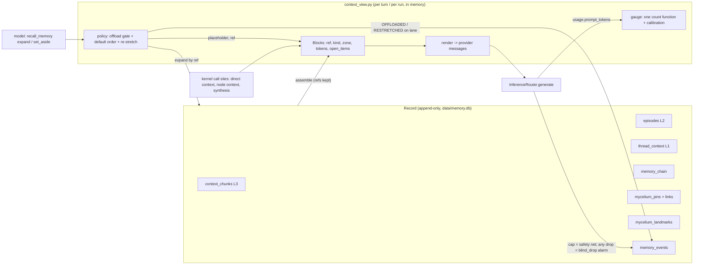
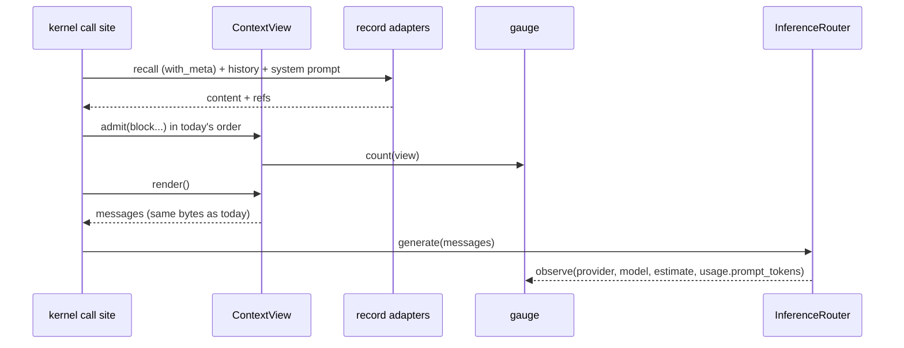

# Design: CLM Memory (the live view)

Read `requirements.md` first (STATUS UPDATE U1-U10 and Decisions Locked).
All file:line references were checked on 2026-11-11 against branch
`oracle-der-goal-contract-2026-11-09`. Line numbers in `agent_kernel.py` move when the
kernel split lands (`docs/architecture/KERNEL_DECOMPOSITION.md`); find by symbol name.

## Context

Plain picture: the window is a desk. Today, when the desk is full, someone sweeps the
oldest papers into the bin without looking (the router cap). This design gives every
paper a filing number before it reaches the desk. A paper leaves the desk only into
the filing cabinet (the record), and a slip with its number stays on the desk (the
placeholder). The model can ask for any paper back by its number. The model may tidy
the desk itself; if it does not, the harness tidies by a fixed order - but never into
the bin.

Constraints that bound the design:
- The answer path waits only for plan -> node work -> verification -> synthesis.
  View bookkeeping (events, calibration) goes on a lane; only the offload gate waits,
  and only where it decides (fold-back).
- One writer (`db.app_write`), one model chokepoint (`InferenceRouter.generate`).
- No tokenizer load, no new dependency.
- The phase scheduler must never read live u/xi; the view is cognitive-layer code and
  may read the settled position, but v1 does not need it.
- `agent_kernel.py` gains call sites only.

## Architecture Overview



Components:

| Component | Where | Job |
|---|---|---|
| `Block`, `ContextView` | NEW `backend/agent/context_view.py` (pure; no kernel import, no I/O at import) | Hold blocks, zones, placeholders; render to messages; apply edit batches |
| Gauge | NEW `backend/agent/context_gauge.py` | The ONE count function; per (provider, model) calibration from server usage |
| Policy | inside `context_view.py` (functions, not a class hierarchy) | Offload gate, default shrink order, re-stretch triggers, break-even |
| Record adapters | existing: `EpisodicStore.retrieve_context_chunks(with_meta=True)`, `PinStore`, `levels.py`, `memory_events` | Resolve a reference to content; write pins; emit events |
| Call sites | kernel context domain (`kernel/context.py` after the split) | Build the view where message lists are built today |
| Router cap | existing `router.py:429-495` | Stays as the last safety net; reports each drop to the view's counter |

No new table. No new store. No new lane (the existing `memory_events` lane carries
the events). The view lives in memory for one turn or one DER run; it is rebuilt from
the record, never persisted (Decisions Locked: derived, not a file).

## Sequence / Data Flow

### A. Assembly and render (no pressure) - must equal today's list (CLM-1 AC6)



### B. Pressure at a boundary (harness default) and re-stretch

```mermaid
sequenceDiagram
  participant K as kernel (node boundary)
  participant V as ContextView
  participant Rec as record
  participant L as lane memory_events
  K->>V: at_boundary(budget)
  V->>V: over margin? pick blocks by default order
  V->>Rec: ref readable? (bounded wait on queued write)
  alt readable and open items carried and saves tokens
    V->>V: replace block with placeholder (one batch)
    V->>L: OFFLOADED(ref, kind, tokens, actor=harness, trigger)
  else
    V->>V: block stays; count gate_refused
  end
  Note over K,V: later: trigger (landmark touch / error match / dead-end match) or model expand
  K->>V: expand(ref)
  V->>Rec: read by ref
  Rec-->>V: original content | pruned | reingestable | forgotten
  V->>L: RESTRETCHED (+ PREMATURE_EVICTION if within N steps)
```

## Data Models

```python
# backend/agent/context_view.py  (sketch - names are the contract, bodies are not)
@dataclass(frozen=True)
class Ref:
    kind: str          # "chunk" | "chain" | "episode" | "thread" | "pin" | "landmark" | "ephemeral"
    id: str            # row id in the record; "" for ephemeral
    thread_id: str = ""  # incidence key (recall REQ-10)

@dataclass
class Block:
    block_id: str      # short, stable within the view: "b12" (what the model names)
    ref: Ref
    kind: str          # "system" | "header" | "history" | "recall" | "tool_result"
                       # | "step_digest" | "pin" | "ledger" | "placeholder" | "user_turn"
    zone: str          # "prefix" | "recent" | "middle" | "past" | "tail"
    messages: list     # provider-shaped message dict(s); a tool call stays with its result
    tokens: int        # gauge count at admit
    ts: float          # for the placeholder time frame
    domain: str = ""   # from the row (chunk zone/type, event family, landmark domain)
    open_items: tuple = ()   # carried forward on offload
    protected: bool = False  # system, current user turn, header, ledger

PLACEHOLDER = "[[SET ASIDE {ref.kind}:{ref.id} | {time_frame} | {domain} | {reason}]]"
```

- **Placeholder syntax** is one line and names the record row directly. The brief's
  example used an MCM build-tool coordinate (`CORE:473`); the app's address is the row
  reference (term map at the top of the brief). Sigma is NOT part of the address in
  v1: chunk vectors carry no phase (recall REQ-10 closed negative, lambda = 0).
- **Reason** comes from, in order: the model's words (model edit), the block's own
  first open item, or the node's verified label + tool name (harness edit). Never an
  extra model call.
- **Default shrink order** (harness, oldest first within each rank):
  1. duplicate tool results (same tool + args hash; the newest stays),
  2. tool results of nodes whose verdict is VERIFIED and whose digest is in the view,
  3. recalled chunks not referenced since admit,
  4. history turns older than the recent zone.
  Never: protected blocks, the newest unit, a block under break-even, a block with an
  unresolved open item that cannot be carried.
  This order is the minimum that replaces DCP's dedup + error purge with a reversible
  form; it is data in one tuple, not a policy engine.
- **Break-even**: offload only if `block.tokens - placeholder_tokens >= MIN_SAVING`.
  `MIN_SAVING` is set from the CLM-0 AC3 distribution and written beside the number
  with its measurement.
- **Gauge**: `count(messages, tools) -> int` = the router's conservative estimator
  (`router.py:349-377`, moved, not copied) times a ratio per (provider, model). The
  ratio is an EMA of `usage.prompt_tokens / estimate` over real calls, held in memory,
  seeded 1.0, clamped to a stated range; the three old estimators are deleted and
  their callers call this. No tokenizer is loaded.
- **Gauge line** (in tool results): `[view 14.2k / 32.0k tokens | 3 set aside]`.
- **Model surface** (Q-B default): `recall_memory` gains `expand: <ref>` and
  `set_aside: [block_id...], reason: <text>`. The tool description states the three
  facts the model needs (block ids are shown, a set-aside block leaves a slip, expand
  brings it back). No policy text.

## The shrink algorithm (works with a model that never edits)

The harness runs this at every node boundary and at the gauge margin. It needs no
model call and no model skill; a small model gets the same guarantee as a large one.
The model's `set_aside` / `expand` are extra, never required.

1. COUNT. `gauge.count(view)`. Under the margin: stop.
2. PICK candidates by the default order (duplicates; verified nodes' raw tool
   results; unused recalled chunks; old history), oldest first. Skip protected
   blocks, the newest unit, and blocks under break-even.
3. KEEP WHAT IS USEFUL - before a block leaves, three things stay in the view:
   - its DIGEST: the node's existing step digest (what the step found, its verified
     label, the decisive call). The digest already exists per step; it is not written
     for the offload.
   - its OPEN ITEMS: unresolved errors, untried ideas, TODOs, dead ends -> moved to
     the ledger block.
   - its PLACEHOLDER: reference, time frame, domain, one-line reason.
4. GATE. The raw content must be readable in the record by its reference. If not,
   the block stays.
5. REPLACE the block with its placeholder, one batch for the boundary. Emit
   `OFFLOADED`.
6. RE-STRETCH automatically when a trigger fires (landmark touched, error matches a
   past event, next action matches a dead end): the ORIGINAL bytes return. Emit
   `RESTRETCHED`; if it was soon after the offload, `PREMATURE_EVICTION`.

So "compression" here is not a rewrite of the content by the model. It is: digest +
open items + address stay, raw bulk leaves, and the raw bulk is exact on return. A
model-written summary (a pin, CLM-3) is optional and can never replace its sources.
What "useful" means is learned from data, not from a prompt: `PREMATURE_EVICTION`
counts per block kind are the signal that the order or the margin is wrong.

## Key Decisions

| Decision | Rationale | Rejected |
|---|---|---|
| The view is in memory and rebuilt from the record | "Derived, never a file"; no persistence, no migration, no growth budget | A `live_view` table (a second truth; growth) |
| Harness default + model edits | Brief 5.2 and 5.4: unenforced backups do not happen; small models barely edit | Model-only editing (the paper's setup) |
| Calibrated estimator as the gauge | Exact for the last call (server truth), no dependency, ~0 ms; satisfies "real tokenizer of the active backend" by measurement | Loading a tokenizer per backend (dependency, 10-50 ms per call, wrong for hosted models) |
| Row reference as the address, no Sigma | REQ-10 measured negative for chunks; one address form | NBL coordinate strings |
| Reuse `OFFLOADED` / `RESTRETCHED` / `PREMATURE_EVICTION` | Already seeded; alphabet stays closed | New `VIEW_*` labels |
| Extend `recall_memory` | Menu parity contract (`test_tool_menu_parity_contract.py`); one fewer tool to choose | A new `context` tool |
| Edits only at boundaries, batched | Edit cost (brief 5.5); prefix stays byte-stable | Edit on every tool result |
| Router cap stays, becomes an alarm | A fallback on a path that should never fall back is an alarm (CLAUDE.md hidden failures rule 4) | Removing the cap (the provider 400 is worse) |
| View in its own module; kernel = call sites | Kernel split; unit-testable without the kernel's 430 lazy imports | Methods on `AgentKernel` |
| Dead-end ledger = a view block built from `DEAD_END` events | The store exists (`memory_events.py:597-607`) | A ledger table |
| Parity first (Wave 1 changes no behavior) | The migration guard: same inputs -> same bytes | Switching assembly and policy in one step |

## Ripple-Effect Map

| Area / File | Change? | Classification | Why / Evidence |
|---|---|---|---|
| `backend/agent/context_view.py`, `context_gauge.py` | New | CHANGE NEEDED | The view, policy, gauge |
| `_assemble_direct_context` (`kernel/context.py:656`) | Yes | CHANGE NEEDED | Builds blocks instead of a bare list; parity test CT-1 |
| `_der_run_node` (`kernel/der/node.py:1048`) message list, `_der_bound_step_context` | Yes | CHANGE NEEDED | The pressure site (tool results); CLM-0 AC4 Q1 pins the exact build points first |
| `_synthesize_response` (`kernel/der/report.py:1524`) | Yes | CHANGE NEEDED | Step results enter as blocks; synthesis diet contract must hold (`test_der_t26_synthesis_diet_contract.py`) |
| `_count_tokens` (`kernel/context.py:651`), `_DIRECT_CTX_BUDGET` (`agent_kernel.py:1219`) | Yes | CHANGE NEEDED | Replaced by the gauge; budget from `get_effective_token_budget` (`kernel/context.py:427`) |
| `inference/router.py` `_estimate_prompt_tokens` (:349), `_cap_messages_to_window` (:429) | Yes | CHANGE NEEDED | Estimator moves to the gauge; cap reports drops (blind_drop) |
| `inference/transport.py` usage (:436-481) | Read only | NO CHANGE (verified) | Already yields `usage.prompt_tokens`; the router passes it to `gauge.observe` |
| `agent/mcm.py` `count_tokens` (:311) | No | NO CHANGE (out of scope) | Swarm path, Q-A |
| `memory/episodic.py` `retrieve_context_chunks` (:1225) | Maybe | CHANGE NEEDED if ids absent | `with_meta=True` returns a producer label (:1604-1611); row id presence NOT confirmed - Q2 |
| `memory/event_alphabet.py` (:169-171) | No | NO CHANGE (verified) | Labels seeded |
| `memory/memory_events.py` | Yes (emit helper use) | CONTRACT LOCK CT-4 | Row shape for the three labels |
| `memory/surface_queries.py` (:1737-1738) | No | NO CHANGE (verified) | Already maps the three labels to display text; the memory dashboard starts showing them once emitted |
| `memory/pin_store.py` | Small | CHANGE NEEDED | Author + source links on add; `LINK_VOCABULARY` (:61) may need a `summarises` relationship - check before adding |
| `memory/levels.py` / `thread_context` | Read | CHANGE NEEDED | First production reader (CLM-5 AC7); run S2 (`test_answer_path_standards`) if any index is touched |
| `agent/tool_bridge.py` `recall_memory` | Yes | CHANGE NEEDED + CONTRACT LOCK CT-5 | Two operations; menu parity |
| `_emit_context_usage` (`kernel/context.py:435`) / frontend ContextPill | Value source | CONTRACT LOCK CT-6 | Event shape unchanged; `used_tokens` now from the gauge. Pinned by `test_context_usage_emit` T29 and `test_context_usage_parity.py` - run both; a value-source change there is a stated test input change if needed |
| `swarm/context_control.py` (:83-90), `mcm_protocol/actions/dcp_prune.py` | Yes | CHANGE NEEDED (CLM-9) | DCP callers |
| `backend/agent/dcp.py`, `test_der_phase0.py` (x2), `test_write_paths_proven.py` DCP cases | Delete | CHANGE NEEDED (CLM-9) | Stated test removals |
| `_der_emit_fan_trace` (`kernel/der/report.py:1069`) | No | CONTRACT LOCK CT-7 | One row per node keeps flowing |
| Forget paths | No code | CONTRACT LOCK | `test_every_recall_path_leaves_a_forgotten_strand_out` must include expand-by-ref |
| Oracle consumers (`tool_choice`, `web_intent`) | No | NO CHANGE | They read frames, not the view; verify their frame inputs do not include raw history length (Q4) |
| Phase scheduler | No | NO CHANGE | The view never reads live u/xi |
| Frontend | No | NO CHANGE (v1) | Placeholders are model-facing only; never in the reply (contract CT-8) |

## Error Handling

- IF the record cannot resolve a reference at assembly THEN the block renders, marked
  `ref_unresolved`, and the miss is counted. The turn continues.
- IF the offload gate's bounded wait expires THEN the block stays. Nothing is dropped
  on a timeout.
- IF `expand` fails THEN the view shows the placeholder with its case
  (`pruned` / `reingestable` / `forgotten` / `error`), and the failure is counted.
- IF the view raises anywhere THEN the call site falls back to today's list builder
  for that call, logs with the conversation id, and increments `view_fallback`. That
  counter is an alarm; its expected value is 0 (guarded in the eval report).
- IF a model edit is invalid (unknown id, protected block) THEN the tool returns the
  reason and the valid ids. No exception reaches the loop.
- Every `except` in the two new modules logs or counts. No silent fallback.

## Testing Strategy

Layers (CLAUDE.md: contract + behavioral + intertwined + standing harness).
Tests named here are the spec's tests; they are written once, before the code they
guard, and each must be shown to FAIL on the old state.

**Contract (`backend/tests/contract/`)**
- CT-1 `test_view_parity_contract.py`: for recorded assembly inputs, `render()` equals
  the old builder's output byte-for-byte when no edit happened (CLM-1 AC6).
- CT-2 `test_view_offload_gate_contract.py`: a block with an unreadable ref, an
  uncarried open item, or under break-even is NOT dropped; a tool result never
  separates from its call; protected blocks never leave.
- CT-3 `test_view_expand_contract.py`: expand returns the original bytes; the four
  failure cases are named, never empty.
- CT-4 `test_view_events_contract.py`: row shape of `OFFLOADED` / `RESTRETCHED` /
  `PREMATURE_EVICTION`; written on the `memory_events` lane, never the loop thread
  (same form as S82).
- CT-5 tool menu parity with the two operations.
- CT-6 context-usage event shape unchanged.
- CT-7 `der_fan_traces` one row per node (existing guard).
- CT-8 no placeholder or gauge line in a spoken or displayed reply.
- CT-9 one count function: a source guard that the three old estimators are gone.
- CT-10 pin never renders in a system/instruction block; pin never promotes.

**Behavioral (`backend/tests/behavioral/`)**
- BT-1: a DER run with tool results at 8x pressure through the real loop: blind drops
  = 0, every offload has an event, the final answer uses a re-expanded value.
- BT-2: the model never edits (stand-in): the harness default alone keeps the run
  inside the budget.
- BT-3: forget a strand, then expand its placeholder: `forgotten`.
- BT-4: a repeated dead-end action triggers the ledger re-stretch.

**Unit (`backend/tests/unit/`)**: zone assignment, default order, break-even
arithmetic, placeholder formatting, gauge EMA and clamp.

**Standing harness / live gate (the measured loop)**
- `evals/` gains the ContextBench analogue group (`--group context`): KV store, log
  triage, needle retention, sketchpad, time-frame recall, domain recall. Graded from
  the rendered view captured per call, not from the store.
- A replay script (`scripts/validate_view_replay.py`) replays recorded runs' message
  lists through the view offline before any live switch (hidden-failures rule 2) and
  prints the value distributions (tokens per zone, offload counts, gate refusals).
  Zero variance or everything-at-a-clamp is a failure.
- Each wave's gate: baseline -> change -> same cohort, same model, same commit pair;
  read pass + `reply_s`; `evals/standards.json` no regression.

## Open questions (answer from code in Wave 0; CLM-0 AC4)

- Q1: The exact points where a node's message list is created, grows (tool results),
  and where earlier steps' outputs enter a later node (`_der_bound_step_context`,
  step digests). List each with file:line and the block kind it maps to.
- Q2: Does `retrieve_context_chunks(with_meta=True)` return the chunk row id? If not,
  the smallest change that makes it do so.
- Q3: Which providers in use report cached prompt tokens in `usage`, and what the
  local llama.cpp server reports.
- Q4: Does any Oracle frame or physics input depend on message count or history
  length (so that offload would shift it)?
