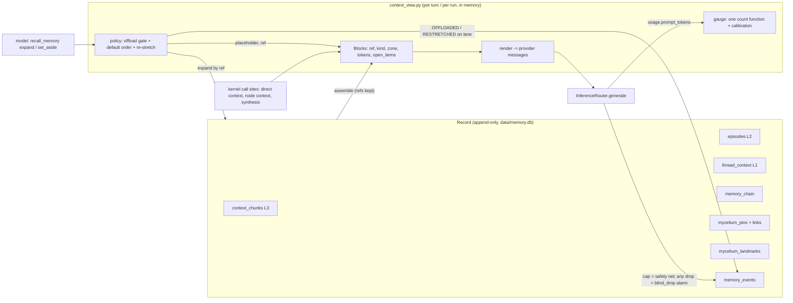
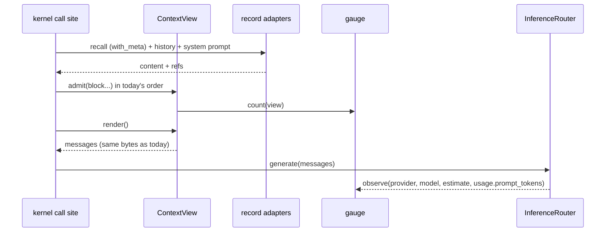

# Design: CLM Memory (the live view)

Read `requirements.md` first (STATUS UPDATE U1-U10 and Decisions Locked).
All file:line references were checked on 2026-11-11 against branch
`oracle-der-goal-contract-2026-11-09`. Line numbers in `agent_kernel.py` move when the
kernel split lands (`docs/architecture/KERNEL_DECOMPOSITION.md`); find by symbol name.

## Context

Plain picture: the window is a desk. Today, when the desk is full, someone sweeps the
oldest papers into the bin without looking (the router cap). This design gives every
paper a filing number before it reaches the desk. A paper leaves the desk only into
the filing cabinet (the record), and a slip with its number stays on the desk (the
placeholder). The model can ask for any paper back by its number. The model may tidy
the desk itself; if it does not, the harness tidies by a fixed order - but never into
the bin.

Constraints that bound the design:
- The answer path waits only for plan -> node work -> verification -> synthesis.
  View bookkeeping (events, calibration) goes on a lane; only the offload gate waits,
  and only where it decides (fold-back).
- One writer (`db.app_write`), one model chokepoint (`InferenceRouter.generate`).
- No tokenizer load, no new dependency.
- The phase scheduler must never read live u/xi; the view is cognitive-layer code and
  may read the settled position, but v1 does not need it.
- `agent_kernel.py` gains call sites only.

## Architecture Overview



Components:

| Component | Where | Job |
|---|---|---|
| `Block`, `ContextView` | NEW `backend/agent/context_view.py` (pure; no kernel import, no I/O at import) | Hold blocks, zones, placeholders; render to messages; apply edit batches |
| Gauge | NEW `backend/agent/context_gauge.py` | The ONE count function; per (provider, model) calibration from server usage |
| Policy | inside `context_view.py` (functions, not a class hierarchy) | Offload gate, default shrink order, re-stretch triggers, break-even |
| Record adapters | existing: `EpisodicStore.retrieve_context_chunks(with_meta=True)`, `PinStore`, `levels.py`, `memory_events` | Resolve a reference to content; write pins; emit events |
| Call sites | kernel context domain (`kernel/context.py` after the split) | Build the view where message lists are built today |
| Router cap | existing `router.py:429-495` | Stays as the last safety net; reports each drop to the view's counter |

No new table. No new store. No new lane (the existing `memory_events` lane carries
the events). The view lives in memory for one turn or one DER run; it is rebuilt from
the record, never persisted (Decisions Locked: derived, not a file).

## Sequence / Data Flow

### A. Assembly and render (no pressure) - must equal today's list (CLM-1 AC6)



### B. Pressure at a boundary (harness default) and re-stretch

```mermaid
sequenceDiagram
  participant K as kernel (node boundary)
  participant V as ContextView
  participant Rec as record
  participant L as lane memory_events
  K->>V: at_boundary(budget)
  V->>V: over margin? pick blocks by default order
  V->>Rec: ref readable? (bounded wait on queued write)
  alt readable and open items carried and saves tokens
    V->>V: replace block with placeholder (one batch)
    V->>L: OFFLOADED(ref, kind, tokens, actor=harness, trigger)
  else
    V->>V: block stays; count gate_refused
  end
  Note over K,V: later: trigger (landmark touch / error match / dead-end match) or model expand
  K->>V: expand(ref)
  V->>Rec: read by ref
  Rec-->>V: original content | pruned | reingestable | forgotten
  V->>L: RESTRETCHED (+ PREMATURE_EVICTION if within N steps)
```

## Data Models

```python
# backend/agent/context_view.py  (sketch - names are the contract, bodies are not)
@dataclass(frozen=True)
class Ref:
    kind: str          # "chunk" | "chain" | "episode" | "thread" | "pin" | "landmark" | "ephemeral"
    id: str            # row id in the record; "" for ephemeral
    thread_id: str = ""  # incidence key (recall REQ-10)

@dataclass
class Block:
    block_id: str      # short, stable within the view: "b12" (what the model names)
    ref: Ref
    kind: str          # "system" | "header" | "history" | "recall" | "tool_result"
                       # | "step_digest" | "pin" | "ledger" | "placeholder" | "user_turn"
    zone: str          # "prefix" | "recent" | "middle" | "past" | "tail"
    messages: list     # provider-shaped message dict(s); a tool call stays with its result
    tokens: int        # gauge count at admit
    ts: float          # for the placeholder time frame
    domain: str = ""   # from the row (chunk zone/type, event family, landmark domain)
    open_items: tuple = ()   # carried forward on offload
    protected: bool = False  # system, current user turn, header, ledger

PLACEHOLDER = "[[SET ASIDE {ref.kind}:{ref.id} | {time_frame} | {domain} | {reason}]]"
```

- **Placeholder syntax** is one line and names the record row directly. The brief's
  example used an MCM build-tool coordinate (`CORE:473`); the app's address is the row
  reference (term map at the top of the brief). Sigma is NOT part of the address in
  v1: chunk vectors carry no phase (recall REQ-10 closed negative, lambda = 0).
- **Reason** comes from, in order: the model's words (model edit), the block's own
  first open item, or the node's verified label + tool name (harness edit). Never an
  extra model call.
- **Default shrink order** (harness, oldest first within each rank):
  1. duplicate tool results (same tool + args hash; the newest stays),
  2. tool results of nodes whose verdict is VERIFIED and whose digest is in the view,
  3. recalled chunks not referenced since admit,
  4. history turns older than the recent zone.
  Never: protected blocks, the newest unit, a block under break-even, a block with an
  unresolved open item that cannot be carried.
  This order is the minimum that replaces DCP's dedup + error purge with a reversible
  form; it is data in one tuple, not a policy engine.
- **Break-even**: offload only if `block.tokens - placeholder_tokens >= MIN_SAVING`.
  `MIN_SAVING` is set from the CLM-0 AC3 distribution and written beside the number
  with its measurement.
- **Gauge**: `count(messages, tools) -> int` = the router's conservative estimator
  (`router.py:349-377`, moved, not copied) times a ratio per (provider, model). The
  ratio is an EMA of `usage.prompt_tokens / estimate` over real calls, held in memory,
  seeded 1.0, clamped to a stated range; the three old estimators are deleted and
  their callers call this. No tokenizer is loaded.
- **Gauge line** (in tool results): `[view 14.2k / 32.0k tokens | 3 set aside]`.
- **Model surface** (Q-B default): `recall_memory` gains `expand: <ref>` and
  `set_aside: [block_id...], reason: <text>`. The tool description states the three
  facts the model needs (block ids are shown, a set-aside block leaves a slip, expand
  brings it back). No policy text.

## The shrink algorithm (works with a model that never edits)

The harness runs this at every node boundary and at the gauge margin. It needs no
model call and no model skill; a small model gets the same guarantee as a large one.
The model's `set_aside` / `expand` are extra, never required.

1. COUNT. `gauge.count(view)`. Under the margin: stop.
2. PICK candidates by the default order (duplicates; verified nodes' raw tool
   results; unused recalled chunks; old history), oldest first. Skip protected
   blocks, the newest unit, and blocks under break-even.
3. KEEP WHAT IS USEFUL - before a block leaves, three things stay in the view:
   - its DIGEST: the step's existing readable result (`NodeResult.as_step_result`,
     `node_executor.py:263`: what the step found and its verified label) plus the
     decisive call (`_step_decisive_call`, `kernel/base.py:121`). Both exist per
     step; nothing is written for the offload. (Decided 2026-11-12. NOT
     `_step_digest`, `kernel/der/finalize.py:119`: that is a repeat-detection hash.)
   - its OPEN ITEMS: unresolved errors, untried ideas, TODOs, dead ends -> moved to
     the ledger block.
   - its PLACEHOLDER: reference, time frame, domain, one-line reason.
4. GATE. The raw content must be readable in the record by its reference. If not,
   the block stays.
5. REPLACE the block with its placeholder, one batch for the boundary. Emit
   `OFFLOADED`.
6. RE-STRETCH automatically when a trigger fires (landmark touched, error matches a
   past event, next action matches a dead end): the ORIGINAL bytes return. Emit
   `RESTRETCHED`; if it was soon after the offload, `PREMATURE_EVICTION`.

So "compression" here is not a rewrite of the content by the model. It is: digest +
open items + address stay, raw bulk leaves, and the raw bulk is exact on return. A
model-written summary (a pin, CLM-3) is optional and can never replace its sources.
What "useful" means is learned from data, not from a prompt: `PREMATURE_EVICTION`
counts per block kind are the signal that the order or the margin is wrong.

## The Workbench (CLM-11; advisor design 2026-11-15)

**Boundary.** Package `backend/agent/workbench/` (a sibling of `kernel/`; "kernel" and
"workspace" are taken names). It owns one Python child process per conversation, its
namespace, the request/reply protocol, the output digest and the enter/leave policy.
It never plans, routes, recalls, writes a store, calls a model, consults the Oracle or
approves: it is reached only as the registered tool `run_python` through the normal
dispatch (box.dispatch -> tool_bridge), so ledger rows, deadlines, `_der_after_call`,
`calls[]` and `as_step_result` apply without new code.

**Process and protocol v1.** Stdlib only (no jupyter_client: a one-file PyInstaller
backend, no pyzmq, no ZMQ ports on Windows). Interpreter: the project venv, then PATH
python, then sys.executable when not frozen; none -> unavailable (counted fallback).
Launch `python -I -X utf8 -u worker.py`, binary pipes, CREATE_NO_WINDOW; the worker
keeps a private copy of fd 1 for frames and points fd 1/2 at capture buffers. JSON
lines, five ops: `hello` (version, incarnation), `exec`, `inspect` (expression,
offset, limit), `put` (name, JSON value), `shutdown`. `exec` reply: ok, stdout,
stderr, value, error{type,message,trace_tail}, vars[] (name, type, size, 80-char
preview of changed names), kept[], wall_ms, truncated. Owner: conversation_id, lazy
start at the first run_python; ends on 10 min idle, conversation delete, workdir or
mode change, backend exit (stdin EOF). Bounds per AC8. Sandbox = the same trust
boundary as run_command (cwd = the session workdir / self-edit worktree; env as
run_isolated; one audit hook refuses write-opens outside cwd and temp; no network).

**Code mode and fallback.** Chosen once at node entry in `_der_run_node` (next to
`mode_for_goal`) by a stated rule: developer mode, an interpreter resolved, the step's
action class READ or RUN, no browser/screen/web reference. It reuses `run_node`
unchanged with a different NodeContext: tools=[run_python], role="reasoning" (the
Brain writes the scripts; tool_execution keeps fine-grained nodes), max_tokens 2048, a
short code-mode system prompt, max_calls 6. `run_python` is NOT added to NODE_TOOLS,
so the fine-grained menu and its tool_choice candidates do not move. Parallel
branches: a `workbench` node claim. Fallback per AC4 re-runs the same item once on
the fine-grained path.

**Digest and `wb` refs.** The tool message is the digest: stdout head+tail <= 1,200
chars, value <= 400, error tail, <= 12 changed-variable lines with
`wb:<incarnation>/<name>`. `Ref(kind="wb", ...)`; `ref_readable` = incarnation alive
and name present, so the offload gate and placeholders work unchanged;
`recall_memory(expand="wb:...")` routes to `inspect`. Code nodes write about zero
`tool_results` rows (digests are below the 2,500-char record threshold); code longer
than that is recorded once. Estimated code-mode call on 8k: limit (8,192 - 2,304) x
0.8 = 4,710; protected ~1,200 typical / ~2,100 worst; >= 2,600 tokens for digests.

**Enter/leave policy.** Enters at start via `put`: task, goal, steps (full results of
finished steps), memory (the node's `_memory_facts`). Leaves only through `keep()`
(AC6) into the step result ("Kept:") and the existing `write_pin` hook.

**Parts and contracts.**

| File | One responsibility | Contract test |
|---|---|---|
| `protocol.py` | frame shapes, PROTOCOL_VERSION, encode/decode | golden frames; a version mismatch refuses |
| `worker.py` | the child: exec, capture, manifest, keep, audit hook | stdlib-only import guard; runs on the oldest supported Python |
| `client.py` | spawn, send/receive, timeout, kill | real worker: soft stop keeps state; hard kill changes incarnation |
| `manager.py` | per-conversation ownership, idle end, cap | no orphan process after close; the cap holds |
| `digest.py` | reply -> model text and `wb` refs | size bounds; a ref parses with parse_placeholder |
| `policy.py` | what enters, what `keep` may leave | refusal cases named and counted |

Import rule (a contract test): only `tool_bridge.py` and `kernel/der/node.py` import
the package; `node_executor.py` never does.

### Round 6 (2026-11-16, CURRENT for browser work): the Oracle, the browser and code mode in unison

Owner (verbatim): "so essentially the application would need be able to handle the oracle
using browser tools and code mode with workbench in unison or a parallel if that aligns with
your recommendation i want you to build that and do proper testing to make sure theres no
issues". Advisor report 2026-11-16 (read-only).

Facts that set the design: the Round 2 line "tool_approval and browser_next continue through
the same hooks" was NOT built (the code-mode ctx has on_call=None and a counting-only
on_result) - a script's browser_act writes no browser_next row; all 14 browser evals are
personal mode on live public sites, judged by reply regex, and none strictly needs sight;
with no bound folder a personal conversation resolves the workdir to the IRIS repo, which is
refused, so code mode cannot start there; browser_observe returns a 2,500-char digest, so a
script cannot read a page; when a vision model is live the results carry marked_screenshot
b64, which the callback handler passed into the worker; an ended node cannot stop its script
(the handler object is handed to client.exec once); a code node would take the `browser`
claim inside its clock (the D7 problem); record_browser_next reads its scope from a contextvar
of the node thread (empty on the callback thread); the browser runs in the backend process
(the Low-integrity worker only writes a call frame); the worker's network is open.

- **Entry rule (C3).** A browser code step = flag on + run_python offered + a brief with
  outputs and a check + the brief's `tools` names a browser tool (browser_open / browser_read /
  browser_observe / browser_act / browser_explore) + not WRITE / not after a change +
  `_vision_relevant(goal)` false. Only for such a step the external-reference exclusion is
  lifted. A browser step without a brief stays on today's menu / vision path. `_wb_allowed`
  = the node's menu INTERSECTED with the offered tool names (the web toggle holds).
- **Driving the page.** tools.browser_*() -> the node's `_execute` -> box.dispatch (egress
  guard, click-safety gate, hand-back wait, the 150 s browser deadline unchanged). C2: a
  browser code node takes `browser` then `workbench` at entry, before its clock; a
  non-browser code node's handler refuses browser tools. C1: the handler carries a `closed`
  latch (set in the node's finally before the claims are released) and a browser wall budget
  (node budget - 20 s); after either it answers "the step ended" and dispatches nothing; at
  most 12 browser callbacks per run_python. C5: a new read-only tool `browser_read(max_chars
  = 200000)` (main text + links of the open page, `trust: untrusted`), in the browser claim,
  offered only to browser code nodes (not in NODE_TOOLS). C6: the handler strips
  marked_screenshot and trims marks to id / role / name / disabled before the value reaches
  the worker. A `_WB_BROWSER_NOTE` (<= 400 chars) for browser code nodes only.
- **Sight (C7).** No mixed node this round. Plan time: a sight step is its own menu-path step
  (the page persists per conversation between steps). Run time: a new fallback reason
  `needs_sight` (the check did not pass and the script raised ToolError('needs sight') or an
  observation had too few marks): the node re-runs once on the menu path with sees / look,
  still holding the claim, on the same page. tools.browser_look(question) comes later.
- **Parallel.** Allowed: a code node on files beside a browser node (different claims); the
  loop over pages inside ONE script (zero model calls between pages); browser_explore /
  crawler fan-out for read-only linked pages. Refused: a second page / context per
  conversation (_MAX_SESSIONS = 2 process-wide with LRU close; marks numbering and the
  click-safety memory are per session). Two browser code nodes of one conversation serialize
  on both claims.
- **The Oracle now (C4, shadow).** One browser_next question per script browser_act with an
  element_id, after its result: goal, the last observation text the script saw, element_id,
  action, done_when, calls_this_step, brain_ok, scope captured on the node thread at entry
  (new `scope=` parameter), `via="run_python"`; same consumer and criteria_version; the
  oracle_shadow lane; no sampled swap inside a script. **Later (enforcing):**
  tools.browser_act(action=..., target='<label>') without element_id asks browser_next
  synchronously and clicks its element ONLY when the consumer is enforced on the active
  engine (the existing enforcement check), the confidence clears the fitted threshold, and
  IRIS_WB_BROWSER_PICK=1; otherwise ToolError("no confident element").
- **Scope and safety.** C8 (owner 2026-11-16: "Private scratch folder"): a personal
  conversation with no bound folder gets a per-conversation scratch folder (labelled Low,
  removed at the end), never the IRIS repo and never an ask card in a browser step. C10
  (owner: "Yes, refuse them"; WIDENED by the owner 2026-11-17 after a smoke run showed a
  script fetching 3 public pages with urllib in 1 s, around the browser tools, the egress
  guard and the Oracle rows: "only the browser in the application with the tools and should
  block if the webswitch isnt on"): a script's direct network is refused in EVERY mode -
  socket connect / sendto and name lookups (a lookup alone can carry data out); the web goes
  only through tools.browser_* (egress guard + the web switch's InternetGate). Child
  processes inherit dead proxies (127.0.0.1:9, npm offline, PIP_NO_INDEX), which curl / npm /
  pip / Python obey; a child that ignores proxy variables is NOT covered (a firewall rule /
  AppContainer later). Page actions in scripts (owner: "Actions now"): click / type /
  select through the click-safety gate; credentials and login stay on the vision path.
- **Tests.** Contract (test_workbench_browser_contract.py): latch, claim order, entry table,
  row shape, no b64 in frames, browser_read in claim / family / tier, enforcement guard (bar
  unmet -> no Oracle click). Behavioral (test_workbench_browser_behavior.py): the real
  _der_run_node + a real worker + a fake browser box (no network) through plan -> code node
  -> callbacks -> check -> manifest -> synthesis; needs_sight fallback; a parallel menu
  browser node and a code node without deadlock; a script that outlives its node does not
  act. CDD replay for C4 rows (replay_consumer_instrument). Keep green: the browser_next,
  browser_tools, browser_vision_in_node, browser_session, browser_kept_driver contract tests,
  test_browser_control_behavior, the workbench contract files, unit test_external_reference.
- **Live gate.** Cohorts `browser` (10), `browser_goal` (4) + a new `browser_data` (4 multi-page
  extract-and-compute tasks); IRIS_WORKBENCH 0/1 interleaved, >= 5 rounds, cloud first. Bar
  (on vs off, per cohort): pass >= off and no task lower by >= 2 of 5; model calls, prompt
  tokens, reply_s <= off on `browser` and <= 0.7 x off on `browser_goal` / `browser_data`;
  Brain calls <= off; browser_next rows per script browser_act on an on-list element = 1.0 and
  on-arm rows per task >= off; claim waits >= 0.5 s inside a script 0; latch hits 0; browser
  timeouts <= off; vision steps lost 0; code-node fallbacks <= 20 %; planner retries <= off.
- **Gate CLEARED 2026-11-22 for `browser_goal` + `browser_data`, cloud arm only.**
  `evals/results/wb_gate-20261122-084556` (8 tasks x 5 reps x 2 arms
  = 80 runs, `evals/wb_gate_driver.py --reps 5 --tasks g01 g02 g03 g04 d01 d02 d03 d04 --two-call`).
  All six numeric metrics pass both cohorts: goal pass 20/20 = off 20/20, reply x0.67, calls x0.53,
  prompt x0.32; data pass 20/20 = off 20/20, reply x0.38, calls x0.47, prompt x0.24. Fallbacks 0,
  escalations 0, planner retries off 23 -> on 0, Brain calls median off 4 -> on 3, wb_wait 0.
  NOT YET RUN on the final code (audit 2026-11-22): the `browser` cohort b01-b10 (its bar is
  <= off; it failed at x1.12 calls on 2026-11-19), the small-model arm ("cloud first"), and the
  re-check cohorts; the 2026-11-20 note named "a full 5-rep 18-task gate" as the confirmation
  before the flag goes on. The bar's other clauses (claim waits, latch hits, browser timeouts,
  vision steps lost) are not reported by `evals/wb_ab_analysis.py`. The two non-numeric conditions from the
  handoff are resolved: (a) the g01 pass miss was a system gap, not noise - the pair path had
  `max_calls=1`, so one failed check closed the node with no retry; it now gets one corrected retry;
  (b) browser_next rows on 0 vs off 7 is correct - the pair uses browser_open/read and never
  browser_act on a numbered element, so there is no shadow row to write (owner decision 2026-11-21).
  A computed browser task whose planner brief names search/crawler_query is forced to browser tools
  so the entry rule sends it to code mode (d01 variance fix). Flags on: `IRIS_WORKBENCH=1`,
  `IRIS_WB_TWO_CALL=1`. Standard S169.

### Round 4 (2026-11-16, CURRENT; advisor after TG-7 run 1): make the Workbench win on every metric

Owner (verbatim): "We had a lower prompt token amount which is good but i expect a signficant
improvement in all areas especially the ones that mattee and prove the workbench usefullness".
Run 1 split by call kind (x01-x04, 12 runs per arm; role + max_tokens as the label): Brain calls
3.6 -> 5.75 per task; escalations = 41 % of on-arm completion tokens and +1,075 s of Brain time;
56 menu-node calls (41 % of on-arm prompt) for steps the entry rule kept out of code mode; 97
scripts in 26 code nodes, 30 only list the folder, 13 only print `skeleton`; parallel code nodes
waited 880 s in total on the `workbench` claim, charged to the node's 300 s clock; 7 extra
planner calls (unparseable plans with the brief) in 5 of 12 runs. Re-run after F1-F4 (2 of 5
rounds, then stopped for this round): escalations 19/26 -> 2/18 code nodes, but pass 7/10 vs
10/10 - a check that passed on empty placeholders (x01), a per-file plan (x02), E_PLANNER_EMPTY
(x03). Floor of Brain calls per turn = 3 (the 16-token user_feedback label, the planner,
synthesis); the verifier is embedding-based.

- **D1 cheap, sighted escalation.** `_wb_escalate` passes `reasoning_effort="low"` (as the
  planner does), the repair prompt carries PROJECT FILES (D3), the note shows the skeleton text
  as well as `put`ting it. Trigger unchanged (second REAL failed check, once per node).
- **D2 the brief always parses.** Log the raw planner head when `_parse_planner_json` returns
  None; brief rule: single quotes only and no backslashes inside check / inputs / outputs,
  relative forward-slash paths. The parser fix follows the logged cause.
- **D3 ground.** One pure, bounded function (50 ms, 2,000 entries, depth 3, <= 1,200 chars:
  numbered runs collapsed, sizes, 2 head lines of <= 6 named text files) -> the code node's
  step message (+ `files` variable), the flag-on planner prompt, the repair prompt. In code
  mode the MEMORY text leaves the step message (it stays in the `memory` variable).
- **D4 plan shape + entry rule.** Flag-on planner rule: ONE step per data product, not per
  file / table / stage; outputs small and final; the check tests COMPLETENESS (expected
  count of items / keys), never the type only. `_wb_code_mode` admits a step with outputs and
  a check, or a READ/RUN class, with no browser / screen / web reference.
- **D5 the step result is the outputs manifest:** purpose, each output in full when <= 600
  chars else 600 chars + type, size and `wb:` ref, "check: passed"; no stdout / changed-variable
  lines in a passed step's result.
- **D6 tool-model diet for 8k:** a new `_WB_SYSTEM` (relative paths, never chdir, one script
  that assigns every output, PROJECT FILES already listed); `_WB_TOOLS_NOTE` only when the
  brief names a tool Python cannot replace; the code-node run_python schema = code + purpose;
  digest lists outputs first + <= 4 others; max_tokens 2048 -> 1024.
- **D7 the claim before the clock:** the code-mode node takes the `workbench` claim before
  run_node starts its deadline; `wb_wait_s` counted.
- **D8 the spill writes declared outputs only** (+ `out<n>` refs).
- **Measurement (TG-7 v2):** W0 first - `call_kind` on every baseline row (label, plan, node,
  code_node, wb_repair, synth, other) through one optional InferenceRouter.generate keyword,
  HTTP sends (resends + hedges) per call, `wb_wait_s` / scripts per node / exploring scripts in
  `_wb_stats`, the analysis script in `evals/`. Arms interleaved, >= 5 rounds: A0/A1 cloud both
  roles, flag 0/1; B0/B1 the same Brain + LFM2.5-2.6B (8k) tool model, then LFM3-1.7B.
  Cohorts: context x01-x04 (x05 noise control), data c46-c52, config c38-c45, run-and-report
  c14 c17 c18 c19 c25 c26 c27, explain c13, write control c01 c02 c11.
- **Pass bar (on vs off, per cohort, medians):** pass >= off and no task lower by >= 2 of 5;
  Brain calls/task <= 3.1 and <= off; tool-model calls <= 0.4 x off (context, data), <= off
  elsewhere; prompt tokens <= 0.5 x off (context, data); completion tokens <= 0.7 x off;
  steps <= off; reply_s <= 0.8 x off (context, data), <= off elsewhere; escalations <= 10 % of
  code nodes, median <= 10 s; scripts per code node <= 1.5; planner retries <= off; small arm
  pass above B0, blind drops 0, largest prompt <= 4,000. The flag goes on only when every row
  holds on the cloud arm; otherwise the failing row + number + date are written in tasks.md.
- **Owner answers (2026-11-16):** (1) file-changing steps (edit, write) stay on the menu path
  until the READ/RUN gain is proven by TG-7 v2; (2) on escalation the TOOL MODEL sends the
  skeleton (the harness never runs Brain code itself); (3) the Brain-call proof = the floor
  of 3 per turn and never above the off arm (synthesis stays).

### Round 3 (2026-11-16): the two-model loop; personal mode as a scope

- **Roles.** Brain (`reasoning`): plans, writes each step's brief at plan time (no
  extra call), steps in on escalation, reads reports at synthesis. Tool model
  (`tool_execution`): writes and runs ALL Workbench Python, repairs its own script.
  The harness runs the check. The menu path runs only with no interpreter
  (`wb_degraded`).
- **The brief (planner fields per step):** goal, inputs, outputs, check, approach,
  tools; `expected_output` stays for the verifier. Level 0 = contract + approach (the
  planner has not seen the data); level 1 = the Brain's repair skeleton (<= 40 lines,
  `put` into the namespace as `skeleton`, run as `exec(skeleton)`). T7.0b measures
  which level a 1.7-2.6B model needs to start at.
- **The report:** `exec` carries `check`; the worker evaluates it after the body in
  the same request; reply `check: {ok, error}`. A passing check closes the node. The
  step result = the purpose line, the output manifest (name, type, size, preview,
  `wb:` ref), the check result, the digest. No Brain call per step; the verifier
  grades against expected_output.
- **Repair loop:** attempts 1-2 by the tool model from the digest and the check error;
  then ONE Brain call (`on_check_failed(attempt, code, digest)` hook on NodeContext,
  implemented in the kernel) returns a level-1 repair brief; attempt 3 by the tool
  model; still failing -> DER recovery. Replaces `_hand_over`.
- **The namespace is the medium:** the Brain names variables (outputs/inputs); the tool
  model fills them; prompts carry names, types, sizes and 80-char previews, never the
  data; `task`, `steps`, `memory` are variables.
- **Token budget on 8k (est.):** limit 4,710 at max_tokens 2048; first call ~1,425
  (system 260, run_python schema 250, <= 5 tool signatures 125, brief <= 2,400 chars
  ~690, memory 100); +~880 per kept attempt; +~400 for a skeleton.
- **Personal mode = scope.** One profile (no `profile` field, no Job Object, no
  subprocess/network refusal); `run_python` leaves `_TERMINAL_TOOLS`; the scope is the
  session folder; personal mode refuses a workdir at or under the IRIS repo (no bound
  folder -> the existing ask-user folder flow); developer mode = the IRIS repo through
  `_self_edit_view`. Finding: personal mode also blocks run_command/git and
  auto-approves side-effect tools today - that does not match the owner's definition
  (owner question; its own change).
- **Oracle:** tool_choice has no question inside code (no manufactured rows). New
  single question at each failed check: REPAIR or ESCALATE (consumer `repair_route`,
  two fixed labels; evidence: attempt, error type, check error, the typed failure
  rows BUG/OBSTACLE/DEAD_END now written live; label: did the next tool-model attempt
  pass). Shadow until the bar.
- **Protocol v2:** callbacks (`ev:call` / `op:result`), `fresh`, `close`, spill as
  Round 2; `check` added to exec; `profile` removed.

### Round 2 (2026-11-16, superseded by Round 3 where they differ): every step a code step, tools callable from Python

- **Boundary.** The Workbench is the default execution surface of every DER node in
  both modes; the menu path (run_node + NODE_TOOLS on tool_execution) is the
  fallback only. The Workbench never dispatches a tool itself.
- **Protocol v2.** hello adds `profile`, `roots`; exec adds `tools` (names) and
  `call_budget`; a worker-to-parent frame `{"v":2,"ev":"call","id","seq","tool",
  "args"}` mid-exec and the parent's `{"v":2,"op":"result","id","seq","ok","value",
  "error"}`; `kept` leaves the exec reply. The client keeps its one-request lock for
  the whole exec and answers only `call` frames of the current exec; the worker is
  single-threaded (tools.x() writes the frame and blocks on the reply).
- **Not a second path.** `client.exec(code, timeout_s, on_call=handler)`; the handler
  is the node's existing `_execute` closure (turn-live check, domain guard, claims,
  `_der_before_call`, box.dispatch, `_der_after_call`, the on_call/on_result hooks),
  registered per conversation for the node's duration. Each callback becomes one
  `calls[]` entry (`via: run_python`), so node_call_log, as_step_result, the ledger
  and the UI see it. While a callback is pending the watchdog and the exec deadline
  pause; the callback is bounded by `_der_tool_deadline(tool)`. `tools.x()` returns
  the result dict or raises ToolError (failure or denial) so a script stops before
  later side effects. Budget: 24 callbacks per execution, 48 per node; the
  dispatch duplicate guard still applies.
- **Lifetime by the Brain.** `run_python(fresh=True)` spills, starts a new
  incarnation and runs; `run_python(close=True)` runs, spills and ends. The step
  message carries the manifest (live variables, sizes, producing step).
- **CLM hand in hand.** The namespace is the live store; the view holds `wb:` refs;
  the offload gate is unchanged; callback results become variables (not
  `tool_results` rows). `tool_results` keeps three jobs: code rows (every
  submission), spills (on fresh/close/idle/eviction, the values a step result or a
  live placeholder names), and the fallback path. Crash or hard kill: no spill,
  `workbench_gone` plus the code row.
- **Safety per mode.** `run_python` leaves `_TERMINAL_TOOLS`; the profile is fixed at
  spawn from the mode (a mode change ends the workbench); `tools` holds only what the
  mode's menu offers. Developer profile = today's. Personal profile = R4.
- **Oracle.** `exec_mode` dropped (no mode choice remains). `tool_choice` cannot act
  inside a script: its rows stay alive in shadow - one sampled question per callback
  on the hook lane, label = the tool the code called; it enforces only on the
  fallback path. tool_approval and browser_next continue through the same hooks.
- **Expected effect (est., TG-7 measures):** a step from several model calls to 1-2;
  prompt per call ~700 tokens of tool surface (one schema + one-line signatures)
  against JSON schemas p50 1,733 / p95 5,968.

**Oracle `exec_mode` (first version; dropped in Round 2).** Code nodes ask no tool_choice question (one tool) - one d1
call saved per model call; tool_choice row volume must be watched after switch-on.
A new shadow consumer `exec_mode` (labels CODE / TOOLS, one question at node entry)
learns from structured outcomes; the stated rule decides until the bar.

## Key Decisions

| Decision | Rationale | Rejected |
|---|---|---|
| The view is in memory and rebuilt from the record | "Derived, never a file"; no persistence, no migration, no growth budget | A `live_view` table (a second truth; growth) |
| Harness default + model edits | Brief 5.2 and 5.4: unenforced backups do not happen; small models barely edit | Model-only editing (the paper's setup) |
| Calibrated estimator as the gauge | Exact for the last call (server truth), no dependency, ~0 ms; satisfies "real tokenizer of the active backend" by measurement | Loading a tokenizer per backend (dependency, 10-50 ms per call, wrong for hosted models) |
| Row reference as the address, no Sigma | REQ-10 measured negative for chunks; one address form | NBL coordinate strings |
| Reuse `OFFLOADED` / `RESTRETCHED` / `PREMATURE_EVICTION` | Already seeded; alphabet stays closed | New `VIEW_*` labels |
| Extend `recall_memory` | Menu parity contract (`test_tool_menu_parity_contract.py`); one fewer tool to choose | A new `context` tool |
| Edits only at boundaries, batched | Edit cost (brief 5.5); prefix stays byte-stable | Edit on every tool result |
| Router cap stays, becomes an alarm | A fallback on a path that should never fall back is an alarm (CLAUDE.md hidden failures rule 4) | Removing the cap (the provider 400 is worse) |
| View in its own module; kernel = call sites | Kernel split; unit-testable without the kernel's 430 lazy imports | Methods on `AgentKernel` |
| Dead-end ledger = a view block built from `DEAD_END` events | The store exists (`memory_events.py:597-607`) | A ledger table |
| Parity first (Wave 1 changes no behavior) | The migration guard: same inputs -> same bytes | Switching assembly and policy in one step |

## Ripple-Effect Map

| Area / File | Change? | Classification | Why / Evidence |
|---|---|---|---|
| `backend/agent/context_view.py`, `context_gauge.py` | New | CHANGE NEEDED | The view, policy, gauge |
| `_assemble_direct_context` (`kernel/context.py:656`) | Yes | CHANGE NEEDED | Builds blocks instead of a bare list; parity test CT-1 |
| `run_node` (`backend/agent/node_executor.py:636`, list built at `:648`, grown at `:786`/`:946`) | Yes | CHANGE NEEDED | The pressure site. The node message list is NOT built in the kernel: `_der_run_node` (`kernel/der/node.py:1048`) only passes `_generate` and a `NodeContext` (`:1463-1480`). The view call site is therefore in `node_executor.py`, a non-kernel module - T1.3 touches it (Q1) |
| `_der_bound_step_context` (`kernel/context.py`, called `kernel/der/run.py:1250`) | No | NO CHANGE (nothing to wire) | It truncates `item.coordinate_signal`, a field no model prompt reads (Q1). It is not a pressure site; it leaves with the dead field, not with the view |
| `mcm_protocol` `pre_call_flow.json` (`dcp_prune`, `mito_inject`, `pacman_recall`) via `_mcm_orch.pre_call` (`_assemble_direct_context`, last lines) | Yes | CHANGE NEEDED (new row, forced by Q1) | Runs on the direct path after assembly and mutates the list (prune, inserts at `[1]` and `[2]`). CT-1 parity must be defined against assemble + pre_call, and `dcp_prune` leaves the workflow in CLM-9 |
| `mcm_protocol` `post_turn_flow.json` `mcm_check_compress` via `_mcm_orch.post_turn` (`kernel/turn.py:1691`) | No (record) / CHANGE NEEDED (CLM-9) | CONTRACT LOCK | Passed `self._conversation_memory.messages` and replaces it in place when it fires (`orchestrator.py:97-98`): the one path that can edit the record. Not seen to fire in `logs/iris.log*` (0 matches) |
| `_synthesize_response` (`kernel/der/report.py:1524`) | Yes | CHANGE NEEDED | Step results enter as blocks; synthesis diet contract must hold (`test_der_t26_synthesis_diet_contract.py`) |
| `_count_tokens` (`kernel/context.py:651`), `_DIRECT_CTX_BUDGET` (`agent_kernel.py:1219`) | Yes | CHANGE NEEDED | Replaced by the gauge; budget from `get_effective_token_budget` (`kernel/context.py:427`) |
| `inference/router.py` `_estimate_prompt_tokens` (:349), `_cap_messages_to_window` (:429) | Yes | CHANGE NEEDED | Estimator moves to the gauge; cap reports drops (blind_drop) |
| `inference/transport.py` `_extract_usage` (:433) / `_extract_ollama_usage` (:459) | Wave 1: read only; T5.3: Yes | NO CHANGE for the gauge; CHANGE NEEDED for CLM-10 AC3 | Already yields `usage.prompt_tokens`; the router passes it to `gauge.observe`. Both extractors keep only prompt/completion/total, so a cached-token field is dropped at parse (Q3): T5.3 needs a small additive parse |
| `agent/mcm.py` `count_tokens` (:311) | No | NO CHANGE (out of scope) | Swarm path, Q-A |
| `memory/episodic.py` `retrieve_context_chunks` (:1225) | Yes (one key) | CHANGE NEEDED | The `with_meta=True` dict (:1616-1625) has content, chunk_type, producer, score, timestamp and NO id, though `cid` is in scope in that comprehension (Q2). Add `"id": cid`; additive, no caller breaks |
| `memory/event_alphabet.py` (:169-171) | No | NO CHANGE (verified) | Labels seeded |
| `memory/memory_events.py` | Yes (emit helper use) | CONTRACT LOCK CT-4 | Row shape for the three labels |
| `memory/surface_queries.py` (:1737-1738) | No | NO CHANGE (verified) | Already maps the three labels to display text; the memory dashboard starts showing them once emitted |
| `memory/pin_store.py` | Yes (small) | CHANGE NEEDED | `LINK_VOCABULARY` (:61) needs NO new word: `derives_from` is already in it and `link()` (:327) takes free `source_type`/`target_type`. `add()` (:198) has no author field and the table has no author column (`origin_id` or a tag carries it; T3.1 picks, no schema change) |
| `memory/levels.py` / `thread_context` | Read | CHANGE NEEDED | First production reader (CLM-5 AC7); run S2 (`test_answer_path_standards`) if any index is touched |
| `agent/tool_bridge.py` `recall_memory` | Yes | CHANGE NEEDED + CONTRACT LOCK CT-5 | Two operations; menu parity |
| `_emit_context_usage` (`kernel/context.py`, by name) / frontend ContextPill | Value source | CONTRACT LOCK CT-6 | Event shape unchanged. Today `used_tokens` = `_context_fill`, the largest single call's server `total_tokens` (`_accrue_tokens`), already real usage; the gauge becomes the pre-call estimate beside it. Pinned by `test_context_usage_emit` T29 and `test_context_usage_parity.py` - run both; a value-source change there is a stated test input change if needed |
| `swarm/context_control.py` (:83-90), `mcm_protocol/actions/dcp_prune.py` | Yes | CHANGE NEEDED (CLM-9) | DCP callers |
| `backend/agent/dcp.py`, `test_der_phase0.py` (x2), `test_write_paths_proven.py` DCP cases | Delete | CHANGE NEEDED (CLM-9) | Stated test removals |
| `_der_emit_fan_trace` (`kernel/der/report.py:1069`) | No | CONTRACT LOCK CT-7 | One row per node keeps flowing |
| Forget paths | No code | CONTRACT LOCK | `test_every_recall_path_leaves_a_forgotten_strand_out` must include expand-by-ref |
| Oracle consumers (`tool_choice`, `web_intent`) | No | NO CHANGE (verified, Q4) | No declared Oracle job field is a message count or history length (`decision_engine.py` `ORACLE_JOBS`); node frames read `NodeContext.history` / `last_result_text`, not `messages`. Keep those two out of the view |
| Phase scheduler | No | NO CHANGE | The view never reads live u/xi |
| Frontend | No | NO CHANGE (v1) | Placeholders are model-facing only; never in the reply (contract CT-8) |

**Workbench rows (CLM-11, added 2026-11-16 - the map had none; mapped read-only, file:line as of 283f902d):**

| Area / File | Change? | Classification | Why / Evidence |
|---|---|---|---|
| `backend/agent/workbench/{protocol,worker,client}.py` | Yes | CHANGE NEEDED (T7.12, T7.9) | `check` on exec (worker evaluates it after the body, reply `check:{ok,error}`); protocol v2 callback frames `ev:call` / `op:result` |
| `workbench/manager.py`, `capabilities.py` `_TERMINAL_TOOLS` (:71), `tool_registry.py` run_python spec (:997) | Yes | CHANGE NEEDED (T7.11) | Personal mode = scope: run_python offered in both modes; a personal workbench refuses a workdir at or under the IRIS repo |
| `tool_bridge.py` `_run_python_tool` (:361) | Yes | CHANGE NEEDED (T7.12, T7.9) | Passes `check`, returns `check_ok`; passes the node's dispatch handler for callbacks. Today it reads only code/purpose/timeout_s |
| `kernel/der/node.py` `_wb_code_mode` (:164), code-mode call site (~:1810) | Yes | CHANGE NEEDED (Round 3 R1, done in 283f902d) | Code nodes on `tool_execution`; brief, check and `on_check_failed` (`_wb_escalate`, one Brain call) |
| Planner: `kernel/planning.py` (:863 prompt, :1048 parse), `core_models.PlanStep` (:715), `der_loop.QueueItem` (:216), `kernel/der/run.py` (:520-543 copy) | Yes | CHANGE NEEDED (T7.13) | Brief fields inputs/outputs/check/approach/tools; no model has them today, so `_wb_brief` returns empty. Flag off: planner prompt byte-equal |
| `node_executor.run_node` `calls.append` (:1251), `_target` (:542) | Yes | CONTRACT LOCK (`test_step_calls_contract.py`) | Every run_python call and every callback (`via: run_python`) is one `calls[]` entry -> `item.node_call_log` (`kernel/der/node.py`) -> `_step_calls` (`kernel/base.py:88`). `_target` reads no run_python key today -> the card's step has an empty target; T7.12 reads `purpose` |
| Task card events: `tool:call` (`kernel/der/run.py:1312-1322`), `tool:result` (`kernel/der/finalize.py:827-832`, `_step_tool_name` :88) -> `ws_event_bridge.py` -> `hooks/useIRISWebSocket.ts:1949` `iris:task_update` -> `components/chat/TaskListCard.tsx` | No (shape) | CONTRACT LOCK | Same events and shape in both modes and both paths. A node step sends `tool_name: "direct"` on `tool:call` (all nodes, not only code nodes); `tool:result` names the decisive call (run_python, or the last/failed callback tool). No Workbench-specific event exists |
| Frontend labels: `lib/cards/verbRegistry.ts` (`run_` prefix -> exec family, :166), `hooks/useTaskProgress.ts` `TOOL_TITLES` (:443) | No | NO CHANGE (verified) | run_python is in no map; it falls back to the EXEC verb and the title "Run Python" |
| Permission path for run_python (`tool_bridge.py:2505-2517`, permission `side_effect`) | Verify | VERIFY AT TG-7 | Personal mode after T7.11: count `permissions` per eval task; a permission card per script would make a code step slower than the menu path |
| CLM events `OFFLOADED` / `RESTRETCHED` / `PREMATURE_EVICTION` (`node_executor.py:846, 892, 955, 1151`) | No | NO CHANGE (verified) | Sink = `_clm_node_hooks.on_clm_event` (`kernel/der/node.py:310`) -> `_emit_event`, passed as `**hooks` only when `IRIS_CLM_OFFLOAD` is on; the code-mode ctx inherits it through `dataclasses.replace`. Expand emits RESTRETCHED from `tool_bridge.py:326`. Dashboard words: `surface_queries.py:1737` |
| Task card earn counter: `_on_result` -> `_der_count_tool_call` (`kernel/surface.py:2277`; gate `kernel/der/run.py:~700`, `MIN_TOOL_STEPS_FOR_CARD` = 5) | Yes | CHANGE NEEDED (with T7.11) | Personal mode only (developer mode always shows the card): a short plan's card is released at the 5th real tool call. The code-mode ctx sets `on_result=None`, so code steps never count and a code-only personal turn never shows its card. Fix: the code-mode ctx counts each run_python call and each callback once. Open: one script can replace ~10 calls, so the bound may rarely trip with code nodes - measure at TG-7 (cards shown per personal-mode turn) |
| Code-node fallback (`kernel/der/node.py`, `_wb_needs_fallback` -> `run_node(goal, _node_ctx)`) | No | NOTE | The fallback run replaces `result`, so the code attempt's calls leave `node_call_log` and the card; `wb_fallback` is counted in `_wb_stats` and the log only |
| Oracle `repair_route` (T7.15) | New consumer | CHANGE NEEDED | One question per failed check, REPAIR / ESCALATE, shadow until the bar |

## Error Handling

- IF the record cannot resolve a reference at assembly THEN the block renders, marked
  `ref_unresolved`, and the miss is counted. The turn continues.
- IF the offload gate's bounded wait expires THEN the block stays. Nothing is dropped
  on a timeout.
- IF `expand` fails THEN the view shows the placeholder with its case
  (`pruned` / `reingestable` / `forgotten` / `error`), and the failure is counted.
- IF the view raises anywhere THEN the call site falls back to today's list builder
  for that call, logs with the conversation id, and increments `view_fallback`. That
  counter is an alarm; its expected value is 0 (guarded in the eval report).
- IF a model edit is invalid (unknown id, protected block) THEN the tool returns the
  reason and the valid ids. No exception reaches the loop.
- Every `except` in the two new modules logs or counts. No silent fallback.

## Testing Strategy

Layers (CLAUDE.md: contract + behavioral + intertwined + standing harness).
Tests named here are the spec's tests; they are written once, before the code they
guard, and each must be shown to FAIL on the old state.

**Contract (`backend/tests/contract/`)**
- CT-1 `test_view_parity_contract.py`: for recorded assembly inputs, `render()` equals
  the old builder's output byte-for-byte when no edit happened (CLM-1 AC6).
- CT-2 `test_view_offload_gate_contract.py`: a block with an unreadable ref, an
  uncarried open item, or under break-even is NOT dropped; a tool result never
  separates from its call; protected blocks never leave.
- CT-3 `test_view_expand_contract.py`: expand returns the original bytes; the four
  failure cases are named, never empty.
- CT-4 `test_view_events_contract.py`: row shape of `OFFLOADED` / `RESTRETCHED` /
  `PREMATURE_EVICTION`; written on the `memory_events` lane, never the loop thread
  (same form as S82).
- CT-5 tool menu parity with the two operations.
- CT-6 context-usage event shape unchanged.
- CT-7 `der_fan_traces` one row per node (existing guard).
- CT-8 no placeholder or gauge line in a spoken or displayed reply.
- CT-9 one count function: a source guard that the three old estimators are gone.
- CT-10 pin never renders in a system/instruction block; pin never promotes.

**Behavioral (`backend/tests/behavioral/`)**
- BT-1: a DER run with tool results at 8x pressure through the real loop: blind drops
  = 0, every offload has an event, the final answer uses a re-expanded value.
- BT-2: the model never edits (stand-in): the harness default alone keeps the run
  inside the budget.
- BT-3: forget a strand, then expand its placeholder: `forgotten`.
- BT-4: a repeated dead-end action triggers the ledger re-stretch.

**Unit (`backend/tests/unit/`)**: zone assignment, default order, break-even
arithmetic, placeholder formatting, gauge EMA and clamp.

**Standing harness / live gate (the measured loop)**
- `evals/` gains the ContextBench analogue group (`--group context`): KV store, log
  triage, needle retention, sketchpad, time-frame recall, domain recall. Graded from
  the rendered view captured per call, not from the store.
- A replay script (`scripts/validate_view_replay.py`) replays recorded runs' message
  lists through the view offline before any live switch (hidden-failures rule 2) and
  prints the value distributions (tokens per zone, offload counts, gate refusals).
  Zero variance or everything-at-a-clamp is a failure.
- Each wave's gate: baseline -> change -> same cohort, same model, same commit pair;
  read pass + `reply_s`; `evals/standards.json` no regression.

## Open questions - answered 2026-11-12 (Wave 0, T0.2; code as it is after the kernel split)

Line numbers are for the files as read on 2026-11-12. `router.py` and
`kernel/context.py` were being edited by another agent during this pass: those two
are cited by function name.

- **Q1 - ANSWERED. Where a node's message list is made, grows, and where earlier
  steps enter.** The node list is built in `backend/agent/node_executor.py`
  `run_node`, not in the kernel. `kernel/der/node.py:1048` `_der_run_node` builds a
  `NodeContext` (`:1463-1480`) and calls `run_node(goal, _node_ctx)` (`:1480`).

  | Point | file:line | Block kind |
  |---|---|---|
  | list created: system `_SYSTEM`, one user message (task, parent goal, STEP, DONE WHEN, reviewer note, RESULTS OF EARLIER STEPS, MEMORY facts) | `node_executor.py:648-655` (`_user_message` `:591`) | `system` (protected), `user_turn` (protected) |
  | earlier steps enter: `_prior_results` built from `queue.items` results, each cut by `_step_evidence_cap` | `kernel/der/node.py:1532-1552`, `kernel/base.py:103`; passed `node.py:1559`; rendered `node_executor.py:608-612`, clip `limit*3` = 24,000 chars | `step_digest` (the step result text) |
  | memory facts: `_mf(goal, ...)` max ~420 chars | `kernel/der/node.py:1455-1457`; rendered `node_executor.py:653-654` | `recall` |
  | model answer with tool calls | `node_executor.py:786` | `tool_result` unit (call half) |
  | tool result, clipped to `result_chars` 8,000 | `node_executor.py:946-949` (clip `:911`); repeat stub `:828` | `tool_result` |
  | screenshot as a user message; older ones dropped by `_drop_old_screenshots` (`:149`) | `node_executor.py:971`, `:970` | `tool_result` (image) |
  | harness notes (handover, malformed, empty, picture hint, closing stop) | `:750`, `:754`, `:773-779`, `:1029` | `header`-like, never offloaded |
  | model calls | `node_executor.py:735` (loop), `:1033` (closing) through `_generate` (`node.py:1079`) to `InferenceRouter.generate` | |

  Other builders: a direct node is one user message (`node.py` `_der_run_direct_node`,
  `_msgs`); synthesis is ONE user message, an f-string over
  `TaskContext.get_results_summary()` (`kernel/der/report.py:96`, prompt `:1450`, sent
  `:1524`, `:1548`, `:1594`) - it has no history list. `_der_bound_step_context`
  (`kernel/context.py`, called `kernel/der/run.py:1250`) truncates
  `item.coordinate_signal`; no model prompt reads that field (grep: only writers in
  `run.py:1064-1222` and one copy in `der_loop.py:1021`; `evidence.py:213` says so).
  It does not shrink any model window. Also stale in the design text above: the
  existing per-step "digest" (`kernel/der/finalize.py:119` `_step_digest`) is a
  repeat-detection HASH, not readable text. The readable carrier today is the step
  result (`NodeResult.as_step_result`, `node_executor.py:263`) and
  `_step_decisive_call` (`kernel/base.py:121`); CLM-5 and the shrink algorithm must
  name those. DECIDED 2026-11-12: the shrink algorithm uses those two carriers; no new
  digest line is written (see "The shrink algorithm", step 3).
  The direct chat path additionally passes through `_mcm_orch.pre_call` after
  assembly (`pre_call_flow.json`: `dcp_prune`, `mito_inject` at `[1]`,
  `pacman_recall` at `[2]`); that is a live list mutator (see Ripple map).

- **Q2 - ANSWERED: No, the id is not returned.** The `with_meta=True` dict
  (`memory/episodic.py:1616-1625`) carries `content`, `chunk_type`, `producer`,
  `score`, `timestamp` only. The row id exists (`context_chunks.id`, a UUID text key,
  verified in the live store schema) and `cid` is already in scope in that
  comprehension (`:1626` `for score, content, cid in top`). Smallest change: add
  `"id": cid` to the dict. Callers of `with_meta=True` (`kernel/context.py`
  `_assemble_direct_context`, `kernel/der/run.py:1109`, `evidence.py:232`) read keys
  by name, so an added key is safe. Two side facts: the `with_meta` branch returns at
  `:1627`, before the `retrieval_count` update (`:1629-1639`), so a with_meta recall
  never counts as a use (a decay-signal gap, not changed here); the reindex branch
  (`:1272-1277`) returns `rm.search_chunks` and ignores `with_meta` (idle/complete
  state skips it).

- **Q3 - PARTLY ANSWERED; the provider facts are OPEN.** From code: IRIS reports NO
  cached prompt tokens from any provider today. `_extract_usage`
  (`inference/transport.py:433-456`) keeps only `prompt_tokens`, `completion_tokens`,
  `total_tokens`; `_extract_ollama_usage` (`:459-486`) keeps only `prompt_eval_count`
  and `eval_count`; no `cached` / `cache_n` / `timings` field is parsed anywhere in
  `backend/agent/inference/`. Usage reaches `router.last_usage` after each call
  (`router.py` `generate`, reading `transport.last_usage`). `InProcessTransport` sets
  no `last_usage` (class at `:1726`): "no ground truth". `ApiHttxTransport` streaming
  asks `stream_options.include_usage` (`:964`); `OpenAICompatTransport` (llama-server,
  `:1282`) parses a usage chunk (`:1515`) but does not ask for it. MISSING
  MEASUREMENT: one raw response (stream and non-stream) per provider in use, and one
  from the local llama-server, with the raw `usage` and `timings` objects logged
  before parsing, to see which carry a cached-token field. That is T0.1/T5.3
  instrumentation, not decidable from code. (The provider list in use lives in
  `data/iris_config.json`, which this task must not touch.)

- **Q4 - ANSWERED: No input depends on message count or history length.**
  Oracle jobs declare their fields in `agent/decision_engine.py` (`ORACLE_JOBS`,
  `job_input` `:790`): goal, done_when, calls_this_step, step_facts, last_result,
  task_class, previous_chosen/outcome, step_index, ruled_out, error_snippet,
  proposed_tool, args, page fields, etc. None is a count of messages or history.
  The node frames read `NodeContext.history` (the `calls` list, `node_executor.py:683`)
  and `last_result_text` (`:950`), via `_step_so_far` (`kernel/der/node.py:1231`);
  both are separate from `messages`. `route_v2` uses `chars=len(text)` of the user's
  text (`kernel/planning.py` `_route_v2_frame`). Physics: `step_action`
  (`physics_action.py`) is a function of tool names and success only. Other
  length-like inputs, all independent of the view: the DER token budget counts
  `len(_window_evidence)//4` per step (`kernel/der/finalize.py:969`, stop at `:987`);
  `derive_work_units_0(resolve_context_window())` uses the window size, not the fill
  (`kernel/der/recovery.py:283-284`); the outer loop's `tokens_total` is
  `ConversationMemory.get_token_count()` over the stored turns (`agent/memory.py:346`,
  `:396-408`), i.e. the record. `_context_fill` / `_tokens_used` feed only the pill and
  the persisted snapshot (`kernel/context.py` `_accrue_tokens`, `:158`). Condition:
  the view must never mutate `ConversationMemory.messages` (see the `post_turn`
  Ripple row), and `calls` / `last_result_text` stay outside the view.
