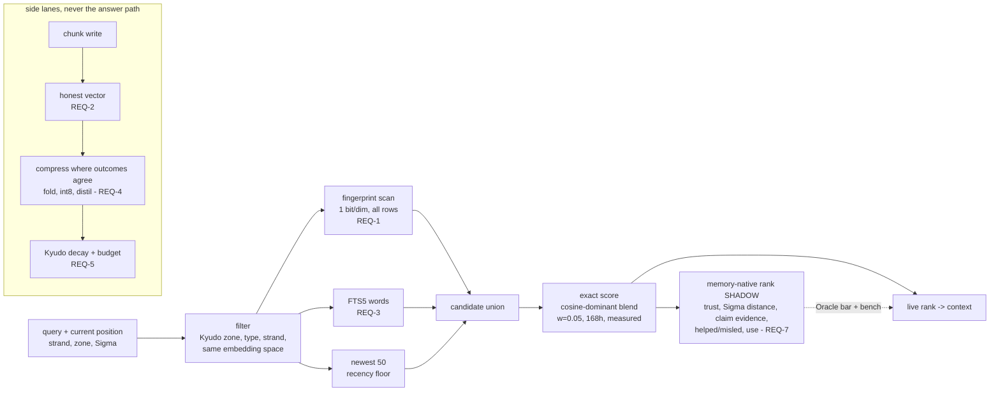
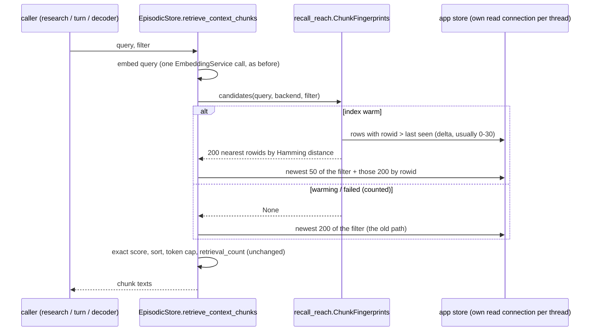
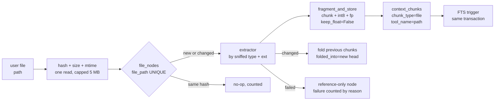

# Design: Memory Recall Reach and Performance

## Context
IRIS's memory is not a vector database and must not be rebuilt as one. Its parts each
answer a different question:

| Part | Question it answers | Store |
|---|---|---|
| Context chunks | what was said / read / produced (payload) | `context_chunks` (146,653 rows) |
| Immortus chain | what happened, in order, by reference (never payload) | `memory_chain` (58,117) |
| Mycelium coordinates | who the user is, how the machine works (profile) | `mycelium_nodes` / spaces |
| Landmarks | what is PROVEN true by outside evidence (claims) | `mycelium_landmarks` |
| Kyudo | how much a source may write, how fast it fades, where it may go | channels, zones, decay |
| Caducean Σ | the phase of the work when anything happened | `caducean_trajectories`, chain coords |
| Events | the closed alphabet of what each step meant | `memory_events` (56,757) |

LEANN and memvid both answer one question - "which stored text is nearest this text?" -
and optimise storage (LEANN) or packaging/latency (memvid) for it. IRIS needs that answer
too (chunks), but recall here is a NAVIGATION: from the current position (Σ, the strand,
the zone), along what is proven and used, to the payload. The design keeps the nearest-text
answer as one cheap component and puts the memory's own structure around it.

Constraints: CPU only; the answer path waits only for plan → nodes → verify → synthesis
(everything else on a lane); one writer for the store (`db.app_write`); no new dependency
without the owner; every computed signal needs a production consumer and a sane value.

## Architecture Overview



## Sequence / Data Flow (REQ-1, built)



Warm-up: the first `index_for(path)` starts one daemon thread that reads every vector once in
batches of 5,000 rows (measured build time in the bench), computes the store mean, keeps the
sign bits. Nothing is written.

## Data Models

`ChunkFingerprints` (per store path, in RAM):

| Field | Type | Bytes/row | Meaning |
|---|---|---|---|
| `_codes` | uint64 (16, capacity) | 128 | sign of each component, packed; COLUMN-major so the scan is 16 contiguous passes |
| `_rowids` | int64 (n,) | 8 | `context_chunks.rowid` |
| `_session`, `_type`, `_zone`, `_backend` | int32 / int16 | 10 | filter columns, by small id tables |

~146 B per chunk, ~21 MB at today's 146,653 rows; bound FP_MAX_ROWS = 1,000,000 (~146 MB).

Planned (REQ-3/4, not built): `context_chunks_fts` (FTS5, content = context_chunks, rowid
linked); `context_chunks.vec_i8` BLOB (1,024 B) + `vec_scale` REAL; `context_chunks.folded_into`
TEXT; `memory_chain.distilled` used as specified.

## Key Decisions

1. **Fingerprint first, exact score second** (REQ-1). One bit per dimension is both the
   compression and the index: 32× smaller than float32, scanned with `np.bitwise_count` in
   milliseconds, and the M = 200 survivors are scored exactly as before - so the ranking
   formula, thresholds and every caller are unchanged; only WHICH rows are scored changes.
   Rejected: HNSW/sqlite-vec (new dependency, an index to keep in sync on every write, an
   approximate graph that needs tuning); LEANN recomputation (embedding calls at query time).
2. **Plain signs, measured.** Signs about a mean taken from raw vectors (norms up to 72.5)
   reached recall@10 0.35 on the whole store; plain signs reach 0.96 (0.963 at M=200, 0.985 at
   M=500 on 40 queries). The centre is 0; nothing to drift.
2b. **Column-major codes, two scan paths.** Row-major `bitwise_count(...).sum(axis=1)` took
   28 ms at 147k rows; 16 contiguous passes with a reused buffer take 9.9 ms. A filter that
   allows under 1/8 of the rows scans only its rows (research 1,777 rows: p95 9.5 ms).
   Capacity doubles, so a new row never copies the matrix.
3. **The newest 50 stay in the scored set.** The old path's recency behaviour survives
   (a chunk written seconds ago is always considered), so the change is a superset in spirit.
4. **No schema change for REQ-1.** Fingerprints are derived from the stored vectors; a
   rebuild is a restart. Persisting them (REQ-4 AC1) comes with the compression work.
5. **Memory-native ranking stays shadow until it earns the job** (REQ-7) - the same bar the
   Oracle consumers use. Cosine is a fine first rank; the memory's structure has to prove it
   ranks better on the bench and on helped/misled outcomes.
6. **Compression is the operator, not a codec** (REQ-4): fold where outcomes agree, distil
   proven clusters into a claim + references, keep payloads only where Kyudo trust allows -
   the same "compress where outcomes agree" the DER loop and the Mycelium graph already use.
   int8 storage is the one codec, and only where the bench shows ≤ 0.02 recall loss.

### Reference points (their claims, their corpora - never mixed with ours)

| | LEANN (README) | memvid v2 (README) | IRIS (bench, this store) |
|---|---|---|---|
| storage | 91-97% below a FAISS flat index (e.g. 38K items: 130 MB → 6.4 MB ≈ 168 B/item) | single `.mv2` file, codec unspecified | fingerprint 128 B/chunk (+ float 4,096 B today; int8 1,024 B planned) |
| search | not published; recomputes embeddings on the search path | "0.025 ms P50, 0.075 ms P99" (undefined baseline) | candidate stage p50 / p95: research 2.1 / 9.5 ms, turn 5.4 / 20.6 ms, whole store 13 / 41 ms; 10× 171 / 236 ms |
| recall | "no accuracy loss" (no recall figures) | "+35% on LoCoMo" (LLM judge) | recall@10 vs exact search: 0.975 / 0.901 / 0.96 (was 0.14 / 0.054 / 0.029) |
| beyond retrieval | - | time index | position (Σ), proven claims, trust + decay, use feedback |

## File recall (REQ-9) — identity in the graph, payload in chunks

A file is not a new store. It is an ADDRESS the memory already has (`file_nodes`) plus text
the memory already knows how to keep (`context_chunks`). The whole feature is a bridge
between the two, which is why it adds no table, no second write path and no new index.



**Why the pieces are where they are**

| Decision | Why (from the code, not preference) |
|---|---|
| Identity in `file_nodes` | `file_path UNIQUE` already dedups by path; `last_edited` is the mtime; `language`, `confidence`, `decay_rate` already exist. Adding two columns (hash, size) is cheaper than a table and keeps one address per file. |
| Payload through `fragment_and_store` | it already chunks at 2,048 with overlap, dedups at 0.92, writes int8 + fingerprint and goes through `app_write`. A second writer would drift from every one of those. |
| FTS with no hook | the three triggers on `context_chunks` index any insert in the same transaction. Verified on the live schema. |
| `tool_name` = path | the column already means "which source produced this chunk"; a file is a source. No migration. |
| `chunk_type = "file"` | no CHECK constraint on the column; a new value needs no schema change. |
| Fold, never delete | `folded_into` is the existing compression operator; a changed file is the same "compress where outcomes agree" the DER loop uses, and it keeps the undo trail. |
| No float on file rows | the bench proves int8 loses 0.0 recall@10 on every type; 5,256 B/row of text+float would spend the 100 MB budget five times faster than 1,160 B. |

**Not built in W1, decided for W2:** the session filter cannot see a file (a file is not a
conversation). The turn recall at `agent_kernel.py:4037-4049` passes a session; the file leg
must be a second, session-less call on zones (the memory-native answer) or file chunks pinned
to the ingesting session (the cheap answer). The bench's `files` filter measures the first
before the call site changes.

## Two planes (REQ-10) — semantic and phase, joined by incidence

Owner decision 2026-10-28: two planes, never one geometry. They answer different
questions and must keep different meanings.

| plane | carrier | dimensions | question it answers | index |
|---|---|---|---|---|
| **S — semantic** | `context_chunks.vec_i8` / `vec_fp` | 1024-d from LFM | which text is near this text | fingerprint scan (unchanged) |
| **P — phase** | `memory_chain.coords_*`, `caducean_trajectories` | x, y, ξ, u | where in the work was this | the chain's own order |

They are joined by **incidence**, not by a new edge: a chunk belongs to the
position of the chain row in its thread (`chunk.session_id = chain.thread_id`).
No coordinate is copied onto the chunk, and no chunk becomes a graph node.

```
   plane S (cloud)                       plane P (path)
   chunk a  ──incidence──▶  position p1 ──path──▶ p2 ──incidence──▶ chunk b
   chunk c  ──incidence──▶  p1
```

**Why not one plane.** Concatenating (x, y, ξ, u) into the 1024-d vector makes the
four dimensions 0.4 % of the norm (so cosine ignores them), changes the 128-byte
fingerprint that *is* the index, and puts live u/ξ inside a vector the phase
scheduler must never read (CT-3/CT-4). A learned projection needs training data
and turns ξ from an angle into an uninterpretable latent.

**The rank, not the vector.** Candidates stay semantic; the scored set blends:

```
score = cosine · (1 − λ) + affinity · λ
affinity = 1 / (1 + d_Σ),  d_Σ = w_ξ·|Δξ| + w_u·|Δu|   (x, y are REGIME, matched not subtracted)
```

Measured anisotropy (2026-10-28, 14,298 trajectories): x has **17** distinct
values (zero on 36.5 %), y **43**, ξ **520**, u **679**. A symmetric Euclidean Σ
would be dominated by integer jumps in x/y and blind to phase.

**Coverage gates λ, per path — measured, not assumed:**

| live filter | chunks with a position | λ allowed |
|---|---|---|
| turn (`agent_kernel.py:4046`, session_iris) | 3,620 / 3,620 = **100.0 %** | yes, tune it |
| global (no production caller) | 55,327 / 143,265 = 38.6 % | only with absent≠zero handling |
| research (`research_memory.py:482`) | 0 / 1,782 = **0.0 %** | **no** — every row would be "absent" |

A row with no position is **absent, not zero**: it carries no phase term, and the
weights renormalise over what the row actually has. A single global λ would
silently corrupt the research path, where no row has a position at all.

**Prerequisites before λ is tuned at all** (found 2026-10-28):
1. `coords_from` / `coords_to` hold non-coordinates — only 3,637 / 3,075 of
   13,739 rows are 4 numbers; the rest hold `'json'` (675×), `'markdown'`,
   `'text'`, `'rest:input:<id>'`. Repair before measuring, or λ fits a file format.
2. The join is `thread_id`, not `session_id`: every coordinate-shaped chain row
   has `session_id = NULL`, so the session join returns 0 of 143,265.
3. 3,075 positioned rows spread over only **480** distinct positions, so the
   phase plane is coarse; a distance smaller than one position step is noise.

**Vocabulary.** `mycelium_edges` (400 rows) connects `from_node_id` →
`to_node_id` with `score`, traversal/hit/miss counts and its own decay
(`tool_choice` 389, `informed` 11). Edge is the right word **only** when both
ends are nodes. A chunk is a payload: chunk → position is **incidence**. Adding
143k chunk nodes would change what the graph means.

## Ripple-Effect Map

| Area / File | Change? | Classification | Why / Evidence |
|---|---|---|---|
| `backend/memory/recall_reach.py` | Yes (new) | CHANGE NEEDED (built) | the fingerprint index, warm-up, counters |
| `backend/memory/episodic.py` retrieve_context_chunks | Yes | CHANGE NEEDED (built) | candidate rows = 200 nearest + newest 50; old path on None (`episodic.py` reach block) |
| scoring, token cap, retrieval_count, crystallization signal | No | NO CHANGE (verified) | same loop over `rows` (`episodic.py:1063-1156`) |
| `research_memory.recall_prior_research` | No | NO CHANGE (verified) | calls retrieve_context_chunks with type/zone (`research_memory.py:482`) |
| `agent_kernel` turn recall (`:4046`, `:4065`) | No | NO CHANGE (verified) | session + zones passed through |
| `recall_decoder` (`:436`) | No | NO CHANGE (verified) | session passed through |
| reindex dual-read (`episodic.py:1017-1023`) | No | NO CHANGE (verified) | returns before the reach block while a migration runs |
| S79 / S81 answer-path standards | No | CONTRACT LOCK | `test_answer_path_standards.py` (newest-rows plan uses idx_chunks_session_ts_zone; rowid IN is a primary-key search) |
| `compare_embeddings` provenance rule | No | CONTRACT LOCK | candidates filtered to the query's backend (CT-R5) |
| Memory surface `/api/memory/*` | No (REQ-8 adds counters) | NO CHANGE now | reads its own SQL (`surface_queries.py`) |
| embedding fallback (`embedding.py:750-779`) | REQ-2 | CHANGE NEEDED (next) | mislabels hash vectors |
| FTS5 (`episodic._init_schema`) | REQ-3 | CHANGE NEEDED (next) | new virtual table + triggers or writer hook; S2 check first |
| integrity pass / Kyudo decay | REQ-5 | CHANGE NEEDED (next) | `cleanup_stale_chunks` has no caller |
| `evals/memory_bench.py`, `evals/standards.json` | Yes | CHANGE NEEDED (built) | the benchmark + its standard |

## Error Handling
- IF the warm-up read fails THEN recall keeps the old path for the life of the process,
  `fallback_error` counts it, one warning is logged.
- IF a query fails inside the index THEN that recall uses the old path (counted).
- IF the store has vectors of another dimension THEN those rows are skipped (never mixed).
- WHILE a reindex migration runs THEN dual-read answers (unchanged).

## Testing Strategy
- `tests/contract/test_memory_recall_reach_contract.py` (built): the oldest matching chunk of
  600 is reachable (CT-R1), the filter holds (CT-R2), new rows join once (CT-R3), recall
  returns a relevant chunk older than the newest 200 end to end (CT-R4; fails on the old
  path), the warming fallback is counted (CT-R5), never across embedding spaces (CT-R6).
- Contract locks kept green: `test_answer_path_standards.py` S79/S81.
- Behavioral: `evals/run_evals.py` research (r*) and coding (c*) groups before/after - no pass
  loss, no reply-time regression; the memory group (REQ-6 AC3) once built.
- Standing harness: `evals/memory_bench.py` on every memory change, compared with
  `evals/standards.json` "memory" (tolerances stated in the script).
- Physics-aware (REQ-7): replay recorded trajectories with injected Σ and assert the
  native rank prefers same-phase rows only when they also helped (never phase alone).
- HIDDEN FAILURES check: fingerprint bits must vary (no constant code), the mean must not be
  0, recall@10 must not equal reach (a sign the scan returns everything).
