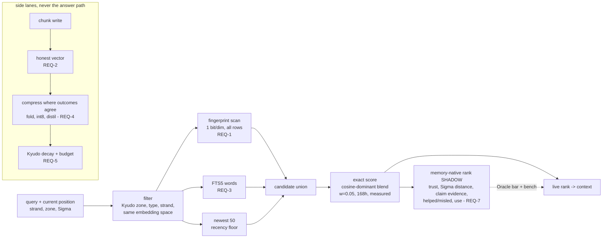
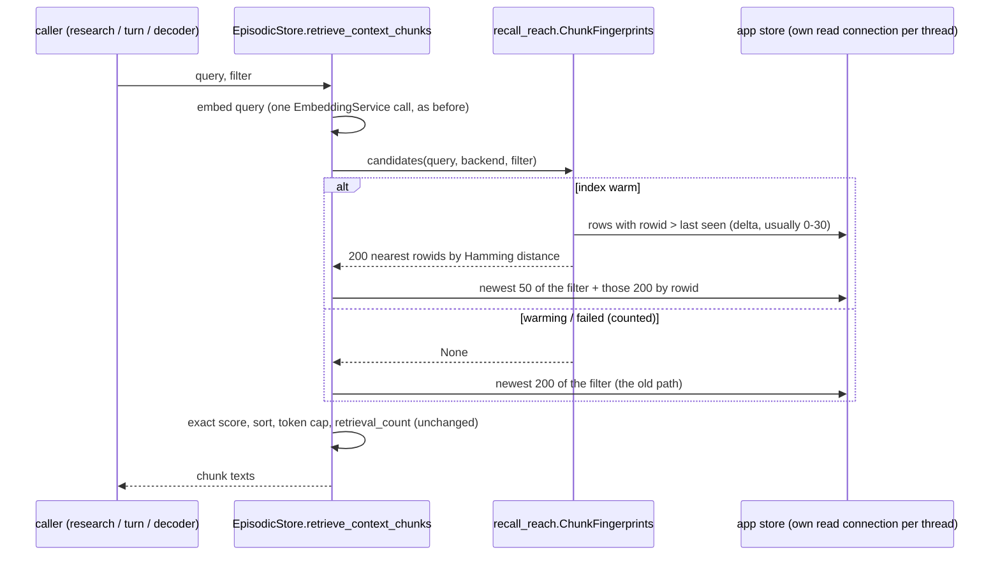
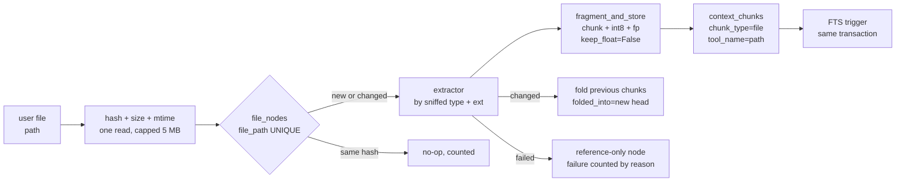
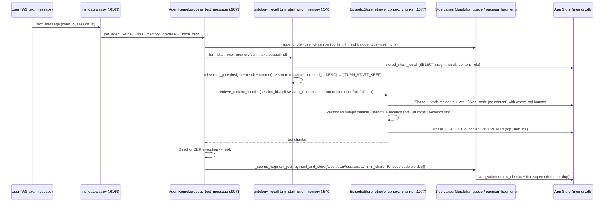

# Design: Memory Recall Reach and Performance

## Context
IRIS's memory is not a vector database and must not be rebuilt as one. Its parts each
answer a different question:

| Part | Question it answers | Store |
|---|---|---|
| Context chunks | what was said / read / produced (payload) | `context_chunks` (146,653 rows) |
| Immortus chain | what happened, in order, by reference (never payload) | `memory_chain` (58,117) |
| Mycelium coordinates | who the user is, how the machine works (profile) | `mycelium_nodes` / spaces |
| Landmarks | what is PROVEN true by outside evidence (claims) | `mycelium_landmarks` |
| Kyudo | how much a source may write, how fast it fades, where it may go | channels, zones, decay |
| Caducean Σ | the phase of the work when anything happened | `caducean_trajectories`, chain coords |
| Events | the closed alphabet of what each step meant | `memory_events` (56,757) |

LEANN and memvid both answer one question - "which stored text is nearest this text?" -
and optimise storage (LEANN) or packaging/latency (memvid) for it. IRIS needs that answer
too (chunks), but recall here is a NAVIGATION: from the current position (Σ, the strand,
the zone), along what is proven and used, to the payload. The design keeps the nearest-text
answer as one cheap component and puts the memory's own structure around it.

Constraints: CPU only; the answer path waits only for plan → nodes → verify → synthesis
(everything else on a lane); one writer for the store (`db.app_write`); no new dependency
without the owner; every computed signal needs a production consumer and a sane value.

## Architecture Overview



## Sequence / Data Flow (REQ-1, built)



Warm-up: the first `index_for(path)` starts one daemon thread that reads every vector once in
batches of 5,000 rows (measured build time in the bench), computes the store mean, keeps the
sign bits. Nothing is written.

## Data Models

`ChunkFingerprints` (per store path, in RAM):

| Field | Type | Bytes/row | Meaning |
|---|---|---|---|
| `_codes` | uint64 (16, capacity) | 128 | sign of each component, packed; COLUMN-major so the scan is 16 contiguous passes |
| `_rowids` | int64 (n,) | 8 | `context_chunks.rowid` |
| `_session`, `_type`, `_zone`, `_backend` | int32 / int16 | 10 | filter columns, by small id tables |

~146 B per chunk, ~21 MB at today's 146,653 rows; bound FP_MAX_ROWS = 1,000,000 (~146 MB).

Planned (REQ-3/4, not built): `context_chunks_fts` (FTS5, content = context_chunks, rowid
linked); `context_chunks.vec_i8` BLOB (1,024 B) + `vec_scale` REAL; `context_chunks.folded_into`
TEXT; `memory_chain.distilled` used as specified.

## Key Decisions

1. **Fingerprint first, exact score second** (REQ-1). One bit per dimension is both the
   compression and the index: 32× smaller than float32, scanned with `np.bitwise_count` in
   milliseconds, and the M = 200 survivors are scored exactly as before - so the ranking
   formula, thresholds and every caller are unchanged; only WHICH rows are scored changes.
   Rejected: HNSW/sqlite-vec (new dependency, an index to keep in sync on every write, an
   approximate graph that needs tuning); LEANN recomputation (embedding calls at query time).
2. **Plain signs, measured.** Signs about a mean taken from raw vectors (norms up to 72.5)
   reached recall@10 0.35 on the whole store; plain signs reach 0.96 (0.963 at M=200, 0.985 at
   M=500 on 40 queries). The centre is 0; nothing to drift.
2b. **Column-major codes, two scan paths.** Row-major `bitwise_count(...).sum(axis=1)` took
   28 ms at 147k rows; 16 contiguous passes with a reused buffer take 9.9 ms. A filter that
   allows under 1/8 of the rows scans only its rows (research 1,777 rows: p95 9.5 ms).
   Capacity doubles, so a new row never copies the matrix.
3. **The newest 50 stay in the scored set.** The old path's recency behaviour survives
   (a chunk written seconds ago is always considered), so the change is a superset in spirit.
4. **No schema change for REQ-1.** Fingerprints are derived from the stored vectors; a
   rebuild is a restart. Persisting them (REQ-4 AC1) comes with the compression work.
5. **Memory-native ranking stays shadow until it earns the job** (REQ-7) - the same bar the
   Oracle consumers use. Cosine is a fine first rank; the memory's structure has to prove it
   ranks better on the bench and on helped/misled outcomes.
6. **Compression is the operator, not a codec** (REQ-4): fold where outcomes agree, distil
   proven clusters into a claim + references, keep payloads only where Kyudo trust allows -
   the same "compress where outcomes agree" the DER loop and the Mycelium graph already use.
   int8 storage is the one codec, and only where the bench shows ≤ 0.02 recall loss.
7. **Single-slot keyword guarantee instead of full-list `_kw_rows + _rest` promotion** (REQ-3 AC2,
   Wave 10).
   - *Default/current approach & why it existed:* Commit `26fb26a0` (`episodic.py:1309-1312`)
     Partitioned `scored` into `_kw_rows + _rest` so `test_exact_words_reach_a_row_the_fingerprint_cannot`
     (where the target row had synthetic cosine `-1.0` against 600 noise rows at `~0.0`) would
     still return the keyword hit in `top = scored[:10]`.
   - *Why it failed:* `chunk_fts.search` (`chunk_fts.py:284`) runs an `OR` query over up to 12
     content words and returns up to `KEYWORD_CANDIDATES = 50` rows. Placing all `_kw_rows`
     ahead of `_rest` causes any 6+ single-word BM25 hits with `sim >= 0.25` to fill the entire
     `limit = 6` window, evicting every high-cosine semantic match in `_rest`.
   - *Alternatives considered across cost layers (Resource / Latency / Complexity / Architecture / Operational):*
     - **Alt A (Full `_kw_rows + _rest`):** 0 ms extra CPU, low code complexity, but catastrophic
       recall quality loss on prose queries (all semantic hits evicted). Rejected.
     - **Alt B (RRF score blend into `combined`):** Blends rank with cosine band, which breaks the
       comparative-recency band invariant (`math.floor(sim / _RECENCY_BAND) * 10 + recency`) and
       requires tuning a magic RRF weight against cosine. Rejected.
     - **Alt C (Chosen optimum — Single-Slot Keyword Guarantee):** Score all union candidates
       (fingerprint + FTS + newest-50) by the exact `combined` score (`band * 10 + recency`). If
       `limit > 0`, `_kw_ids` is non-empty, and none of `scored[:limit]` is in `_kw_ids`, replace
       only the last slot (`scored[limit - 1]`) with the highest-scoring `_kw_ids` survivor (or
       highest FTS rank on a tie). Preserves `limit - 1` pure semantic winners AND guarantees
       that a literal/exact-word hit with anti-correlated embedding (`zebra` test) still enters
       the delivered set. Also remove the dead `chunk_fts.fuse_by_rank` call on unsorted
       `argpartition` output (`episodic.py:1202`) and use a direct deduplicated union.
8. **Two-phase vectorized numpy rescore at `FP_CANDIDATES = 1000`** (REQ-12 AC6, Wave 10).
   - *Default/current approach & why it existed:* `episodic.py:1205-1305` fetched all columns
     (including `content` up to 2 KB/row) for all 1,050 candidate rows, converted each `int8`
     vector to a Python `list` (`vector_quant.py:100`), and called pure-Python `_cosine`
     (`embedding.py:407-417`). That worked at `LIMIT 200` originally, before `FP_CANDIDATES`
     rose to `1000` (`commit 1bd926ed`).
   - *Why it failed:* At `M = 1000`, `retrieve_context_chunks` executes `3.22 million` Python
     generator iterations and reads ~1 MB of unneeded `content` text from SQLite per call (called
     up to 3× per turn at `agent_kernel.py:4046, 4065, 4148`).
   - *Alternatives considered across cost layers:*
     - **Alt A (Keep Python loop + full row fetch):** High latency (~100–250 ms/call on CPU) and
       high SQLite I/O on the answer path. Rejected.
     - **Alt B (Keep all `int8` vectors in RAM inside `ChunkFingerprints`):** Zero SQLite vector
       fetch, but adds ~1.02 GB at `FP_MAX_ROWS = 1,000,000` (10× the 146 MB RAM bound). Rejected
       until store exceeds 500k rows.
     - **Alt C (Chosen optimum — Two-Phase Vectorized Rescore):** Phase 1 fetches candidate
       metadata + `vec_i8, vec_scale, embedding` (no `content` column) in one `WHERE rowid IN (...)`
       query (filtered by `where_sql`), decodes the candidate vectors into one `(K_cand, 1024)`
       `float32` numpy matrix, computes all cosine similarities in a single BLAS `mat @ q` (< 0.2 ms),
       and ranks the top `limit`. Phase 2 fetches `content` ONLY for the `<= limit` winning rowids.
       Cuts Python loop work by ~1000× and SQLite payload I/O by ~99%.
9. **Push `since`, `until`, and `tool_name` bounds into candidate SQL and drop per-row warning spam**
   (REQ-1 AC7, Wave 10).
   - *Default/current approach & why it existed:* Commit `cb41c577` filtered `since`/`until`/`tool_name`
     in Python after fetching the global top-1000 fingerprint candidates (`episodic.py:1243-1256`)
     and left a debug `logger.warning` inside the loop.
   - *Alternatives considered:*
     - **Alt A (Post-filter global top-1000 in Python):** Selective `tool_name` or narrow time
       windows miss any row outside the global top-1000, and `logger.warning` emits up to 1,000
       warnings per query. Rejected.
     - **Alt B (Chosen optimum — SQL Bound Pushdown + Selective Direct Fetch):** Append `where_sql`
       (`since`, `until`, `tool_name`, `folded_into IS NULL`) to the `WHERE rowid IN (...)` fetch,
       remove the per-row `logger.warning`, and when `_bounded` (`since`, `until`, or `tool_name`)
       is set, include up to `FP_CANDIDATES` rows matching `where_sql` directly from SQLite so a
       selective `tool_name` or time window has 100% reach even when its rows fall outside the
       unfiltered global top-1000.
10. **Dual-path user statement persistence and `ontology_recall` gate fix for `m03`** (REQ-12 AC1–AC5,
    Wave 10).
    - *Default/current approach & why it existed:* Handoff `pin_c26f13059c2f` assumed `_memory_interface`
      was `None` in `process_text_message` and proposed only calling `fragment_and_store(text, session_id=...)`.
    - *Why it failed:* (1) `_memory_interface` is NOT `None` — `get_agent_kernel` (`agent_kernel.py:22886`)
      wires it and creates `_mcm_orch` (`:1937`), which routes `post_turn` (`:9368`) to
      `pacman_fragment.execute` (`pacman_fragment.py:217-253`), dropping conversational turns and
      ignoring user text; DER turn completion (`:9888`) never stores the turn pair at all.
      (2) `agent_kernel.py:4046` filters `context_chunks` by `session_id = self.session_id` (hard
      WHERE filter) and `_plan_task` (`:8450-8519`) never calls `retrieve_context_chunks`, so
      storing chunks under `session_id` alone cannot answer cross-conversation tasks (`m01`–`m03`).
      (3) `ontology_recall.py:474` (`relevance_gate`) omits `r.get("content")`, `turn_start_prior_memory`
      (`:562`) sorts `role == "user"` AFTER slicing to `TURN_START_KEEP = 3` (`:489`), and
      `_plan_task` (`:8486`) omits `_pm_r.get("content")`.
    - *Alternatives considered:*
      - **Alt A (Chain-only fix):** Fix `ontology_recall.py` and write `role='user'` chain rows,
        leaving `context_chunks` without user turns. Fails spelling/synonym variants (`color` vs
        `colour`) when lexical overlap falls below `0.40`. Rejected alone.
      - **Alt B (Chunk-only fix):** Store user chunks and remove `session_id` filter everywhere.
        Pollutes intra-thread working memory (`_assemble_direct_context`) with unrelated sessions.
        Rejected alone.
      - **Alt C (Chosen optimum — Dual-Path Persistence + Scoped Cross-Session Recall):**
        1. On turn entry/completion, append a `role='user'` row to `memory_chain` (carrying the
           user statement in `content` and `insight`, `node_type='user_turn'`) AND persist the
           `User: <text>\nAssistant: <reply>` turn pair to `context_chunks` (`chunk_type='context_fragment'`,
           `_USER_CHUNK_MIN_CHARS = 10`) on both direct (`agent_kernel.py:9368`) and DER
           (`agent_kernel.py:9888`) paths via `pacman_fragment._submit_fragment_job`.
        2. When `fragment_and_store` sees a near-duplicate (`sim >= 0.92`) on a `context_fragment`,
           store the new chunk and fold (`folded_into`) the older one so re-taught facts update
           to the newest value instead of being silently skipped.
        3. In `ontology_recall.relevance_gate` (`:474`), match against `insight + result + content`,
           rank survivors by `(role == 'user', created_at DESC)` BEFORE slicing `kept[:keep]`,
           and include `content` in `_plan_task` (`agent_kernel.py:8486`).
        4. Add a bounded, session-less trusted chunk fallback (`session_id=None`,
           `chunk_types=['context_fragment']`, `zones=['trusted']`, `limit=3`, `min_similarity=0.45`)
           in `turn_start_prior_memory` / `_plan_task` and `_assemble_direct_context` so semantic
           embeddings bridge spelling/paraphrase gaps (`color` vs `colour`) across conversations.
11. **Honest benchmark and standard guard** (REQ-6 AC1b/AC2, Wave 10).
    - *Why needed:* `evals/memory_bench.py` reimplemented a simplified scoring loop without FTS or
      `_kw_rows`, timed only `fp.candidates()`, reused `m=1000` for `ceiling_by_m["200"]`, tested
      `int8` against already-quantized `vec_i8` (tautological `delta=0.0`), and recorded
      `evals/standards.json` at `--words 10` instead of default `--words 40` without guarding
      `recall@10_live`.
    - *Chosen fix:* `memory_bench.py` runs the exact candidate union + single-slot keyword rule for
      `recall@10_live` / `recall@10_shipped`, passes `m=_m` explicitly in `ceiling_by_m`, wraps
      `WHERE (embedding IS NOT NULL OR vec_i8 IS NOT NULL) AND folded_into IS NULL` in parentheses,
      times the full rescore, guards `recall@10_live` in `standards.json`, and re-records the
      standard at the default `--queries 120 --words 40`.
12. **Active `recall_memory` tool reaches all three layers (`chunks`, `chain`, `episodes`) and exposes
    `since`, `until`, `tool_name`** (REQ-13 AC1, Wave 10).
    - *Default/current approach & why it existed:* `tool_bridge.py:2497-2522` (`recall_memory`)
      called only `_mi.episodic.retrieve_similar(task=query)` (`episodes` table — 362 rows,
      returning `task_summary` + `tool_sequence` without `full_content`) and exposed only `query`
      in `tool_registry.py:999` / `tool_bridge.py:894`.
    - *Why it failed:* (1) On `m03`, when the planner created a step `"Recall the user's preferred
      color for status indicators"` and called `recall_memory`, the tool ignored 100% of
      `context_chunks` (53,569 rows) and 100% of `memory_chain` (13,987 rows), returning `[]`
      (`"the tool returned no information"`). (2) Commit `cb41c577` added `since`, `until`, and
      `tool_name` to `retrieve_context_chunks` with **0 production callers**.
    - *Alternatives considered across cost layers:*
      - **Alt A (Keep `recall_memory` on `episodes` only):** Leaves the agent unable to actively
        query chunks, files, or chain facts by time window or source. Rejected.
      - **Alt B (Add a second `recall_chunks` tool):** Expands the tool catalogue and splits the
        agent's memory lookup across two tools. Rejected (AGENTS.md over-build rule).
      - **Alt C (Chosen optimum — Unified 3-Layer `recall_memory` Tool):** Extend `recall_memory`
        in `tool_registry.py:994-1001` and `tool_bridge.py:889-896, 2497-2522` with optional
        `since`, `until`, and `tool_name` parameters, and return `{ "success": True, "chunks": ..., "chain": ..., "episodes": ..., "results": ... }`
        combining `retrieve_context_chunks(query, session_id=None, since=since, until=until, tool_name=tool_name, limit=5)`,
        `turn_start_prior_memory(conn, query)`, and `retrieve_similar(task=query, limit=3)`.
13. **Gated Mycelium profile read wired into existing `ProfileRenderer` + `ContextPackage` pipeline,
    not a duplicate reader** (REQ-13 AC2–AC4, Wave 10 — correcting `pin_a78b6885f704`).
    - *Default/current approach & why it existed:* `pin_a78b6885f704` and Handoff §8 claimed
      `get_profile_section()` had 0 callers and proposed writing a new reader from scratch.
    - *What the code actually does:* `MyceliumInterface._context_parts()` (`backend/memory/mycelium/interface.py:785, 836-855`)
      ALREADY filters spaces by `spaces_for_class(task_class)` and `render_order` (`toolpath`
      excluded), calls `self._renderer.get_profile_section(space_id)`, and puts `partial_profile`
      into `ContextPackage.mycelium_path` (`:725-729`). It failed to reach prompts because:
      (a) `agent_kernel.py:8396` (`_plan_task`) read only `context_package.tier1_directives`
      (hardcoded to `""` at `interface.py:732`!) and ignored `mycelium_path` and `tier3_failures`,
      while `_assemble_direct_context` (`:3982`) assumed `_build_system_prompt()` (`:3307`)
      injected Mycelium when it had none;
      (b) `get_profile_section` read `mycelium_profile` without lazy rendering when missing or
      `dirty = 1`;
      (c) `ProfileRenderer._render_space` (`profile.py:523-750`) did not filter nodes by
      `space.confidence_floor`, did not weight by `channel_weight(space.write_lock) * freshness(space.decay_rate)`
      (`_EXTERNAL` capped at `0.30`, `3×` decay), and did not filter to resonant nodes.
    - *Chosen optimum:* Add node-level `confidence_floor` + `write_lock * freshness` weighting +
      resonance filtering + lazy-on-dirty rendering directly inside `ProfileRenderer` /
      `MyceliumInterface._context_parts`, and wire `context_package.mycelium_path` +
      `get_tier3_failures()` into `AgentKernel._plan_task` (`:8395, :8511`) and the gated
      `partial_profile` into `AgentKernel._assemble_direct_context` (`:4002`). Zero duplicate
      modules; fixes the existing pipeline end to end.

### Reference points (their claims, their corpora - never mixed with ours)

| | LEANN (README) | memvid v2 (README) | IRIS (bench, this store) |
|---|---|---|---|
| storage | 91-97% below a FAISS flat index (e.g. 38K items: 130 MB → 6.4 MB ≈ 168 B/item) | single `.mv2` file, codec unspecified | fingerprint 128 B/chunk (+ float 4,096 B today; int8 1,024 B planned) |
| search | not published; recomputes embeddings on the search path | "0.025 ms P50, 0.075 ms P99" (undefined baseline) | candidate stage p50 / p95: research 2.1 / 9.5 ms, turn 5.4 / 20.6 ms, whole store 13 / 41 ms; 10× 171 / 236 ms |
| recall | "no accuracy loss" (no recall figures) | "+35% on LoCoMo" (LLM judge) | recall@10 vs exact search: 0.975 / 0.901 / 0.96 (was 0.14 / 0.054 / 0.029) |
| beyond retrieval | - | time index | position (Σ), proven claims, trust + decay, use feedback |

## File recall (REQ-9) — identity in the graph, payload in chunks

A file is not a new store. It is an ADDRESS the memory already has (`file_nodes`) plus text
the memory already knows how to keep (`context_chunks`). The whole feature is a bridge
between the two, which is why it adds no table, no second write path and no new index.



**Why the pieces are where they are**

| Decision | Why (from the code, not preference) |
|---|---|
| Identity in `file_nodes` | `file_path UNIQUE` already dedups by path; `last_edited` is the mtime; `language`, `confidence`, `decay_rate` already exist. Adding two columns (hash, size) is cheaper than a table and keeps one address per file. |
| Payload through `fragment_and_store` | it already chunks at 2,048 with overlap, dedups at 0.92, writes int8 + fingerprint and goes through `app_write`. A second writer would drift from every one of those. |
| FTS with no hook | the three triggers on `context_chunks` index any insert in the same transaction. Verified on the live schema. |
| `tool_name` = path | the column already means "which source produced this chunk"; a file is a source. No migration. |
| `chunk_type = "file"` | no CHECK constraint on the column; a new value needs no schema change. |
| Fold, never delete | `folded_into` is the existing compression operator; a changed file is the same "compress where outcomes agree" the DER loop uses, and it keeps the undo trail. |
| No float on file rows | the bench proves int8 loses 0.0 recall@10 on every type; 5,256 B/row of text+float would spend the 100 MB budget five times faster than 1,160 B. |

**Not built in W1, decided for W2:** the session filter cannot see a file (a file is not a
conversation). The turn recall at `agent_kernel.py:4037-4049` passes a session; the file leg
must be a second, session-less call on zones (the memory-native answer) or file chunks pinned
to the ingesting session (the cheap answer). The bench's `files` filter measures the first
before the call site changes.

## Two planes (REQ-10) — semantic and phase, joined by incidence

Owner decision 2026-10-28: two planes, never one geometry. They answer different
questions and must keep different meanings.

| plane | carrier | dimensions | question it answers | index |
|---|---|---|---|---|
| **S — semantic** | `context_chunks.vec_i8` / `vec_fp` | 1024-d from LFM | which text is near this text | fingerprint scan (unchanged) |
| **P — phase** | `memory_chain.coords_*`, `caducean_trajectories` | x, y, ξ, u | where in the work was this | the chain's own order |

They are joined by **incidence**, not by a new edge: a chunk belongs to the
position of the chain row in its thread (`chunk.session_id = chain.thread_id`).
No coordinate is copied onto the chunk, and no chunk becomes a graph node.

```
   plane S (cloud)                       plane P (path)
   chunk a  ──incidence──▶  position p1 ──path──▶ p2 ──incidence──▶ chunk b
   chunk c  ──incidence──▶  p1
```

**Why not one plane.** Concatenating (x, y, ξ, u) into the 1024-d vector makes the
four dimensions 0.4 % of the norm (so cosine ignores them), changes the 128-byte
fingerprint that *is* the index, and puts live u/ξ inside a vector the phase
scheduler must never read (CT-3/CT-4). A learned projection needs training data
and turns ξ from an angle into an uninterpretable latent.

**The rank, not the vector.** Candidates stay semantic; the scored set blends:

```
score = cosine · (1 − λ) + affinity · λ
affinity = 1 / (1 + d_Σ),  d_Σ = w_ξ·|Δξ| + w_u·|Δu|   (x, y are REGIME, matched not subtracted)
```

Measured anisotropy (2026-10-28, 14,298 trajectories): x has **17** distinct
values (zero on 36.5 %), y **43**, ξ **520**, u **679**. A symmetric Euclidean Σ
would be dominated by integer jumps in x/y and blind to phase.

**Coverage gates λ, per path — measured, not assumed:**

| live filter | chunks with a position | λ allowed |
|---|---|---|
| turn (`agent_kernel.py:4046`, session_iris) | 3,620 / 3,620 = **100.0 %** | yes, tune it |
| global (no production caller) | 55,327 / 143,265 = 38.6 % | only with absent≠zero handling |
| research (`research_memory.py:482`) | 0 / 1,782 = **0.0 %** | **no** — every row would be "absent" |

A row with no position is **absent, not zero**: it carries no phase term, and the
weights renormalise over what the row actually has. A single global λ would
silently corrupt the research path, where no row has a position at all.

**Prerequisites before λ is tuned at all** (found 2026-10-28):
1. `coords_from` / `coords_to` hold non-coordinates — only 3,637 / 3,075 of
   13,739 rows are 4 numbers; the rest hold `'json'` (675×), `'markdown'`,
   `'text'`, `'rest:input:<id>'`. Repair before measuring, or λ fits a file format.
2. The join is `thread_id`, not `session_id`: every coordinate-shaped chain row
   has `session_id = NULL`, so the session join returns 0 of 143,265.
3. 3,075 positioned rows spread over only **480** distinct positions, so the
   phase plane is coarse; a distance smaller than one position step is noise.

**Vocabulary.** `mycelium_edges` (400 rows) connects `from_node_id` →
`to_node_id` with `score`, traversal/hit/miss counts and its own decay
(`tool_choice` 389, `informed` 11). Edge is the right word **only** when both
ends are nodes. A chunk is a payload: chunk → position is **incidence**. Adding
143k chunk nodes would change what the graph means.

## Three levels (REQ-11) — conversation context as a vector, for CLM later

Owner question 2026-10-28: can each conversation's context become a vector tied to
its thread and strands, with history attached, staying dynamic - prepared now so
the CLM (`docs/Design/CLM_MYCELIUM_DESIGN_BRIEF.md`) can be built later?

**Yes, and the middle level already exists.** `episodes` (362 rows) carries
`embedding` + `embedding_backend`, `full_content`, `task_summary`, `tool_sequence`,
`node_id`; `mycelium_episode_index` (4,526 rows) already links each episode to
`node_ids`, `space_ids`, `landmark_id`, `coordinate_hash`. What is missing is not
a concept, it is (a) one codec across the levels, (b) a level above episodes, and
(c) keys that actually meet.

| level | what it is | table | vector today |
|---|---|---|---|
| L1 thread | one conversation / strand | **none** (only the `thread_id` column in `memory_chain`, `session_id` in chunks) | absent |
| L2 episode | one task or strand of work | `episodes` (+ `mycelium_episode_index`) | float32 `embedding`, uncompressed, not fingerprint-indexed |
| L3 chunk | one payload | `context_chunks` | int8 + fingerprint (the proven codec) |

**Measured key reality (2026-10-28):** `memory_chain` has **5,262** threads,
`context_chunks` has **8,098** sessions, and only **1,584** ids appear in both
(30.1 % of threads, 19.6 % of sessions). So the hierarchy cannot be joined
reliably today - this is preparation item 1. Strands exist as ids
(`strand-<hex>`, `STRAND_LEARNING_FORGOTTEN` is already a recall-scoping marker,
2 emitted) but are rare: 6 strand sessions / 47 chunks. Treat a strand as a
thread id, not a new table, until it is used widely.

**What to prepare now (no CLM, no policy, no editable view).**

1. **Reconcile the keys** so every conversation has one address and a chunk can
   reach its thread without a heuristic. (The same repair the two-plane work
   needs: `thread_id`, not `session_id`.)
2. **Give L2 the same codec as L3** - additive, recomputable:
   `episodes.vec_i8`, `episodes.vec_fp`, `episodes.vec_scale`.
3. **Add L1** - one derived row per conversation, never authoritative:

```sql
CREATE TABLE thread_context (
  thread_id    TEXT PRIMARY KEY,
  first_ts     REAL, last_ts REAL,
  n_chunks     INTEGER NOT NULL DEFAULT 0,
  n_episodes   INTEGER NOT NULL DEFAULT 0,
  coords_from  TEXT, coords_to TEXT,      -- phase of the first/last positioned row
  centroid_i8  BLOB, centroid_fp BLOB, centroid_scale REAL,
  digest_ref   TEXT,                      -- memory_chain.insight, not a copy
  updated_at   REAL NOT NULL
);
```

Derived and refreshed as chunks arrive, so the history stays dynamic and the
record layer stays immutable - the brief's own rule (§7.1). Nothing here is new
truth: delete the table and it can be rebuilt from chunks.

**Why it pays immediately, before any CLM work.** Fingerprints are 128 B per
row, so a level-1 scan reads **5,262 x 128 B = 673 KB** against **108k x 128 B =
13.6 MB** for chunks - about **20x less memory per query**, sub-millisecond. That
is REQ-1 AC6 ("scan by region") arriving early: the region is the conversation.
Recall becomes: query -> L1 fingerprint scan -> best T threads -> the existing
chunk scan inside them -> the phase blend (REQ-10, lambda per path).

**What is explicitly NOT prepared here.** The CLM's editable live view,
placeholders, compaction policy, and skill steering stay out
(`CLM_MYCELIUM_DESIGN_BRIEF.md` §11 Phase 1+). The memory only has to be able to
answer "what was this conversation about" cheaply and addressably - which is
what these three levels are.

## Wave 10 Architecture — User Fact Persistence, Cross-Thread Recall & Two-Phase Rescore (REQ-12)



## Ripple-Effect Map

| Area / File | Change? | Classification | Why / Evidence (file:line) |
|---|---|---|---|
| `backend/memory/recall_reach.py` | Yes (built) | NO CHANGE (verified) | Fingerprint index, warm-up, `FP_CANDIDATES = 1000`, `update_rows` (`recall_reach.py:1-331`) |
| `backend/memory/episodic.py` (`retrieve_context_chunks`, `fragment_and_store`) | Yes | CHANGE NEEDED (Wave 10) | Fix `_kw_rows + _rest` full-list eviction (`:1309-1312`); push `since`/`until`/`tool_name` bounds into SQL + remove per-row warning (`:1205-1256`); two-phase vectorized numpy rescore (`:1252-1305`); `_USER_CHUNK_MIN_CHARS = 10` + fold superseded near-dup on `context_fragment` (`:152, :959-1005`) |
| `backend/memory/embedding.py` | Built (Wave 2) | CONTRACT LOCK | Honest fallback labels (`:750-885`) and `compare_embeddings` provenance check (`:387-418`, pinned by CT-E1..E6, CT-R6) |
| `backend/memory/chunk_fts.py` | Built (Wave 3) | NO CHANGE (verified) | External-content FTS5 + triggers + literal-first `_plan` (`chunk_fts.py:1-314`) |
| `backend/memory/vector_quant.py` | Built (Wave 4) | NO CHANGE (verified) | `compress`, `decompress`, `fingerprint`, `vector_of` (`vector_quant.py:1-105`) |
| `backend/memory/vector_compress.py` / `scripts/compress_vectors.py` | Built (Wave 4) | NO CHANGE (verified) | Int8 + fingerprint backfill and float drop (`vector_compress.py`) |
| `backend/memory/fold_chunks.py` / `scripts/fold_chunks.py` | Built (Wave 4) | NO CHANGE (verified) | Near-duplicate folding within strand (`fold_chunks.py`) |
| `backend/memory/distil_claims.py` / `scripts/distil_claims.py` | Built (Wave 4) | NO CHANGE (verified) | Distilled claim rows in `memory_chain` (`distil_claims.py`) |
| `backend/memory/chunk_decay.py` | Built (Wave 5) | CONTRACT LOCK | Kyudo decay law + `ZONE_BUDGET` (`chunk_decay.py:1-200`) |
| `backend/memory/maintenance.py` | Built (Wave 5) | NO CHANGE (verified) | `measure`, `maintain`, `reclaim` (`maintenance.py:1-122`) |
| `backend/memory/memory_rank.py` | Built (Wave 6) | CONTRACT LOCK | Shadow memory-native rank (`memory_rank.LIVE = False`, `memory_rank.py`) |
| `backend/memory/surface_queries.py` | Built (Wave 1/6) | CONTRACT LOCK | `/api/memory/overview` recall/FTS/rank counters (`surface_queries.py`, pinned by `test_memory_snapshot_contract.py`) |
| `backend/memory/file_ingest.py` | Built (Wave 7) | NO CHANGE (verified) | `file_nodes` + `context_chunks` ingest + cold tier (`file_ingest.py:1-376`) |
| `backend/memory/levels.py` | Built (Wave 9) | NO CHANGE (verified) | L1 `thread_context` + L2 `episodes` codec (`levels.py:1-191`) |
| `backend/memory/db.py` | No | CONTRACT LOCK | Single writer `app_write` / `app_flush` (`db.py`, pinned by `test_one_writer_contract.py`) |
| `backend/agent/agent_kernel.py` | Yes | CHANGE NEEDED (Wave 10) | Append `role='user'` chain row at turn entry (`:9127`); persist `User/Assistant` turn pair on both direct (`:9368`) and DER (`:9888`) completion; read `_pm_r.get("content")` in `_plan_task` (`:8486`); add cross-session trusted `context_fragment` recall leg (`:4046`, `:8482`); pass `context_package.mycelium_path` and `get_tier3_failures()` into `_build_planning_prompt` (`:8395-8407, :8511`) and inject gated `partial_profile` in `_assemble_direct_context` (`:3982, :4002`) |
| `backend/agent/ontology_recall.py` | Yes | CHANGE NEEDED (Wave 10) | Include `r.get("content")` in `relevance_gate` (`:474`); sort by `(role == "user", created_at DESC)` BEFORE slicing `kept[:keep]` (`:489, :562`) |
| `backend/agent/tool_bridge.py` & `backend/agent/tool_registry.py` | Yes | CHANGE NEEDED (Wave 10) | Upgrade `recall_memory` (`tool_registry.py:994-1001`, `tool_bridge.py:889-896, 2497-2522`) to accept optional `since`, `until`, `tool_name` and return `chunks` (`retrieve_context_chunks`) + `chain` (`turn_start_prior_memory`) + `episodes` (`retrieve_similar`) |
| `backend/memory/mycelium/profile.py` & `backend/memory/mycelium/interface.py` | Yes | CHANGE NEEDED (Wave 10) | Apply `confidence_floor`, `write_lock * freshness` weight (`_EXTERNAL` cap `0.30`, `3×` decay), resonance filtering, and lazy-on-dirty render in `ProfileRenderer` (`profile.py:452-750`) and `_context_parts` (`interface.py:725-741, 836-855`) |
| `backend/memory/mycelium/spaces.py` | No | CONTRACT LOCK | Canonical 7 coordinate spaces, `render_order` (`toolpath=None`), `write_lock`, `task_classes`, `confidence_floor` (`spaces.py:66-160`) |
| `backend/agent/mcm_protocol/actions/pacman_fragment.py` | Yes | CHANGE NEEDED (Wave 10) | Allow explicit user-assistant turn pairs (`chunk_type="context_fragment"`) to store without being dropped by `_is_fragment_candidate` (`:217-253`) |
| `backend/iris_gateway.py` | No | NO CHANGE (verified) | Calls `get_agent_kernel(conversation_id, session_id)` (`:6169`) and persists assistant turn to `conversations.db` (`:6362`) |
| `backend/agent/research_memory.py` | No | NO CHANGE (verified) | Calls `retrieve_context_chunks` with `chunk_types=["research_summary"]`, `zones=["reference"]` (`:482`) |
| `backend/agent/recall_decoder.py` | No | NO CHANGE (verified) | Calls `retrieve_context_chunks` with `session_id` (`:436`) |
| `scripts/purge_harness_chunks.py` | Yes | CHANGE NEEDED (Wave 10) | Also delete `eval-*` / `de-*` / `ct-*` / `s365*` rows from `memory_chain` (`:38-47`) |
| `evals/memory_bench.py` & `evals/standards.json` | Yes | CHANGE NEEDED (Wave 10) | Include FTS + single-slot keyword rule in `recall@10_live`, fix `ceiling_by_m` (`:376`), parenthesize `OR` in SQL (`:227, :273`), guard `recall@10_live` in `standards.json`, re-record at default `--words 40` |
| `evals/run_evals.py` & `evals/tasks.json` | No | CONTRACT LOCK | End-to-end eval runner and `m01`–`m03` task definitions (`run_evals.py:186-560`, `tasks.json:1106-1146`) |
| S79 / S81 answer-path standards | No | CONTRACT LOCK | `test_answer_path_standards.py` (newest-rows plan uses `idx_chunks_session_ts_zone`; `rowid IN` is a primary-key search) |

## Error Handling
- IF the warm-up read fails THEN recall keeps the old path for the life of the process,
  `fallback_error` counts it, one warning is logged.
- IF a query fails inside the index THEN that recall uses the old path (counted).
- IF the store has vectors of another dimension THEN those rows are skipped (never mixed).
- WHILE a reindex migration runs THEN dual-read answers (unchanged).
- IF a row in Phase 1 vectorized rescore has `vec_i8 IS NULL` THEN THE SYSTEM SHALL decode its
  float `embedding` blob (or skip if both are NULL/corrupt) without failing the batch.
- IF a user-turn chain append or fragment store fails on the side lane THEN THE SYSTEM SHALL
  log at warning/error on the lane and never block the user's reply.

## Testing Strategy
- `tests/contract/test_memory_recall_reach_contract.py` (built): the oldest matching chunk of
  600 is reachable (CT-R1), the filter holds (CT-R2), new rows join once (CT-R3), recall
  returns a relevant chunk older than the newest 200 end to end (CT-R4; fails on the old
  path), the warming fallback is counted (CT-R5), never across embedding spaces (CT-R6).
- `tests/contract/test_memory_chunk_fts_contract.py` (built + amended in Wave 10):
  - **CT-W10-1**: when 10+ FTS `OR`-matched chunks have low cosine (`0.30`) and 6 non-FTS
    chunks have high cosine (`0.90`), `retrieve_context_chunks(limit=6)` keeps the 5 top
    semantic chunks and reserves at most 1 slot for the top keyword hit (fails on `26fb26a0`).
- `tests/contract/test_recall_filter_arguments.py` (built + amended in Wave 10):
  - **CT-W10-2**: `retrieve_context_chunks` with selective `tool_name` or `since`/`until`
    finds matching chunks even when >1,000 newer chunks of other tools exist, and emits 0
    `WARNING` log lines for non-matching rows (fails on `cb41c577`).
  - **CT-W10-3**: two-phase vectorized rescore returns the exact same ranking as float/int8
    cosine and fetches `content` only for the top `limit` rows.
- `tests/contract/test_turn_start_recall_contract.py` (built + amended in Wave 10):
  - **CT-W10-4**: `relevance_gate` matches text in `memory_chain.content` even when `insight`
    is empty, and `turn_start_prior_memory` ranks `role == "user"` and newer `created_at`
    rows BEFORE slicing to `TURN_START_KEEP = 3` (fails on `ff66a54a`).
  - **CT-W10-5**: short user statements (`10 <= len < 50`, e.g. `"my name is Bob"`) are stored
    by `fragment_and_store(chunk_type="context_fragment")`, and a re-taught near-duplicate
    folds (`folded_into`) the older chunk so the newest value wins.
  - **CT-W10-6**: `memory_bench.py` parenthesizes `WHERE (embedding IS NOT NULL OR vec_i8 IS NOT NULL) AND folded_into IS NULL`, passes `m=_m` for all `ceiling_by_m` keys, and guards `recall@10_live` in `standards.json`.
  - **CT-W10-7**: `recall_memory` tool (`tool_bridge.py:2497`, `tool_registry.py:994`) accepts `query`, `since`, `until`, `tool_name` and returns hits from `context_chunks`, `memory_chain`, and `episodes` (fails on old `episodes`-only implementation).
  - **CT-W10-8**: `ProfileRenderer` and `MyceliumInterface._context_parts` exclude `toolpath` (`render_order=None`), gate spaces by `task_classes` (e.g. `capability` excluded on `quick_edit`, `chrono` excluded on `code_task`), weight `domain` by `_EXTERNAL` (`<= 0.30` cap, `3×` decay) so unweighted `domain` nodes below `confidence_floor` are dropped, and lazily render dirty/missing sections on read.
  - **CT-W10-9**: `AgentKernel._plan_task` passes `context_package.mycelium_path` and `context_package.get_tier3_failures()` into `_build_planning_prompt` (instead of dropping them behind empty `tier1_directives=""`), and `_assemble_direct_context` injects the gated `partial_profile` when mature.
- Contract locks kept green: `test_answer_path_standards.py` S79/S81, `test_one_writer_contract.py`.
- Behavioral:
  - **BT-W10-1**: `evals/run_evals.py --group memory` (`m01`, `m02`, `m03`) passes 3/3 on the
    live backend with a fresh per-run fact.
  - **BT-W10-2**: live conflict probe — teach preference A in thread 1, teach preference B in
    thread 2, ask in thread 3 -> reply contains B and not A.
- Standing harness: `evals/memory_bench.py` (at default `--queries 120 --words 40`) on every
  memory change, compared with `evals/standards.json` "memory".
- Physics-aware (REQ-7): replay recorded trajectories with injected Σ and assert the
  native rank prefers same-phase rows only when they also helped (never phase alone).
- HIDDEN FAILURES check: fingerprint bits must vary (no constant code), the mean must not be
  0, recall@10 must not equal reach (a sign the scan returns everything).
