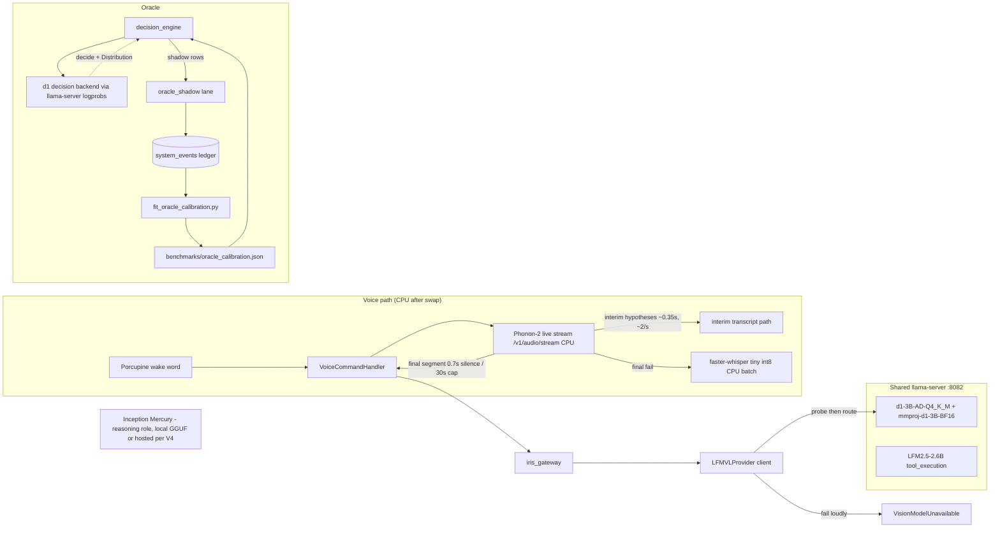
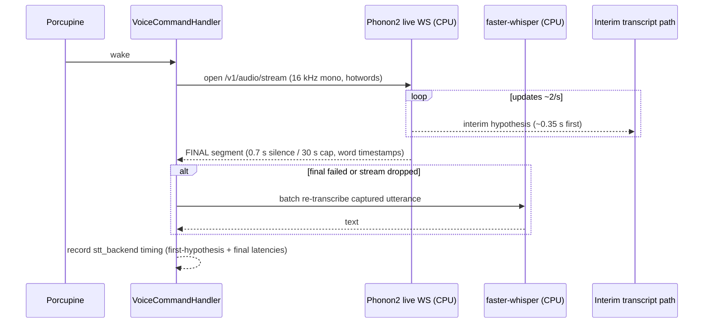
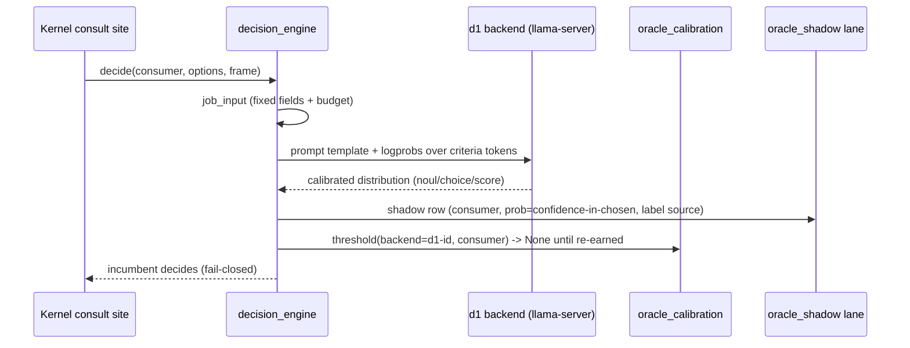

# Design: Phonon-2 STT Swap + d1-3B Vision/Oracle Adoption

## Context
One GPU (RTX 3070, 8 GB). Today Parakeet holds GPU residency for STT and the
Oracle is an ONNX GLiNER classifier on CPU. The owner's build d1-3B (GGUF +
mmproj, 2.52 GB) exists on disk and fits the EXISTING llama.cpp serving
infrastructure — the supported path, not a new backend. The swap frees VRAM,
consolidates vision onto the owned model, and moves the Oracle onto d1 (a
JEV-style decision model) with a mandatory recalibration: a new backend
identity key invalidates every measured curve (oracle.md §5, §16;
decision_engine.py docstring lines 5-15). STT becomes LIVE STREAMING —
interim hypotheses while the user speaks, final segment at silence — which is
what makes Phonon-2 a true pipeline replacement, not a batch substitute. The
Brain splits roles again: reasoning to Inception Mercury, tool execution to
LFM2.5-2.6B (bindings independent, oracle.md §13.1). Both swapped-out models
are DELETED after live verification: Parakeet and GLiNER Decider 2.5 alike.
Eight pre-existing Oracle issues (B1-B8) are fixed in the same program because
they are measured independently of the model swap.

Constraints that bound the design:
- One llama-server serves the shared multimodal endpoint (specs/vision-single-
  server; no spawning from `vision_provider.py`).
- The Oracle never writes text, never batches questions, has no fallback
  model (oracle.md §9; guard test test_batch_single_encode.py).
- Old and new never live simultaneously (C1).
- The Caducean fold-back rule: Oracle/vision/physics work that is not needed
  for THIS reply runs on lanes (`oracle_shadow`), never inline.

## Architecture Overview



## Sequence / Data Flow

STT swap (steady state, streaming):


Oracle decision on d1 (shadow default):


## Data Models

Model registry entry (additive; `models/gguf/.iris_model_settings.json`):
```json
"d1-3B-AD-Q4_K_M.gguf": {"last_profile": "balanced", "last_ctx": 8192, "last_gpu_layers": -1}
```
The mmproj pair is discovered by stem match by the scan (proven:
test_scan_models_baseline.py), yielding `has_vision`, `mmproj_path`,
`mmproj_size_gb` on the entry.

Oracle d1 backend identity: variant-derived string, e.g.
`d1-3b-gguf-ad-q4k-m` (mirrors `GlinerOnnx.backend_id` shape at
decision_backend_onnx.py:500). It keys `backend_thresholds` independently;
GLiNER thresholds remain under their own key as history.

Retirement flags (AC11.1), example shapes:
```python
# backend/audio/voice_command.py
PARAKEET_RETIRED = True  # retirement flag: phonon-2 replaced parakeet 2026-10
```
Final retirement state (C5 extended, owner 2026-10-08): the Parakeet modules
AND the GLiNER backend code are deleted outright; the flags exist only during
the transition window (C1/C2), git is the archive, and retired entries are
removed from the selectable registry JSON in the same change (AC11.2).

Brain role bindings (oracle.md §13.1 wire shape):
```json
{"type": "set_model_selection", "payload": {
  "reasoning_model": "<Inception Mercury id, per V4>",
  "tool_execution_model": "LFM2.5-2.6B-Q4_K_M"}}
```

Streaming hypothesis shape mirrors the existing
`backend/audio/parakeet_buffer.py` `Hypothesis`/`ParakeetStreamingBuffer`
vocabulary (interim vs final, with text + word timestamps), so downstream
consumers of VAD/turn-taking read the same concept under a new engine.

Shadow row (existing shape, unchanged): `system_events` row with
actor=agent_tool_bridge, outcome='shadow', payload.decision {consumer_id,
chosen, confidence=max(p,1-p), probability, label source}. NEW in this spec:
`label_source` field (AC7.2) naming `incumbent` | `outside:<kind>`.

## Key Decisions

D1 — **Swap shape for STT: same-seam replacement, streaming-first.**
Default/obvious: build an engine-abstraction layer with registry + plugins.
WHY the current code is shaped so: `VoiceCommandHandler` owns one engine seam
(worker subprocess + bounded wait + whisper fallback) that already isolates
engine mechanics; Parakeet's sherpa worker and the former transformers worker
show the seam has absorbed two engine implementations already
(`voice_command.py:69-90`, `_WORKER_MODULE`). Alternative A (engine
abstraction framework): rejected — an abstraction over a set of size one
post-swap (Phonon-2 only; whisper is the fallback, not a peer) is the
top entry on the over-build list. Alternative B (in-process Phonon-2 in
voice_command): rejected — the subprocess/stream-client isolation is
load-bearing (a hang in torch/safetensors import must not wedge audio; see
the lazy-import guards at `backend/audio/__init__.py:19-25`). Chosen:
Phonon-2 connects through the same handler seam as a STREAMING client
(owner decision: live streaming is the replacement, not an option), and
interim hypotheses reuse the streaming-buffer vocabulary the repo already has
(`parakeet_buffer.Hypothesis`). Whisper's fallback role narrows to FINAL
segments: interim hypotheses are best-effort and never routed to whisper.

D2 — **d1 vision via the shared server, no new serving path.**
Default: dedicated vision server for d1. WHY forbidden: specs/vision-single-
server deleted the 18181 spawn path (6-minute variable cold starts); vision
proves capability by probe, not id match (vision_provider.py:46-54). Chosen:
d1+mmproj loaded on the shared server; resolution, caching, and fail-loud
behaviour inherited unchanged. Rejected alternative: run d1 through a
transformers/trust_remote_code backend — the GGUF + mmproj exist; adding a
second inference stack doubles maintenance for zero measured need (and AC5
of REQ-5 is founded on V1 proving llama.cpp suffices for decisions too).

D3 — **V1 is a verification gate, not a feasibility doubt (owner).**
d1 IS a JEV-style decision model; the owner expects V1 to pass. The gate
still runs FIRST because it is cheap and the alternative is building the whole
Oracle half on an unverified serving detail. If V1 unexpectedly fails the
branch is written down (stop, d1 vision-only, report) precisely so nobody
improvises a second inference stack mid-flight.

D4 — **Veto at menu build, not per-route (B5).**
Measured bypass: a memory-sourced pick of a web tool for a local goal
(tool_decision.py:948-955). Session-366 track B added a `vetoed` parameter to
`_memory_decision` (915-956) — per-route patching. Chosen: apply the veto
where the candidate menu is assembled so all routes inherit it; keep the
memory-route check as defence in depth. Rejected: enumerating call sites —
the route count already regrew (four `source="memory"` sites at lines
948, 1226, 1842, 1876, 1918, 1995).

D5 — **Dedup at write time with input identity (B6).**
The fit already collapses 10,541 repeats; fixing the store prevents growth.
Identity: (consumer_id, normalized job input hash). Cheap: one hash per
shadow row, computed on the lane. Rejected alternative: periodic compaction
job — masks the cause and adds a scheduled task to maintain.

D6 — **Recalibration is PART of the swap, never deferred (identity rule).**
A changed model OR changed input (job template, menu width, quantisation) is
a new identity (oracle.md §5 levers, line 431). Therefore refit is not a
follow-up; AC5.3/AC6.1-6.4 make enforcement structurally impossible until
re-earned on d1.

D7 — **Order of execution (from the pin, validated):** V1 → Phonon-2 → d1
vision → d1 Oracle + recalibration + B-list → C1-C5 cleanup. Rationale: V1
gates the largest half; Phonon-2 is lowest risk and self-contained; vision is
independent of Oracle; cleanup is gated on live proof of all replacements.

D8 — **Live streaming is the STT interface, not a bolt-on (owner).**
Phonon-2's documented live mode (hypothesis ~0.35 s, updates ~2/s, final at
~0.7 s silence / 30 s cap) matches how a person talks; batch-per-utterance
cannot emit anything until the utterance ends. Rejected alternative:
batch-first, streaming "later" — that builds the wrong seam twice. The
existing `parakeet_buffer` Hypothesis vocabulary proves the codebase already
knows the interim/final distinction; the new client speaks the same concepts.

D9 — **Mercury pairs with the 2.6B tool model; residency verified first.**
The two Brain roles are independent bindings (oracle.md §13.1), so pairing
Mercury (reasoning) with LFM2.5-2.6B (tool execution) is a configuration role
change, not a serving-stack change — UNLESS Mercury turns out to be a local
GGUF, in which case V4 must re-run the VRAM budget (d1 ~3.5-4 GB + 2.6B ~1.6
GB + Mercury). A hosted Mercury keeps the budget untouched and adds a
provider-outage failure mode that already exists for hosted providers.
Rejected alternative: replace 2.6B with Mercury for tool execution — code-
specialist diffusion models are unmeasured against this repo's function-
calling contract; 2.6B is incumbent and measured.

D9a — **d1 DIRECTS, the tool model EXECUTES (owner, 2026-10-08).** d1 never
makes tool calls. The flow across the three models: d1 (Oracle, :8082) scores
the candidate menu and picks the tool; the tool_execution role (2.6B on the
tool server :8091) generates the schema-constrained call with arguments;
Mercury (hosted) writes the prose. This is the EXISTING decision_engine
contract (the backend scores labels, never generates arguments —
decision_engine.py:30-35) restated as the owner's division of labor; the
Wave 2 serving work (tool server + role binding) is what makes the 2.6B
reachable for the EXECUTE half.

D10 — **GLiNER is deleted, not archived in-tree (owner).**
After TG-3 proves the d1 Oracle live, `decision_backend_onnx.py`, the ONNX
artefacts, and their pinning tests go in ONE change. "No fallback model"
(oracle.md §9) already makes the engine safe without GLiNER: no backend =>
unavailable => incumbent decides. Ledger rows and `oracle_calibration.json`
history keyed under `gliner25-decide-onnx-int8` stay forever as
`other_backend` evidence (§16). Rejected alternative: keep GLiNER as a
fallback — it would be a sealed second identity judging consumers on a curve
nobody measures anymore (exactly the §9/§16 failure mode).

## Ripple-Effect Map (MANDATORY)

| Area / File | Change? | Classification | Why / Evidence |
|---|---|---|---|
| `backend/audio/voice_command.py` | Yes | CHANGE NEEDED | Phonon-2 STREAMING client replaces the sherpa worker at the seam (:87, :1066, :1019-1135); interim hypotheses surfaced; keep whisper final-fallback + timing fields (:566) |
| Interim-transcript path (voice_command downstream consumers / WS events) | Yes | CHANGE NEEDED | TRACED at Wave 0 (VERIFY.md): backend broadcasts only `iris:voice_final` (useIRISWebSocket.ts:1236-1242 dispatches it; chat-view.tsx:1612 handles it) — NO interim event exists; Wave 1 adds `iris:voice_interim` + frontend handler |
| `hooks/useParakeetSTT.ts` | Yes (retire) | CHANGE NEEDED | NEW V3 finding: dormant browser→:8765 WS streaming hook (ws://localhost:8765/ws/stream); delete or rewire at T5.3 |
| `scripts/iris_process_manager.py` (:271), `scripts/mem_watch.py`, `scripts/measure_memory.py` | Yes | CHANGE NEEDED | NEW V3 findings: parakeet_sherpa_worker process-name management + monitoring labels; update at T5.3 |
| `backend/audio/parakeet_sherpa.py`, `parakeet_sherpa_worker.py`, `parakeet_worker.py`, `parakeet_buffer.py` | Yes (retire) | CHANGE NEEDED | Replaced/removed after proof; callers enumerated REQ-0 V3 |
| `backend/audio/parakeet_service.py` (:8765) | Yes (retire) | CHANGE NEEDED | Consumers: `backend/tools/media_tools.py:23`, `start_all.py:172-173` |
| `backend/main.py` (:321-340 boot warm, :523 status line) | Yes | CHANGE NEEDED | Cited in REQ-0 AC0.3; warm-up and boot status re-point to the Phonon-2 stream client; fails loudly on dual-engine resolution (AC2.3) |
| `backend/main.py` boot warm (:321-340) + boot line (:523) | Yes | CHANGE NEEDED | Warm-up and status line reference Parakeet |
| Porcupine wake word | No | NO CHANGE (verified) | Independent of STT engine; voice_command consumes its output regardless of engine (`voice_command.py:529`) |
| faster-whisper fallback | No | NO CHANGE (verified) | Fallback semantics engine-agnostic (:860-870, :1271-1315) |
| `backend/tools/vision_provider.py` | No | NO CHANGE (verified) | Client of shared server; capability proven by probe, not model id (:46-62); only the server side changes which model hosts |
| `backend/agent/inference/router.py::resolve_vision_provider` (:888) | No | CONTRACT LOCK | Vision resolution shape pinned by test_vision_hierarchy_wiring.py; model identity is data, not interface |
| Vision consumers (browser_pool, screen_monitor, fetch_vision, session_vision_adapter, search_discovery, vision_guided_operator, vision_mcp_server) | No | NO CHANGE (verified) | All import `vision_provider`/`get_vision_provider`, never a model name (grep evidence, REQ-4 AC4.5) |
| `models/gguf/.iris_model_settings.json` | Yes | CHANGE NEEDED | Add d1 entry; retire old VL + superseded entries (AC11.2) |
| `components/dashboard/ModelBrowserPanel.tsx` | No | NO CHANGE (verified) | Reads scan/registry; mmproj display generic (:491, :595, :645) |
| `backend/agent/decision_engine.py` | Yes (data + config) | CHANGE NEEDED | New backend identity wiring; label_source on rows (AC7.2); CONSUMERS vocabulary change (AC12.2) |
| `backend/agent/decision_backend_onnx.py` + `backend/models/gliner2.5-decide-onnx/` | Yes (delete at Wave 5) | CHANGE NEEDED | GLiNER stays only until TG-3 proves the d1 Oracle live; then deleted in ONE change with its tests (AC11.5, D10). Ledger history retained as other_backend |
| `backend/agent/inference/roles.py` / model-selection config | Yes | CHANGE NEEDED | Brain role binding: reasoning=Mercury, tool_execution=LFM2.5-2.6B (AC4.6; oracle.md §13.1 wire shape); gated on V4 (T0.5) |
| NEW `backend/agent/decision_backend_d1.py` | Yes | CHANGE NEEDED | d1 `decide()` over llama-server logprobs; V1-gated |
| `backend/agent/oracle_calibration.py`, `benchmarks/oracle_calibration.json` | Yes (data) | CHANGE NEEDED | New identity keys; GLiNER keys retained as other_backend |
| `scripts/fit_oracle_calibration.py`, `consumer_enforcement_report.py` | Yes (small) | CHANGE NEEDED | Label-source reporting (AC7.2); dedup identity shared with write path (AC12.1) |
| `backend/agent/tool_decision.py` | Yes | CHANGE NEEDED | Menu-build veto (AC10.1); retry_same field-only (AC12.2-12.3) |
| site of menu build (tool_decision resolve ladder) | Yes | CHANGE NEEDED | The veto moves up from `_memory_decision` (:915) to the menu assembly |
| `backend/agent/agent_kernel.py` continuation/depth consult (:7305-7503, :20026-20079, :20738-20780) | Yes | CHANGE NEEDED | AC9.1 scoring at the consult; AC9.2 skip-visibility logging |
| `backend/tests/behavioral/test_wave5_replay_behavior.py` | Yes | CHANGE NEEDED | Engine stubbed (AC13.1) |
| Pinned-enumeration tests (test_decision_engine_contract, test_surface_observer_contract, test_decision_engine_gates, test_oracle_calibration_contract, test_verdict_consumer_shape) | Yes | CHANGE NEEDED | Same-change CONSUMERS update (AC12.2, oracle.md §11.5 rule) |
| Parakeet tests (test_parakeet_service, test_parakeet_integration, test_parakeet_provider_contract + integration copies) | Yes (update/delete) | CHANGE NEEDED | AC3.3: same change as code |
| Oracle contract tests (test_onnx_backend_contract, test_model_pin, test_bar_record_enforcement, test_oracle_enforcement_contract) | Yes (extend, then retire with GLiNER) | CHANGE NEEDED | During Wave 3: add d1 identity cases, never weaken existing pins. At Wave 5 (AC11.5): GLiNER-specific tests leave with the backend in the SAME change; the fail-closed/identity-keyed BEHAVIOUR pins stay and are re-pointed at d1 |
| `backend/tests/conftest.py:329` identity monkeypatch | Yes (extend) | CHANGE NEEDED | New identity cases |
| `backend/agent/consumer_bar.py` | No | NO CHANGE (verified) | `derive_status` bar (rows>=100, AUROC>=0.65, ECE<=0.05) is identity-agnostic; recalibration re-derives it, code unchanged — decision_engine.py:339-389 reads it generically |
| `backend/agent/mode_detector.py` | No | NO CHANGE (verified) | `_infer_mode` (:311) stays the mode incumbent; REQ-7 changes the LABEL on rows, never the detector |
| `backend/agent/external_reference.py` | No | CONTRACT LOCK | Shipped domain guard (dc7139bc) stays the structural node-mode signal; REQ-10's veto moves into tool_decision menu build, not here |
| `backend/iris_gateway.py` (:3116 STT timing consumer) | No | NO CHANGE (verified) | Reads `_last_stt_timing` fields the new worker populates with the same keys (voice_command.py:566) |
| `docs/architecture/oracle.md` | Yes (doc) | CHANGE NEEDED | §0 current-state must be updated at closeout with the d1 identity, recalibration outcome, and B-list resolution; a stale §0 is the exact drift this program fixes |
| evals/run_evals.py + app-testing harness | No | NO CHANGE (verified) | Live gate instrument, unchanged interface |

## Error Handling
- Phonon-2 load/connect failure → faster-whisper final-segment fallback; sticky
  failure flag; `stt_backend` records the reason (mirrors voice_command.py:1078-1135).
- Stream drops mid-utterance → interim hypotheses marked provisional; final
  falls back to whisper batch re-transcribe of the captured audio; never a
  crash on the audio loop.
- Interim hypothesis failure → logged, skipped; never blocks the final.
- d1 probe fail → `VisionModelUnavailable`, no vision this session until
  re-probe TTL expires (existing `_CAPABILITY_TTL_S = 300` semantics).
- llama-server down at decision time → engine unavailable, incumbent decides,
  `unavailable_events++`; never raises out of `decides()` (decision_engine.py
  fail-closure :482-496).
- Two ASR engines / two vision paths resolved simultaneously → startup error
  naming the retirement constant (AC2.3, AC11.3).
- Calibration file missing → `threshold()` None → all shadow (existing
  fail-closed).

## Testing Strategy
Organised per the project's contract+behavioral+intertwined standard.

tests/unit/
- Phonon-2 worker protocol (fake worker pipes), hotword pass-through, timing
  fields, fallback transitions (exhaustive over load/timeout/empty/success).
- d1 backend option-set scoring against a stubbed llama-server (logprob
  extraction, off-menu answer handling = lowest confidence).
- Dedup identity hash stability; label_source field round-trip.

tests/contract/ (new pins)
- CT-P2-1: `stt_backend` vocabulary includes the Phonon-2 value and EXCLUDES
  `parakeet*` in production code paths after retirement.
- CT-D1-1: vision resolution with d1 registry entry requires probe proof;
  a text-only server named d1 cannot become a vision target (extends the
  existing reuse contract test family).
- CT-D1-2: d1 backend identity keyed thresholds; GLiNER thresholds never
  apply to d1 rows (extends test_threshold_retune/test_model_pin pattern).
- CT-VETO-1: pre-fix shape fails — memory-suggested web tool for a local goal
  reaches the menu (AC10.3).
- CT-CONS-1: CONSUMERS vocabulary post-retry_same-removal, single change-set
  guard (AC12.2).

tests/behavioral/
- BT-P2-1: full voice turn (wake -> streaming hypotheses -> final segment ->
  reply) through the real handler with the Phonon-2 stream stubbed; asserts
  interim hypotheses surface BEFORE the final, whisper fallback never fires on
  success and fires on stream-drop/final-failure.
- BT-ORACLE-1: shadow rows from a driven task carry the d1 identity and the
  label_source; enforcement stays closed until re-earned.
- BT-ROLES-1: the router binds reasoning=Mercury and
  tool_execution=LFM2.5-2.6B through the §13.1 wire shape, and a driven turn
  resolves both (AC13.6 preview).
- BT-WAVE5: test_wave5_replay_behavior.py with stubbed engine, 20 consecutive
  green runs (AC13.1).

Live-verification gates (app-testing Mode A, REAL backend)
- LV-1 voice turn: `stt_backend` = phonon-2 path WITH an interim hypothesis
  surfaced before the final segment (AC13.2).
- LV-2 vision task through d1 with probe proof recorded (AC13.3).
- LV-3 evals/run_evals.py on the touched task set: reply_s within
  baseline + 15%, decision rows on new identity (AC13.4).
- LV-4 VRAM measurement; assert LFM2.5-8B co-residency absent (AC13.5).

Standing harness: replay recorded `system_events` rows through the refit
script; assert the fit refuses (honest fail) under MIN_FIT_ROWS and never
pads (AC6.4).
